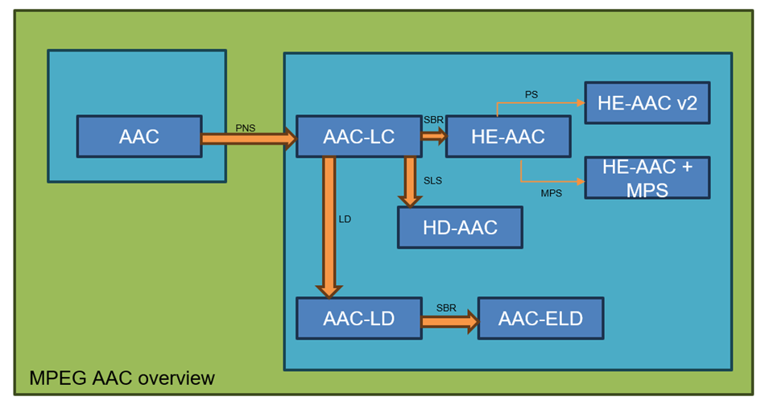
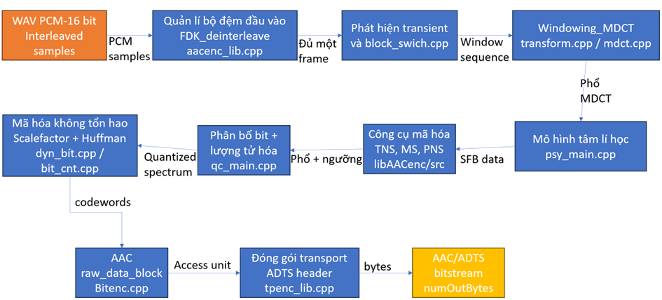
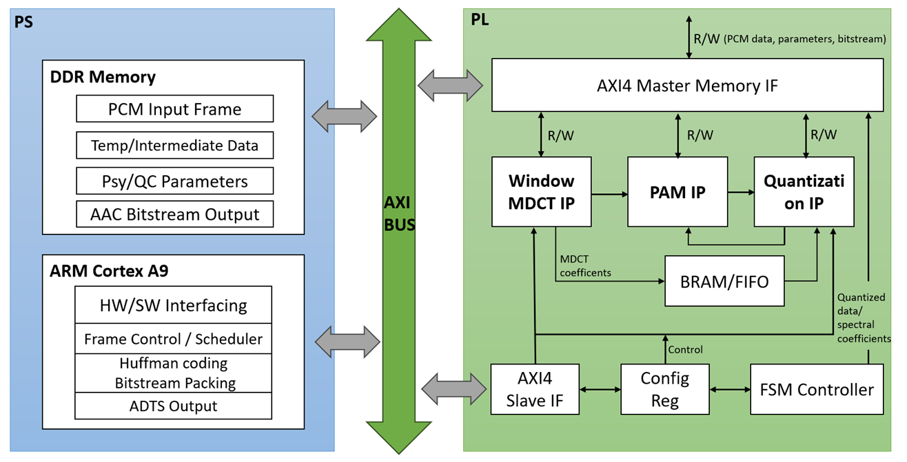
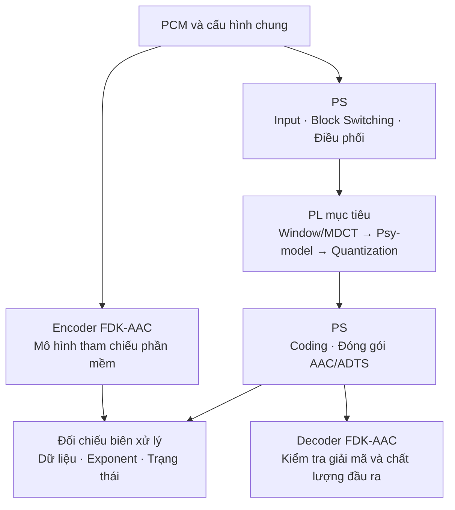

# AAC-LC-23021839_Huong

Dự án nghiên cứu **bộ mã hóa âm thanh AAC-LC** theo hướng **HW/SW co-design trên FPGA PYNQ-Z2**, sử dụng **FDK-AAC** làm mô hình tham chiếu phần mềm. Các khối tính toán được khảo sát, tách giao diện và đối chiếu số học trước khi chuyển sang phần cứng.

> **Hiện trạng:** repo có encoder/decoder FDK-AAC, dữ liệu WAV, công cụ phân tích và RTL Window/MDCT cùng wrapper AXI4-Lite. Kiến trúc đầy đủ Window/MDCT → Psy-model → Quantization trên PL là mục tiêu tích hợp; chưa có bằng chứng chạy toàn pipeline trên board trong bản source này.

**Mục lục**
- [AAC-LC-23021839\_Huong](#aac-lc-23021839_huong)
  - [1. Giới thiệu tổng quan](#1-giới-thiệu-tổng-quan)
  - [2. Ưu tiên đọc](#2-ưu-tiên-đọc)
  - [3. Cấu trúc repo](#3-cấu-trúc-repo)
    - [3.1. Cấu trúc thư mục](#31-cấu-trúc-thư-mục)
    - [3.2. Các nhóm chức năng](#32-các-nhóm-chức-năng)
  - [4. Tình trạng hiện tại](#4-tình-trạng-hiện-tại)
  - [5. Hướng dẫn sử dụng](#5-hướng-dẫn-sử-dụng)

---

## 1. Giới thiệu tổng quan

**Mục tiêu dự án**

- Xây dựng và kiểm chứng luồng mã hóa **PCM → AAC-LC**, sau đó phân chia nhiệm vụ giữa bộ xử lý **PS** và logic lập trình **PL** trên PYNQ-Z2.
- Dùng thuật toán, bảng hệ số và cách biểu diễn fixed-point của FDK-AAC để xây dựng reference cho các khối được phần cứng hóa.
- Đối chiếu kết quả từng khối về giá trị integer, exponent, thứ tự dữ liệu và trạng thái qua các frame.
- Dùng decoder FDK-AAC trong dự án để kiểm tra khả năng giải mã và đánh giá đầu ra của encoder. Kết quả toàn hệ thống cần được kiểm tra cùng với số học từng khối, tốc độ xử lý và tài nguyên FPGA.

**Mô hình tham chiếu: FDK-AAC**

FDK-AAC cung cấp encoder, decoder và các thư viện DSP dùng chung. [CMakeLists.txt](CMakeLists.txt) khai báo phiên bản thư viện **2.0.3**. Repo giữ nhiều thành phần của FDK để phục vụ build và kiểm chứng, trong khi phạm vi phần cứng của dự án tập trung vào **AAC-LC, AOT 2**.



*Hình 1. Hình tổng quan AAC được giữ từ bản README gốc; phạm vi nghiên cứu chính của dự án là AAC-LC.*

Luồng xử lý encoder gồm quản lý PCM đầu vào, chọn cửa sổ, Window/MDCT, phân tích psychoacoustic, phân bổ bit/lượng tử hóa, mã hóa entropy và đóng gói bitstream:



*Hình 2. Luồng chức năng encoder tham chiếu. Các khối trên hình mô tả chức năng; lời gọi thực tế được điều phối trong mã encoder và `psy_main.cpp`.*

Các source quan trọng để lần theo pipeline:

| Chặng xử lý | Source chính |
| :--- | :--- |
| API, cấu hình và điều phối encoder | [aacenc_lib.cpp](libAACenc/src/encoder/aacenc_lib.cpp), [aacenc.cpp](libAACenc/src/encoder/aacenc.cpp) |
| Phát hiện transient, chọn window sequence/shape | [block_switch.cpp](libAACenc/src/block_switch/block_switch.cpp) |
| Analysis filterbank, Window/MDCT | [transform.cpp](libAACenc/src/filterbank/transform.cpp), [mdct.cpp](libFDK/src/mdct.cpp), [dct.cpp](libFDK/src/dct.cpp) |
| Psychoacoustic, năng lượng, masking, TNS/PNS và stereo | [psy_main.cpp](libAACenc/src/psy_model/psy_main.cpp) và các helper trong `psy_model/` |
| Phân bổ bit, điều khiển lượng tử hóa | [qc_main.cpp](libAACenc/src/quantization/qc_main.cpp), [quantize.cpp](libAACenc/src/quantization/quantize.cpp) |
| Đếm bit, sectioning, Huffman và ghi syntax | [dyn_bits.cpp](libAACenc/src/coding/dyn_bits.cpp), [bit_cnt.cpp](libAACenc/src/coding/bit_cnt.cpp), [bitenc.cpp](libAACenc/src/coding/bitenc.cpp) |
| Đóng gói transport và giải mã kiểm chứng | `libMpegTPEnc/`, `libAACdec/`, [test-encode-decode.c](test-encode-decode.c) |

**Mô hình phần cứng: HW/SW co-design**

Phân chia **mục tiêu** giữa PS và PL:

| Miền xử lý | Nhiệm vụ |
| :--- | :--- |
| **PS — ARM Cortex-A9** | Đọc PCM/WAV, quản lý overlap và frame buffer, Block Switching, lập lịch các accelerator, quản lý buffer/driver, Huffman coding, đóng gói AAC/ADTS và kiểm chứng đầu ra |
| **PL — FPGA** | Tăng tốc Window/MDCT (filterbank), các phép tính psychoacoustic và lượng tử hóa; lưu dữ liệu trung gian bằng RAM/FIFO phù hợp với từng khối |
| **Giao tiếp PS–PL** | Truyền cấu hình/trạng thái và dữ liệu; Window/MDCT hiện có AXI4-Lite MMIO, hướng phát triển là AXI4-Stream kết hợp AXI DMA MM2S/S2MM |



*Hình 3. Kiến trúc đích của hệ thống. Hình không đại diện cho một overlay đầy đủ đã được tích hợp và kiểm thử; mức hoàn thiện từng khối xem mục 4.*

Luồng kiểm chứng khi tích hợp accelerator:



**Cấu hình nghiên cứu đang ưu tiên**

| Thông số | Giá trị/phạm vi |
| :--- | :--- |
| Chuẩn mã hóa | AAC-LC, AOT 2 |
| Dữ liệu WAV bàn giao | PCM16, mono, 48 kHz |
| Bitrate ví dụ | 64 kbit/s; có thể thay khi chạy phần mềm |
| Frame AAC-LC của accelerator | 1024 mẫu mới/kênh |
| Snapshot Window/MDCT | 2048 mẫu, chồng lấn 1024 mẫu giữa hai frame |
| Window sequence | LONG, START, SHORT, STOP |
| Window shape | SINE, KBD |
| Phổ MDCT | 1024 hệ số/frame, gồm một long transform hoặc tám short transform |
| Board/FPGA mục tiêu | PYNQ-Z2, `xc7z020clg400-1` |

Với tốc độ lấy mẫu $f_s$, khoảng thời gian dành cho một frame 1024 mẫu là:

$$
T_{\mathrm{frame}}=\frac{1024}{f_s},
\qquad f_s=48\,000\ \mathrm{Hz}
\Rightarrow T_{\mathrm{frame}}\approx21{,}33\ \mathrm{ms}.
$$

Để kết luận real-time, phải đo toàn bộ thời gian nạp dữ liệu, tính toán, đọc kết quả và xử lý phần mềm cho số kênh cần hỗ trợ. Clock PL hoặc latency của một khối riêng chưa đủ để kết luận tốc độ toàn encoder.

## 2. Ưu tiên đọc

Đọc theo thứ tự sau để đi từ khối đang tập trung triển khai đến toàn bộ pipeline:

| Thứ tự | Tài liệu | Nội dung nên nắm |
| :---: | :--- | :--- |
| 1 | [Window/MDCT](my_workspace/window_mdct/README.md) | Kiến trúc accelerator, hợp đồng Q31/Q15, FSM, bộ nhớ, AXI4-Lite và thao tác trên PYNQ-Z2 |
| 2 | [Input](my_workspace/INPUT/README.md) | Bộ WAV, overlap/padding, cách tạo snapshot và stimulus |
| 3 | [Block Switching](my_workspace/block_switch/README.md) | Chọn cửa sổ, trạng thái theo frame và lỗi DUT–REF đang được bảo lưu |
| 4 | [FFT radix-2](my_workspace/window_mdct/fft_radix2_core/README.md) | FFT64/512, scale schedule và giao diện FFT dùng trong MDCT |
| 5 | [Psychoacoustic Model](my_workspace/psychoacoustic_model/README.md) | SFB, năng lượng, masking, Tonality/TNS/PNS và công cụ quan sát native |
| 6 | [Quantization/Coding](my_workspace/quantization_coding/README.md) | Phân bổ bit, scalefactor, lượng tử hóa, đếm bit và coding |
| 7 | [Phân nhóm source encoder](libAACenc/src/README.md) | Ánh xạ các khối chức năng vào mã nguồn C/C++ |
| 8 | [Lịch sử bàn giao và kiểm chứng](CHANGES_RESEARCH.md) | Kết quả đã ghi nhận, phạm vi từng đợt bàn giao và các giới hạn kiểm chứng |

Các thư mục `docs/` hoặc helper được tài liệu cấp module nhắc tới có thể chưa có trong bản source hiện tại. Khi chạy một luồng nghiên cứu, đối chiếu dependency ở mục 5 trước; kết quả lịch sử không thay thế cho việc kiểm tra artifact đang có trên máy.

## 3. Cấu trúc repo

### 3.1. Cấu trúc thư mục

```text
AAC-LC-23021839_Huong/
├── README.md                       # Tổng quan và hướng dẫn bắt đầu
├── CMakeLists.txt                  # Build FDK-AAC và các runner nghiên cứu
├── aac-enc.c                       # CLI mã hóa WAV thành AAC/ADTS
├── test-encode-decode.c             # Harness kiểm tra encode/decode native
├── wavreader.c / wavreader.h        # Đọc WAV cho các chương trình ở gốc
├── libAACenc/                      # AAC encoder
├── libAACdec/                      # AAC decoder dùng đối chiếu
├── libFDK/                         # Fixed-point, ROM, FFT/DCT/MDCT và DSP chung
├── libMpegTPEnc/ / libMpegTPDec/     # Transport và cấu trúc bitstream
├── libPCMutils/ / libSYS/           # Tiện ích PCM, kiểu dữ liệu và nền tảng
├── libArithCoding/ / libDRCdec/      # Các thư viện phụ thuộc của build hiện tại
├── libSACenc/ / libSACdec/           # Thành phần MPEG Surround của FDK
├── libSBRenc/ / libSBRdec/           # Thành phần SBR của FDK
├── my_workspace/
│   ├── INPUT/                      # WAV, manifest và công cụ chuẩn bị input
│   ├── block_switch/               # Probe, reference và kiểm chứng cửa sổ
│   ├── window_mdct/                # Reference, RTL, testbench, driver PYNQ
│   │   └── fft_radix2_core/         # FFT IP được Window/MDCT sử dụng
│   ├── psychoacoustic_model/       # Trace, phân tích và khảo sát Psy
│   └── quantization_coding/        # Trace, phân tích QC/coding
├── win32/                          # Hỗ trợ getopt trên Windows
├── CHANGES_RESEARCH.md             # Biên bản bàn giao và kết quả lịch sử
├── source_manifest.json            # Danh sách file và SHA-256 khi bàn giao
├── requirements.txt               # NumPy/Matplotlib cho các tool cơ bản
└── NOTICE                          # Giấy phép và thông tin FDK-AAC
```

`build/`, `output/`, `plots/`, golden vector, report Vivado và overlay là dữ liệu sinh khi chạy. Các vị trí này được dùng riêng cho từng luồng thử nghiệm; không phải toàn bộ artifact đều có sẵn trong repo.

### 3.2. Các nhóm chức năng

Source encoder nằm trong `libAACenc/src/`, được chia theo chức năng:

| Nhóm | Vai trò |
| :--- | :--- |
| `encoder/` | API, khởi tạo, cấu hình và điều phối encoder |
| `block_switch/` | Phát hiện transient, window sequence/shape, đồng bộ cửa sổ |
| `filterbank/` | Giao diện biến đổi thời gian → tần số và gọi MDCT |
| `psy_model/` | SFB, năng lượng, masking, pre-echo, Tonality, TNS/PNS, grouping và stereo |
| `quantization/` | Phân bổ bit, điều chỉnh ngưỡng, scalefactor, gain và lượng tử hóa |
| `coding/` | Sectioning, bit counting, Huffman và ghi syntax AAC |
| `common/` | ROM, cấu hình và bộ nhớ dùng chung |
| `extensions/` | Metadata và các phần mở rộng đi kèm FDK |
| `profiling/` | Bộ đếm và đo thời gian encoder |

Các phép FFT/DCT/MDCT thực thi trong `libFDK/`; phần `filterbank/` của encoder chủ yếu chọn tham số và gọi phép biến đổi. Header nội bộ được giữ tại `libAACenc/src/` theo cấu hình include hiện có.

## 4. Tình trạng hiện tại

**Phần PS và mô hình phần mềm**

| Hạng mục | Hiện trạng |
| :--- | :--- |
| Encoder/decoder FDK-AAC | Có source và CMake; lịch sử bàn giao ghi build và encode/decode trên Windows thành công. Chưa có bằng chứng triển khai ARM/PS trong bản source này |
| Input | Có sáu WAV PCM16 mono 48 kHz, manifest/hash và công cụ chuẩn bị input |
| Block Switching | Có probe và reference; bài DUT–REF đang **FAIL** do bảng `blockType2windowShape` thiếu hàng LD trước hàng LC. Source và ngưỡng kiểm tra được giữ theo trạng thái bàn giao |
| Window/MDCT và FFT | Có reference C++/Python, vector generator, trace native và đối chiếu fixed-point |
| Psy-model | Có tool trace/experiment dựa trên encoder native, khảo sát Tonality/TNS và ghi nhận trạng thái PNS |
| Quantization/Coding | Có mã native, runner trace và công cụ phân tích QC/coding; bộ standalone reference được nhắc trong lịch sử chưa có trong cây thư mục hiện tại |
| HAL/driver tích hợp encoder | Window/MDCT có driver PYNQ MMIO riêng; chưa có đường HAL thay transform phần mềm bằng PL trong toàn pipeline |

**Phần PL và tích hợp hệ thống**

| Hạng mục | Hiện trạng |
| :--- | :--- |
| Window/MDCT | Có `mdct_core.vhd` cho một luồng mono, hỗ trợ LONG/START/SHORT/STOP, SINE/KBD và FFT64/512 |
| Giao tiếp Window/MDCT | Có `mdct_axi_lite.vhd`, bảng thanh ghi MMIO, driver, runner board và Tcl tạo overlay PYNQ-Z2 |
| Kiểm chứng RTL Window/MDCT | Có testbench kiểm từng biên datapath và giao thức AXI; chưa có log GHDL/Vivado/FPGA đi kèm bản source |
| Psy-model trên PL | Có testbench/oracle và hướng nghiên cứu; thư mục `psychoacoustic_model/rtl/` hiện không có source RTL. Chưa có accelerator Psy hoàn chỉnh để tích hợp |
| Quantization trên PL | Là hạng mục phát triển tiếp; chưa có RTL accelerator lượng tử hóa trong cây source hiện tại |
| AXI DMA và stereo | Chưa có adapter AXI4-Stream/DMA hoặc cơ chế trạng thái nhiều kênh trong Window/MDCT hiện tại |
| Pipeline PS–PL hoàn chỉnh | Chưa có kết quả tích hợp Window/MDCT → Psy-model → Quantization và encode/decode trên board |

**Bằng chứng kiểm chứng đã ghi trong repo**

[CHANGES_RESEARCH.md](CHANGES_RESEARCH.md) ghi nhận các kết quả lịch sử: 48/48 cấu hình AAC-LC encode/decode trên sáu WAV; reference MDCT C++/Python khớp 0 LSB trên 18 frame, 39 subtransform; harness MDCT đối chiếu FDK khớp 6144 hệ số; các đợt kiểm thử Psy và Quant đạt trong phạm vi bàn giao được mô tả tại đó.

Các kết quả này không phải log chạy mới của lần biên tập README. Kiểm chứng Block Switching vẫn có lỗi được bảo lưu; cấu hình AAC-ELD/SBR với file mưa từng vượt ngưỡng harness và nằm ngoài phạm vi AAC-LC. Chưa công bố latency toàn hệ thống, mức sử dụng FPGA hoặc real-time trên PYNQ-Z2 khi chưa có số đo tương ứng.

## 5. Hướng dẫn sử dụng

Các lệnh chạy **từ thư mục gốc repo**. Luồng bắt đầu nên là: build codec → encode WAV → kiểm tra encode/decode → khảo sát từng module → mô phỏng RTL → tạo overlay và kiểm thử board.

**5.1. Chuẩn bị công cụ**

| Công việc | Công cụ cần có |
| :--- | :--- |
| Build codec/CLI | CMake, compiler C/C++, generator phù hợp như Ninja hoặc Visual Studio |
| Runner nghiên cứu native | Compiler C++17; helper WAV và dependency của module tương ứng |
| Sinh vector, phân tích, vẽ | Python; [requirements.txt](requirements.txt) hoặc requirements riêng của module |
| Mô phỏng RTL | GHDL hỗ trợ VHDL-2008 |
| Tổng hợp/triển khai PL | Vivado và board files PYNQ-Z2 |
| Chạy accelerator trên board | Môi trường PYNQ, NumPy, đúng cặp overlay `.bit`/`.hwh` |

**5.2. Build encoder và decoder tham chiếu**

Ví dụ PowerShell trên Windows, khi compiler và CMake đã có trên PATH:

```powershell
cmake -S . -B build/codec -DBUILD_SHARED_LIBS=OFF -DBUILD_PROGRAMS=ON -DCMAKE_BUILD_TYPE=Release
cmake --build build/codec --config Release --parallel 4
```

`BUILD_PROGRAMS=ON` tạo hai chương trình `aac-enc` và `test-encode-decode`. Với Ninja/Makefiles, binary thường ở `build/codec/`; với Visual Studio, thường ở `build/codec/Release/`. Trên Windows dùng hậu tố `.exe`; trên Linux bỏ hậu tố này.

**5.3. Mã hóa WAV thành AAC-LC/ADTS**

Ví dụ dưới đây dùng đường dẫn binary của Ninja/Makefiles trên Windows:

```powershell
cmake -E make_directory output
./build/codec/aac-enc.exe -t 2 -r 64000 -a 1 -d my_workspace/INPUT/data/abc_votay.wav output/abc_votay.aac
```

| Tham số | Ý nghĩa |
| :--- | :--- |
| `-t 2` | Chọn AAC-LC |
| `-r 64000` | Bitrate mục tiêu 64000 bit/s |
| `-a 1` | Bật Afterburner |
| `-d` | In thông tin cấu hình encoder |
| `abc_votay.wav` | WAV PCM16 đầu vào |
| `output/abc_votay.aac` | File AAC đóng gói ADTS |

Có thể thay input bằng một WAV trong `my_workspace/INPUT/data/psy_external/`. Thông tin nguồn, định dạng và hash xem [README Input](my_workspace/INPUT/README.md) và [manifest](my_workspace/INPUT/manifest.json).

**5.4. Kiểm tra encode/decode bằng FDK-AAC**

```powershell
./build/codec/test-encode-decode.exe my_workspace/INPUT/data/abc_votay.wav
```

Harness tự chạy các cấu hình encode/decode từ WAV, kiểm tra các điều kiện trong [test-encode-decode.c](test-encode-decode.c) và trả mã thoát. Chương trình này **không phải CLI nhận một file AAC có sẵn để xuất WAV** và không chỉ chạy AAC-LC; vì vậy cần đọc cấu hình gây lỗi khi harness trả nonzero.

**5.5. Chạy khảo sát từng module**

```powershell
python -m pip install -r requirements.txt
```

Sau đó chọn luồng phù hợp:

| Luồng | Hướng dẫn |
| :--- | :--- |
| Chuẩn bị snapshot PCM, stimulus FFT | [Input](my_workspace/INPUT/README.md) |
| Probe và đối chiếu cửa sổ | [Block Switching](my_workspace/block_switch/README.md) |
| Reference, golden và testbench Window/MDCT | [Window/MDCT](my_workspace/window_mdct/README.md) |
| So sánh FFT native và radix-2 trong encoder | [Khảo sát FFT](my_workspace/window_mdct/experiments/fft/README.md) |
| Trace và phân tích psychoacoustic | [Psy-model](my_workspace/psychoacoustic_model/README.md) |
| Trace và phân tích lượng tử hóa/coding | [Quantization/Coding](my_workspace/quantization_coding/README.md) |

Các cờ `MDCT_DEBUG`, `WINDOW_EXPERIMENT`, `FFT_EXPERIMENT`, `PSY_DEBUG`, `PSY_EXPERIMENT`, `QUANT_DEBUG` và `FDK_ENABLE_ENCODER_PROFILING` mặc định **OFF** trong CMake. Dùng build directory riêng khi bật từng luồng để giữ rõ cấu hình baseline và cấu hình quan sát.

> **Dependency hiện đang thiếu:** các target nghiên cứu native trong CMake tham chiếu `my_workspace/fdk_model_testing/tools/wav_pcm.cpp` và `.h`, nhưng thư mục helper này chưa có trong cây source hiện tại. Cần khôi phục đúng helper trước khi chạy các target đó. Build codec/CLI cơ bản ở mục 5.2 dùng `wavreader.c` tại gốc nên không phụ thuộc helper này.

**5.6. Chạy phần cứng Window/MDCT**

Thực hiện theo [README Window/MDCT](my_workspace/window_mdct/README.md):

1. Kiểm tra reference model và sinh golden baseline.
2. Mô phỏng `mdct_core` và wrapper AXI4-Lite, đối chiếu dữ liệu/exponent.
3. Chạy Tcl Vivado, kiểm tra timing sau route rồi xuất cặp `.bit`/`.hwh` cùng build.
4. Chuyển overlay và golden sang PYNQ-Z2; chạy driver/runner MMIO để so sánh phổ và đo thời gian.
5. Chỉ sau khi khối riêng đạt kiểm chứng mới tích hợp HAL vào đường encoder và mở rộng Psy/Quant/DMA.

`--validate-only` của runner board chỉ xác nhận bộ golden hợp lệ, chưa truy cập FPGA. Tương tự, có RTL hoặc có script synthesis chưa có nghĩa là đã tạo được overlay đạt timing.

**5.7. Tra cứu nguồn và lưu kết quả**

- Dùng [source_manifest.json](source_manifest.json) để đối chiếu danh sách file và SHA-256 của lần bàn giao. Manifest phản ánh snapshot bàn giao, không phải diff đầy đủ so với upstream và không tự cập nhật khi chỉnh sửa tài liệu/source.
- Lưu kết quả chạy, cấu hình build, log, hash input/golden và overlay cùng nhau để có thể tái hiện phép đo.
- Tra [CHANGES_RESEARCH.md](CHANGES_RESEARCH.md) khi so sánh kết quả mới với phạm vi kiểm chứng trước đây.
- Thông tin giấy phép của FDK-AAC nằm trong [NOTICE](NOTICE); giữ các thông báo bản quyền đi kèm mã nguồn.
