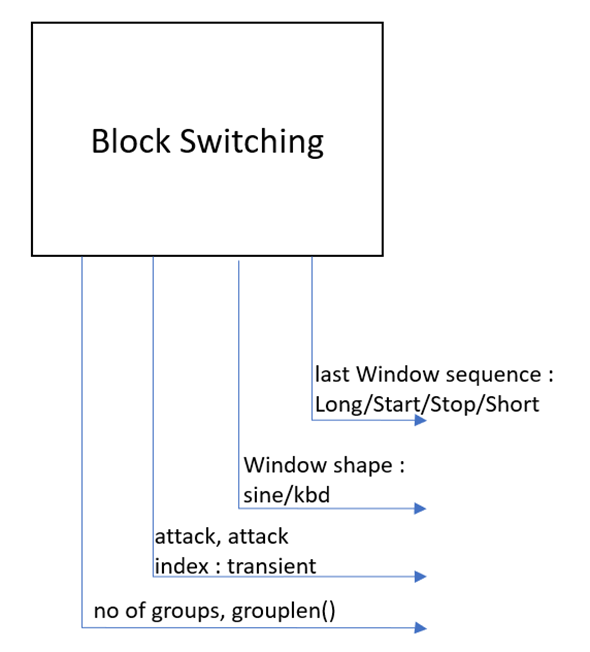

# Block Switching: FDK native, reference và kiểm chứng

## Trạng thái kiểm chứng hiện tại

Source được giữ nguyên theo lựa chọn của người dùng.
Build, probe WAV và tool vẽ chạy thành công trên Windows; bài DUT-REF đang FAIL.
Bảng blockType2windowShape[2][5] của source hiện tại thiếu hàng LD, làm AAC-LC đọc hàng zero-initialized.
Đã đối chiếu gói FDK 2.0.3 gốc có đủ hai hàng. CTest hiện trả nonzero cho bài reference regression; hai bài smoke đạt.
Xem docs/verification.md. Không diễn giải việc probe/vẽ chạy được thành kết luận thuật toán khớp reference.
## Mục đích và phạm vi

Phần này cho phép đọc thuật toán, lấy trạng thái từ FDK thực và đối chiếu với reference.
Luồng quan sát WAV sử dụng AAC-LC mono PCM16, 1024 mẫu/frame; bộ kiểm chứng còn có kịch bản AAC-LD, LFE và stereo.
Source DUT vẫn nằm tại ../../libAACenc/src/block_switch/block_switch.cpp; không tạo bản sao thuật toán trong thư mục này.

## Cấu trúc

- CMakeLists.txt: build riêng hai chương trình, không cần build toàn bộ encoder.
- tb/probe_block_switch.cpp: gọi trực tiếp FDK, xuất CSV trước/sau SyncBlockSwitching.
- tb/verify_block_switch.cpp: DUT vs REF, kiểm tra trạng thái fixed-point và các bất biến.
- ref/ref_block_switch.cpp và .h: reference fixed-point và behavioral float.
- tools/plot_block_switch.py: waveform, spectrogram, attack, window sequence, shape và grouping.
- docs/algorithm.md: input, output và luồng thuật toán.
- docs/verification.md: cách kiểm chứng, giới hạn và kết quả bàn giao.

## Build

Chạy các lệnh từ gốc AAC-LC-23021839_Huong. Dùng compiler C/C++17, CMake và một build generator phù hợp.

~~~bash
cmake -S my_workspace/block_switch -B build/block_switch -DCMAKE_BUILD_TYPE=Release
cmake --build build/block_switch --config Release --parallel 4
cmake -E chdir build/block_switch ctest -C Release --output-on-failure
~~~

Hai chương trình: build/block_switch/probe_block_switch và build/block_switch/verify_block_switch.
Trên Windows thêm .exe; với Visual Studio, binary có thể nằm trong build/block_switch/Release/.
CMake sử dụng đường dẫn tương đối theo vị trí source, không phụ thuộc workspace fdk-aac gốc.

## Khảo sát WAV mặc định

~~~bash
cmake -E make_directory output/block_switch/abc_votay
./build/block_switch/probe_block_switch --wav my_workspace/INPUT/data/abc_votay.wav --csv output/block_switch/abc_votay/trace.csv
~~~

Thay WAV bằng một file trong my_workspace/INPUT/data/psy_external/ để đổi tính chất âm thanh.
Mỗi frame có hai dòng CSV: before_sync và after_sync. Dùng after_sync để đọc control cuối của mono.
Frame cuối thiếu mẫu được zero-pad; validSamples ghi số mẫu thực. Probe không tự chạy chuỗi flush của encoder.

## Tín hiệu chẩn đoán có sẵn

~~~bash
./build/block_switch/probe_block_switch --signal silence --frames 10
./build/block_switch/probe_block_switch --signal impulse --frames 10
./build/block_switch/probe_block_switch --signal sine --frames 10
~~~

--signal và --wav là hai lựa chọn riêng. Trạng thái được giữ qua các frame.

## Đối chiếu DUT và REF

~~~bash
./build/block_switch/verify_block_switch
./build/block_switch/verify_block_switch --verbose
~~~

--pcm nhận raw signed PCM16 mono little-endian, không nhận WAV có header.
Khi dùng input thực, kiểm tra file raw tồn tại và stdout xác nhận số frame đã đọc.
Harness này chỉ xử lý các frame 1024 mẫu đầy đủ của raw input; phần dư không được đưa vào phép đối chiếu.
Xem docs/verification.md để phân biệt các kiểm tra A/B/C và ý nghĩa exit code.

## Vẽ kết quả

Cài hai dependency phân tích từ requirements.txt ở gốc:

~~~bash
python -m pip install -r requirements.txt
python my_workspace/block_switch/tools/plot_block_switch.py --wav my_workspace/INPUT/data/abc_votay.wav --csv output/block_switch/abc_votay/trace.csv --out output/block_switch/abc_votay/plots
~~~

Backend Agg chạy được trên server không có màn hình. Tool xuất overview, zoom dạng PNG/PDF và summary JSON.
Có thể thêm --zoom START_S END_S để chọn vùng quan sát.
CSV phải lấy từ chính WAV đang vẽ; schema và độ dài không thay thế được việc đối chiếu hash input.
Kết quả tự sinh nằm trong output/ và build/, tách khỏi source bàn giao.

## Giới hạn

Probe đo riêng Block Switching, không encode AAC hoặc thực hiện Window/MDCT.
Reference float dùng để giải thích hành vi; tính tương đương từng bit được đánh giá bằng reference fixed-point.
Kết quả kiểm chứng thực tế và nền tảng đã chạy được cập nhật trong docs/verification.md.
