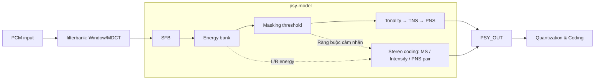

# Định nghĩa khối psy-model theo sơ đồ chức năng

Cập nhật ngày 07/10/2026 theo diagram người dùng cung cấp. Đây là định nghĩa ranh giới chức năng để khảo sát và phân chia khối của bộ mã hóa AAC-LC; việc ánh xạ xuống FDK giữ nguyên thứ tự thực thi hiện có.

Mỗi tiểu khối ở mục 2.1–2.8 có mô tả, code gọi hoặc code xử lý tương ứng và liên kết tới file/dòng trong dự án. Mục 3.1 gắn code giao diện/buffer/output với phần mô tả dữ liệu. Các đoạn code được trích từ working tree, giữ nội dung và chỉ bỏ thụt đầu dòng chung để dễ đọc.

Thiết kế mục tiêu hiện tại đưa **toàn bộ khối đã định nghĩa lên PL**, gồm cả special-math và quyết định công cụ; xem [kiến trúc full-PL](psy_model_hardware_proposal.md). Code FDK bên dưới là baseline tham chiếu, không phải bằng chứng core PL đã được triển khai.

## 1. Định nghĩa

**Psy-model là khối xử lý phổ sau filterbank, phân tích năng lượng theo scalefactor band (SFB), xây dựng masking threshold, đánh giá tonality, xử lý TNS/PNS và chọn biểu diễn stereo, rồi cung cấp phổ cùng các ràng buộc cảm nhận và metadata cho Quantization & Coding.**

Ranh giới top-level:

```text
PCM input -> filterbank (Window/MDCT) -> psy-model -> Quantization & Coding
```

Block Switching cung cấp điều khiển cửa sổ cho filterbank. PCM history/overlap, windowing và phép biến đổi MDCT thuộc phần trước psy-model. Đầu vào xử lý tín hiệu của psy-model là phổ, kèm exponent và metadata cửa sổ.

Trong source, boundary filterbank tạo spectrum và exponent ở lời gọi:

<!-- source-excerpt: libAACenc/src/psy_main.cpp:576-582 -->

Code tại [psy_main.cpp:576](D:/A-lab/AAC/fdk-aac/libAACenc/src/psy_main.cpp:576), trích dòng 576–582:

```cpp
transformError = FDKaacEnc_Transform_Real(
    psyStatic[ch]->psyInputBuffer, psyData[ch]->mdctSpectrum,
    psyStatic[ch]->blockSwitchingControl.lastWindowSequence,
    psyStatic[ch]->blockSwitchingControl.windowShape,
    &psyStatic[ch]->blockSwitchingControl.lastWindowShape,
    &psyStatic[ch]->mdctPers, nTimeSamples, &mdctSpectrum_e,
    hThisPsyConf[ch]->filterbank);
```

psyMain nhận exponent vừa tạo vào mdctScale trước các xử lý Psy; xem psy_main.cpp:621.

## 2. Các tiểu khối theo diagram

| Tiểu khối | Định nghĩa chức năng | Kết quả chính |
|---|---|---|
| **SFB** | Ánh xạ các hệ số MDCT vào scalefactor band theo sample rate và loại cửa sổ | `sfbOffset[]`, số band, độ rộng band và layout theo window/group |
| **Energy bank** | Tính năng lượng trong từng SFB, với scale/headroom phù hợp | `sfbEnergy[]`, `sfbEnergyLdData[]`; thêm energy M/S cho stereo |
| **Masking threshold** | Tạo mức nhiễu lượng tử mục tiêu theo band, gồm spreading, PCM floor và pre-echo control | Threshold theo SFB và dữ liệu hỗ trợ QC như min-SNR, spread energy |
| **Tonality** | Đánh giá tính tonal/noise-like của band để hỗ trợ quyết định công cụ | Chỉ số tonality và dữ liệu cho PNS |
| **TNS** | Phân tích và lọc phổ để định hình nhiễu lượng tử theo thời gian | Phổ sau TNS, tham số bộ lọc; energy/scale được cập nhật khi cần |
| **PNS** | Chọn band noise-like phù hợp để biểu diễn bằng noise energy | Cờ/band PNS, `noiseNrg[]` và threshold điều khiển QC |
| **Stereo coding** | Chọn biểu diễn L/R, Mid/Side hoặc Intensity dựa trên thống kê và ràng buộc cảm nhận | Phổ/energy/threshold cập nhật, `msMask`, `msDigest`, `isBook`, `isScale` và thông tin PNS của cặp channel |

Energy bank được hiểu là tập năng lượng theo SFB:

```text
E[b] = sum(X[k]^2), với sfbOffset[b] <= k < sfbOffset[b+1]
```

### 2.1. SFB — ánh xạ hệ số phổ vào band

SFB xác định khoảng chỉ số MDCT của từng band. Cấu hình sample rate, loại cửa sổ và granule length được đưa vào hàm tạo bảng:

<!-- source-excerpt: libAACenc/src/psy_configuration.cpp:569-571 -->

Code tại [psy_configuration.cpp:569](D:/A-lab/AAC/fdk-aac/libAACenc/src/psy_configuration.cpp:569), trích dòng 569–571:

```cpp
ErrorStatus = FDKaacEnc_initSfbTable(samplerate * downscaleFactor, blocktype,
                                     granuleLength * downscaleFactor,
                                     psyConf->sfbOffset, &psyConf->sfbCnt);
```

Bên trong FDKaacEnc_initSfbTable(), source tích lũy độ rộng band thành các offset và chặn biên cuối theo độ dài cửa sổ:

<!-- source-excerpt: libAACenc/src/psy_configuration.cpp:248-257 -->

Code tại [psy_configuration.cpp:248](D:/A-lab/AAC/fdk-aac/libAACenc/src/psy_configuration.cpp:248), trích dòng 248–257:

```cpp
for (i = 0; i < *sfbCnt; i++) {
  sfbOffset[i] = specStartOffset;
  specStartOffset += sfbWidth[i];
  if (specStartOffset >= granuleLengthWindow) {
    i++;
    break;
  }
}
*sfbCnt = fixMin(i, *sfbCnt);
sfbOffset[*sfbCnt] = fixMin(specStartOffset, granuleLengthWindow);
```

Kết quả là sfbOffset[b] và sfbOffset[b+1], dùng làm biên vòng lặp khi tính energy, threshold và lượng tử hóa band b.

### 2.2. Energy bank — tính năng lượng theo SFB

Energy bank đọc phổ và các biên SFB, rồi tạo energy tuyến tính cùng energy dạng log. Trong psyMain, lời gọi dưới đây còn phục vụ chọn scale an toàn cho energy:

<!-- source-excerpt: libAACenc/src/psy_main.cpp:665-669 -->

Code tại [psy_main.cpp:665](D:/A-lab/AAC/fdk-aac/libAACenc/src/psy_main.cpp:665), trích dòng 665–669:

```cpp
currNrg = FDKaacEnc_CheckBandEnergyOptim(
    psyData[ch]->mdctSpectrum + wOffset,
    pSfbMaxScaleSpec[ch] + w * maxSfb[ch], hThisPsyConf[ch]->sfbOffset,
    psyData[ch]->sfbActive, pSfbEnergy[ch] + w * maxSfb[ch],
    pSfbEnergyLdData[ch] + w * maxSfb[ch], minSpecShift - 4);
```

Phép cộng bình phương thật nằm trong FDKaacEnc_CheckBandEnergyOptim(). Source left-shift từng hệ số theo headroom, dùng fPow2AddDiv2 để tích lũy, rồi hiệu chỉnh energy và log:

<!-- source-excerpt: libAACenc/src/band_nrg.cpp:153-169 -->

Code tại [band_nrg.cpp:153](D:/A-lab/AAC/fdk-aac/libAACenc/src/band_nrg.cpp:153), trích dòng 153–169:

```cpp
for (i = 0; i < numBands; i++) {
  scale = fixMax(0, sfbMaxScaleSpec[i] - 4);
  FIXP_DBL tmp = 0;

  DWORD_ALIGNED(mdctSpectrum);

  for (j = bandOffset[i]; j < bandOffset[i + 1]; j++) {
    spec = mdctSpectrum[j] << scale;
    tmp = fPow2AddDiv2(tmp, spec);
  }
  bandEnergy[i] = tmp << 1;

  /* calculate ld of bandNrg, subtract scaling */
  bandEnergyLdData[i] = CalcLdData(bandEnergy[i]);
  if (bandEnergyLdData[i] != FL2FXCONST_DBL(-1.0f)) {
    bandEnergyLdData[i] -= scale * FL2FXCONST_DBL(2.0 / 64);
  }
```

Do đó công thức tổng X[k]^2 trong mô tả tương ứng với vòng lặp j; scale và hệ số chia hai của fixed-point phải được giữ khi tái tạo phép toán.

### 2.3. Masking threshold — ngưỡng nhiễu theo band

**Khởi tạo:** threshold được suy ra từ energy đã hiệu chỉnh scale bằng C_RATIO. ldShift dùng để cập nhật energy ở miền log:

<!-- source-excerpt: libAACenc/src/psy_main.cpp:708-710 -->

Code tại [psy_main.cpp:708](D:/A-lab/AAC/fdk-aac/libAACenc/src/psy_main.cpp:708), trích dòng 708–710:

```cpp
(pSfbThreshold[ch] + w_maxSfb_ch)[sfb] =
    fMult((pSfbEnergy[ch] + w_maxSfb_ch)[sfb], C_RATIO);
(pSfbEnergyLdData[ch] + w_maxSfb_ch)[sfb] += ldShift;
```

**Clip và spreading:** threshold được giới hạn theo clipEnergy, rồi lan truyền về hai phía tần số bằng hệ số masking:

<!-- source-excerpt: libAACenc/src/psy_main.cpp:953-965 -->

Code tại [psy_main.cpp:953](D:/A-lab/AAC/fdk-aac/libAACenc/src/psy_main.cpp:953), trích dòng 953–965:

```cpp
for (w = 0; w < nWindows[ch]; w++) {
  INT i;
  /* limit threshold to avoid clipping */
  for (i = 0; i < psyData[ch]->sfbActive; i++) {
    *(pSfbThreshold[ch] + w * maxSfb[ch] + i) =
        fixMin(*(pSfbThreshold[ch] + w * maxSfb[ch] + i), clipEnergy);
  }

  /* spreading */
  FDKaacEnc_SpreadingMax(psyData[ch]->sfbActive,
                         hThisPsyConf[ch]->sfbMaskLowFactor,
                         hThisPsyConf[ch]->sfbMaskHighFactor,
                         pSfbThreshold[ch] + w * maxSfb[ch]);
```

Hai lượt lan truyền thực hiện phép max với giá trị truyền từ band bên cạnh:

<!-- source-excerpt: libAACenc/src/spreading.cpp:112-124 -->

Code tại [spreading.cpp:112](D:/A-lab/AAC/fdk-aac/libAACenc/src/spreading.cpp:112), trích dòng 112–124:

```cpp
/* slope to higher frequencies */
delay = pbSpreadEnergy[0];
for (i = 1; i < pbCnt; i++) {
  delay = fixMax(pbSpreadEnergy[i], fMult(maskHighFactor[i], delay));
  pbSpreadEnergy[i] = delay;
}

/* slope to lower frequencies */
delay = pbSpreadEnergy[pbCnt - 1];
for (i = pbCnt - 2; i >= 0; i--) {
  delay = fixMax(pbSpreadEnergy[i], fMult(maskLowFactor[i], delay));
  pbSpreadEnergy[i] = delay;
}
```

**PCM floor:** source bỏ hệ số THR_SHIFTBITS của threshold ban đầu và lấy max với sàn PCM đã quy đổi scale. Hai nhánh dưới xử lý dấu khác nhau của energyShift:

<!-- source-excerpt: libAACenc/src/psy_main.cpp:967-983 -->

Code tại [psy_main.cpp:967](D:/A-lab/AAC/fdk-aac/libAACenc/src/psy_main.cpp:967), trích dòng 967–983:

```cpp
/* PCM quantization threshold */
energyShift += PCM_QUANT_THR_SCALE;
if (energyShift >= 0) {
  energyShift = fixMin(DFRACT_BITS - 1, energyShift);
  for (i = 0; i < psyData[ch]->sfbActive; i++) {
    *(pSfbThreshold[ch] + w * maxSfb[ch] + i) = fixMax(
        *(pSfbThreshold[ch] + w * maxSfb[ch] + i) >> THR_SHIFTBITS,
        (hThisPsyConf[ch]->sfbPcmQuantThreshold[i] >> energyShift));
  }
} else {
  energyShift = fixMin(DFRACT_BITS - 1, -energyShift);
  for (i = 0; i < psyData[ch]->sfbActive; i++) {
    *(pSfbThreshold[ch] + w * maxSfb[ch] + i) = fixMax(
        *(pSfbThreshold[ch] + w * maxSfb[ch] + i) >> THR_SHIFTBITS,
        (hThisPsyConf[ch]->sfbPcmQuantThreshold[i] << energyShift));
  }
}
```

**Pre-echo:** threshold hiện tại được giới hạn theo threshold và mdctScale lưu từ block trước:

<!-- source-excerpt: libAACenc/src/psy_main.cpp:999-1004 -->

Code tại [psy_main.cpp:999](D:/A-lab/AAC/fdk-aac/libAACenc/src/psy_main.cpp:999), trích dòng 999–1004:

```cpp
FDKaacEnc_PreEchoControl(
    psyStatic[ch]->sfbThresholdnm1, psyStatic[ch]->calcPreEcho,
    psyData[ch]->sfbActive, hThisPsyConf[ch]->maxAllowedIncreaseFactor,
    hThisPsyConf[ch]->minRemainingThresholdFactor,
    pSfbThreshold[ch] + w * maxSfb[ch], psyData[ch]->mdctScale,
    &psyStatic[ch]->mdctScalenm1);
```

Ví dụ nhánh khi scale hiện tại lớn hơn scale trước: tmpThreshold1 là giới hạn tăng theo lịch sử, tmpThreshold2 là phần threshold tối thiểu còn giữ. Source lưu threshold chưa giới hạn vào history trước khi áp dụng min/max:

<!-- source-excerpt: libAACenc/src/pre_echo_control.cpp:144-153 -->

Code tại [pre_echo_control.cpp:144](D:/A-lab/AAC/fdk-aac/libAACenc/src/pre_echo_control.cpp:144), trích dòng 144–153:

```cpp
tmpThreshold1 = maxAllowedIncreaseFactor * (pbThresholdNm1[i] >> scaling);
tmpThreshold2 = fMult(minRemainingThresholdFactor, pbThreshold[i]);

FIXP_DBL tmp = pbThreshold[i];

/* copy thresholds to internal memory */
pbThresholdNm1[i] = tmp;

tmp = fixMin(tmp, tmpThreshold1);
pbThreshold[i] = fixMax(tmp, tmpThreshold2);
```

Đoạn trên là một nhánh của hàm pre-echo; nhánh scale còn lại và điều kiện START/STOP được trình bày trong báo cáo hoạt động. Threshold hoàn chỉnh được xử lý sau TNS theo lịch FDK.

### 2.4. Tonality — mức tonal/noise-like

Tonality đọc phổ, headroom, energy log và biên SFB để tạo sfbTonality. Ở top-level, lời gọi nằm trong điều kiện cửa sổ không phải SHORT:

<!-- source-excerpt: libAACenc/src/psy_main.cpp:765-771 -->

Code tại [psy_main.cpp:765](D:/A-lab/AAC/fdk-aac/libAACenc/src/psy_main.cpp:765), trích dòng 765–771:

```cpp
if (!isShortWindow[ch]) {
  /* tonality */
  FDKaacEnc_CalculateFullTonality(
      psyData[ch]->mdctSpectrum, pSfbMaxScaleSpec[ch],
      pSfbEnergyLdData[ch], sfbTonality[ch], psyData[ch]->sfbActive,
      hThisPsyConf[ch]->sfbOffset, hThisPsyConf[ch]->pnsConf.usePns);
}
```

Trong tonality.cpp, thuật toán tạo chaos measure theo spectral line:

<!-- source-excerpt: libAACenc/src/tonality.cpp:133-134 -->

Code tại [tonality.cpp:133](D:/A-lab/AAC/fdk-aac/libAACenc/src/tonality.cpp:133), trích dòng 133–134:

```cpp
FDKaacEnc_CalculateChaosMeasure(spectrum, numberOfLines,
                                chaosMeasurePerLine);
```

Sau bước làm trơn chaos measure tại dòng 136–155, hàm gom thông tin về từng SFB:

<!-- source-excerpt: libAACenc/src/tonality.cpp:157-158 -->

Code tại [tonality.cpp:157](D:/A-lab/AAC/fdk-aac/libAACenc/src/tonality.cpp:157), trích dòng 157–158:

```cpp
FDKaacEnc_CalcSfbTonality(spectrum, sfbMaxScaleSpec, chaosMeasurePerLine,
                          sfbTonality, sfbCnt, sfbOffset, sfbEnergyLD64);
```

Thân FDKaacEnc_CalculateFullTonality() chỉ thực hiện tính toán khi usePns được bật; sfbTonality sau đó đi vào PnsDetect.

### 2.5. TNS — phát hiện và lọc phổ

**Detection:** mỗi cửa sổ được phân tích để chọn trạng thái và tham số TNS; tnsData chứa dữ liệu nội bộ, tnsInfo là metadata phía output:

<!-- source-excerpt: libAACenc/src/psy_main.cpp:785-789 -->

Code tại [psy_main.cpp:785](D:/A-lab/AAC/fdk-aac/libAACenc/src/psy_main.cpp:785), trích dòng 785–789:

```cpp
FDKaacEnc_TnsDetect(
    tnsData[ch], &hThisPsyConf[ch]->tnsConf,
    &psyOutChannel[ch]->tnsInfo, hThisPsyConf[ch]->sfbCnt,
    psyData[ch]->mdctSpectrum + wOffset, w,
    psyStatic[ch]->blockSwitchingControl.lastWindowSequence);
```

**Encoding/filtering:** tham số vừa tìm được điều khiển lọc trực tiếp mdctSpectrum của cửa sổ đang xử lý:

<!-- source-excerpt: libAACenc/src/psy_main.cpp:854-863 -->

Code tại [psy_main.cpp:854](D:/A-lab/AAC/fdk-aac/libAACenc/src/psy_main.cpp:854), trích dòng 854–863:

```cpp
FDKaacEnc_TnsEncode(
    &psyOutChannel[ch]->tnsInfo, tnsData[ch],
    hThisPsyConf[ch]->sfbCnt, &hThisPsyConf[ch]->tnsConf,
    hThisPsyConf[ch]->sfbOffset[psyData[ch]->sfbActive],
    /*hThisPsyConf[ch]->lowpassLine*/ /* filter stops
                                         before that
                                         line ! */
        psyData[ch]->mdctSpectrum +
        wOffset,
    w, psyStatic[ch]->blockSwitchingControl.lastWindowSequence);
```

Sau lọc, source tính lại headroom khi TNS active:

<!-- source-excerpt: libAACenc/src/psy_main.cpp:865-874 -->

Code tại [psy_main.cpp:865](D:/A-lab/AAC/fdk-aac/libAACenc/src/psy_main.cpp:865), trích dòng 865–874:

```cpp
if (tnsActive[w]) {
  /* Calc sfb-bandwise mdct-energies for left and right channel again,
   */
  /* if tns active in current channel or in one channel with same
   * lastWindowSequence left and right */
  FDKaacEnc_CalcSfbMaxScaleSpec(psyData[ch]->mdctSpectrum + wOffset,
                                hThisPsyConf[ch]->sfbOffset,
                                pSfbMaxScaleSpec[ch] + w * maxSfb[ch],
                                psyData[ch]->sfbActive);
}
```

Energy được tính lại tại psy_main.cpp:878–920 bằng CalcBandEnergyOptimShort/Long; các right-shift bảo vệ overflow đi kèm cập nhật mdctScale. Thân hàm TNS nằm trong [aacenc_tns.cpp](../../../libAACenc/src/aacenc_tns.cpp).

### 2.6. PNS — lựa chọn band noise-like

**Detection:** code kết hợp threshold, phổ, tonality, energy và thông tin TNS để tạo quyết định PNS cùng noise energy:

<!-- source-excerpt: libAACenc/src/psy_main.cpp:1158-1168 -->

Code tại [psy_main.cpp:1158](D:/A-lab/AAC/fdk-aac/libAACenc/src/psy_main.cpp:1158), trích dòng 1158–1168:

```cpp
FDKaacEnc_PnsDetect(
    &(psyConf[0].pnsConf), pnsData[ch],
    psyStatic[ch]->blockSwitchingControl.lastWindowSequence,
    psyData[ch]->sfbActive,
    maxSfbPerGroup[ch], /* count of Sfb which are not zero. */
    psyOutChannel[ch]->sfbThresholdLdData, psyConf[win].sfbOffset,
    psyData[ch]->mdctSpectrum, psyData[ch]->sfbMaxScaleSpec.Long,
    sfbTonality[ch], psyOutChannel[ch]->tnsInfo.order[0][0],
    tnsData[ch]->dataRaw.Long.subBlockInfo.predictionGain[HIFILT],
    tnsData[ch]->dataRaw.Long.subBlockInfo.tnsActive[HIFILT],
    psyOutChannel[ch]->sfbEnergyLdData, psyOutChannel[ch]->noiseNrg);
```

Trong nhánh LC dùng IS_LOW_COMPLEXITY, hàm detection bỏ qua SHORT:

<!-- source-excerpt: libAACenc/src/aacenc_pns.cpp:196-199 -->

Code tại [aacenc_pns.cpp:196](D:/A-lab/AAC/fdk-aac/libAACenc/src/aacenc_pns.cpp:196), trích dòng 196–199:

```cpp
if ((pnsConf->np.detectionAlgorithmFlags & IS_LOW_COMPLEXITY) &&
    (lastWindowSequence == SHORT_WINDOW)) {
  return;
}
```

**Coding preparation:** quyết định pnsFlag được chuyển thành dữ liệu noiseNrg và threshold cho QC:

<!-- source-excerpt: libAACenc/src/psy_main.cpp:1253-1258 -->

Code tại [psy_main.cpp:1253](D:/A-lab/AAC/fdk-aac/libAACenc/src/psy_main.cpp:1253), trích dòng 1253–1258:

```cpp
FDKaacEnc_CodePnsChannel(
    psyData[ch]->sfbActive, &(hThisPsyConf[ch]->pnsConf),
    pnsData[ch]->pnsFlag, psyData[ch]->sfbEnergyLdData.Long,
    psyOutChannel[ch]->noiseNrg, /* this is the energy that will be
                                    written to the bitstream */
    psyOutChannel[ch]->sfbThresholdLdData);
```

Với band được chọn PNS và có noise energy hợp lệ, source đặt threshold log cao hơn energy log để PE phần spectral bằng 0:

<!-- source-excerpt: libAACenc/src/aacenc_pns.cpp:401-405 -->

Code tại [aacenc_pns.cpp:401](D:/A-lab/AAC/fdk-aac/libAACenc/src/aacenc_pns.cpp:401), trích dòng 401–405:

```cpp
if (pnsFlag[sfb]) {
  /* high sfbThreshold causes pe = 0 */
  if (noiseNrg[sfb] != NO_NOISE_PNS)
    sfbThresholdLdData[sfb] =
        sfbEnergyLdData[sfb] + FL2FXCONST_DBL(1.0f / LD_DATA_SCALING);
```

Đây là chuẩn bị biểu diễn PNS; việc ghi codebook và noise energy vào bitstream được thực hiện ở coding phía sau.

### 2.7. Stereo coding — chọn biểu diễn hai channel

Stereo coding sử dụng energy và threshold của L/R để chọn Intensity hoặc MS, đồng thời phối hợp PNS của cặp channel. Các lời gọi sau nằm trong nhánh channels == 2, ví dụ đường long window:

<!-- source-excerpt: libAACenc/src/psy_main.cpp:1191-1208 -->

Code tại [psy_main.cpp:1191](D:/A-lab/AAC/fdk-aac/libAACenc/src/psy_main.cpp:1191), trích dòng 1191–1208:

```cpp
FDKaacEnc_IntensityStereoProcessing(
    psyData[0]->sfbEnergy.Long, psyData[1]->sfbEnergy.Long,
    psyData[0]->mdctSpectrum, psyData[1]->mdctSpectrum,
    psyData[0]->sfbThreshold.Long, psyData[1]->sfbThreshold.Long,
    psyOutChannel[1]->sfbThresholdLdData,
    psyData[0]->sfbSpreadEnergy.Long, psyData[1]->sfbSpreadEnergy.Long,
    psyOutChannel[0]->sfbEnergyLdData, psyOutChannel[1]->sfbEnergyLdData,
    &psyOutElement->toolsInfo.msDigest, psyOutElement->toolsInfo.msMask,
    psyConf[0].sfbCnt, psyConf[0].sfbCnt, maxSfbPerGroup[0],
    psyConf[0].sfbOffset,
    psyConf[0].allowIS && psyOutElement->commonWindow,
    psyOutChannel[1]->isBook, psyOutChannel[1]->isScale, pnsData);

FDKaacEnc_MsStereoProcessing(
    psyData, psyOutChannel, psyOutChannel[1]->isBook,
    &psyOutElement->toolsInfo.msDigest, psyOutElement->toolsInfo.msMask,
    psyConf[0].allowMS, psyData[0]->sfbActive, psyData[0]->sfbActive,
    maxSfbPerGroup[0], psyOutChannel[0]->sfbOffsets);
```

Trong MsStereoProcessing(), quyết định useMS dựa trên so sánh chỉ tiêu cảm nhận của MS với L/R và cờ allowMS. Khi chọn MS, code đổi từng cặp hệ số thành Mid/Side với hệ số một nửa:

<!-- source-excerpt: libAACenc/src/ms_stereo.cpp:201-213 -->

Code tại [ms_stereo.cpp:201](D:/A-lab/AAC/fdk-aac/libAACenc/src/ms_stereo.cpp:201), trích dòng 201–213:

```cpp
useMS = ((allowMS != 0) && (pnmsLdData > pnlrLdData)) ? 1 : 0;

if (useMS) {
  msMask[sfb + sfboffs] = 1;
  msMaskTrueSomewhere = 1;
  for (j = sfbOffset[sfb + sfboffs]; j < sfbOffset[sfb + sfboffs + 1];
       j++) {
    FIXP_DBL specL, specR;
    specL = mdctSpectrumLeft[j] >> 1;
    specR = mdctSpectrumRight[j] >> 1;
    mdctSpectrumLeft[j] = specL + specR;
    mdctSpectrumRight[j] = specL - specR;
  }
```

Các dòng 214–229 của ms_stereo.cpp tiếp tục cập nhật threshold, energy và spread energy cho biểu diễn MS. Intensity Stereo nằm trong [intensity.cpp:614](D:/A-lab/AAC/fdk-aac/libAACenc/src/intensity.cpp:614); kết quả được ghi vào isBook/isScale. PNS pair preprocessing/postprocessing nằm tại psy_main.cpp:1185 và :1211. Với mono, nhánh stereo này không được chạy.

### 2.8. Các xử lý phụ trợ trong phạm vi Psy

**Low-pass spectrum:** sau filterbank, code đặt các line ngoài bandwidth bằng 0 cho từng cửa sổ:

<!-- source-excerpt: libAACenc/src/psy_main.cpp:593-595 -->

Code tại [psy_main.cpp:593](D:/A-lab/AAC/fdk-aac/libAACenc/src/psy_main.cpp:593), trích dòng 593–595:

```cpp
FDKmemclear(
    &psyData[ch]->mdctSpectrum[psyData[ch]->lowpassLine + wOffset],
    (windowLength[ch] - psyData[ch]->lowpassLine) * sizeof(FIXP_DBL));
```

**Short grouping:** ngoài việc cộng energy/threshold theo group, source rearrange phổ theo group, SFB và window trong group:

<!-- source-excerpt: libAACenc/src/grp_data.cpp:241-261 -->

Code tại [grp_data.cpp:241](D:/A-lab/AAC/fdk-aac/libAACenc/src/grp_data.cpp:241), trích dòng 241–261:

```cpp
/* re-group spectrum */
wnd = 0;
i = 0;
for (grp = 0; grp < noOfGroups; grp++) {
  for (sfb = 0; sfb < sfbActive; sfb++) {
    int width = sfbOffset[sfb + 1] - sfbOffset[sfb];
    FIXP_DBL *pMdctSpectrum =
        &mdctSpectrum[sfbOffset[sfb]] + wnd * granuleLength_short;
    for (j = 0; j < groupLen[grp]; j++) {
      FIXP_DBL *pTmp = pMdctSpectrum;
      for (line = width; line > 0; line--) {
        tmpSpectrum[i++] = *pTmp++;
      }
      pMdctSpectrum += granuleLength_short;
    }
  }
  i += (groupLen[grp] * (sfbOffset[sfbCnt] - sfbOffset[sfb]));
  wnd += groupLen[grp];
}

FDKmemcpy(mdctSpectrum, tmpSpectrum, granuleLength * sizeof(FIXP_DBL));
```

Kết quả grouping làm thay đổi layout của spectrum trước QC; biên groupedSfbOffset và groupLen phải đi cùng dữ liệu này.

Sơ đồ dưới thể hiện quan hệ chức năng của các tiểu khối trong hình. Nhánh stereo dùng dữ liệu của hai channel; vị trí khối stereo trong hình không xác định một lịch thực thi nối tiếp riêng.



Các công việc phụ trợ sau filterbank như low-pass phổ, chuẩn hóa fixed-point, kiểm tra silence và short grouping được tính vào phạm vi psy-model trong tài liệu này.

## 3. Giao diện logic

| Hướng | Dữ liệu | Ý nghĩa |
|---|---|---|
| Input từ filterbank | `mdctSpectrum[1024]` và `mdctSpectrum_e` | Phổ fixed-point và exponent; SHORT gồm 8 x 128 trước grouping |
| Input metadata | Window sequence/shape, số group, `groupLen[]` | Hình học cửa sổ và grouping để phân tích/mã hóa đúng |
| Configuration | Sample rate, bandwidth, bảng SFB, hệ số masking/min-SNR, cờ TNS/PNS/MS/IS | Quy tắc xử lý của khối |
| State nội bộ Psy | `sfbThresholdnm1[]`, `mdctScalenm1`, `calcPreEcho` | Lịch sử phục vụ pre-echo control |
| Output phổ | `mdctSpectrum`, `mdctScale` | Phổ sau các xử lý được chọn và scale cuối |
| Output theo band | Energy, energy log, threshold log, min-SNR log, spread energy, SFB offsets | Dữ liệu và ràng buộc cảm nhận cho QC |
| Output tool/control | TNS info, PNS noise energy, MS/Intensity metadata, window/grouping metadata | Thông tin QC và bitstream writer cần sử dụng |

Đây là hợp đồng chức năng, không phải khai báo một API C mới. Trong FDK, spectrum và một số mảng band được chia sẻ trực tiếp với bộ nhớ QC.

Phân bổ bit cuối cùng, bit reservoir, threshold adjustment theo rate control, scalefactor estimation, quantization, Huffman và ghi bitstream thuộc phần QC/coding phía sau.

### 3.1. Code giao diện và buffer chia sẻ

Các trường input/output theo band, window và tool được lưu trong PSY_OUT_CHANNEL:

<!-- source-excerpt: libAACenc/src/interface.h:121-146 -->

Code tại [interface.h:121](D:/A-lab/AAC/fdk-aac/libAACenc/src/interface.h:121), trích dòng 121–146:

```cpp
typedef struct {
  INT sfbCnt;
  INT sfbPerGroup;
  INT maxSfbPerGroup;
  INT lastWindowSequence;
  INT windowShape;
  INT groupingMask;
  INT sfbOffsets[MAX_GROUPED_SFB + 1];

  INT mdctScale; /* number of transform shifts */
  INT groupLen[MAX_NO_OF_GROUPS];

  TNS_INFO tnsInfo;
  INT noiseNrg[MAX_GROUPED_SFB];
  INT isBook[MAX_GROUPED_SFB];
  INT isScale[MAX_GROUPED_SFB];

  /* memory located in QC_OUT_CHANNEL */
  FIXP_DBL *mdctSpectrum;
  FIXP_DBL *sfbEnergy;
  FIXP_DBL *sfbSpreadEnergy;
  FIXP_DBL *sfbThresholdLdData;
  FIXP_DBL *sfbMinSnrLdData;
  FIXP_DBL *sfbEnergyLdData;

} PSY_OUT_CHANNEL;
```

Trước khi gọi hàm điều phối Psy, EncodeFrame() nối các buffer này với bộ nhớ QC:

<!-- source-excerpt: libAACenc/src/aacenc.cpp:805-810 -->

Code tại [aacenc.cpp:805](D:/A-lab/AAC/fdk-aac/libAACenc/src/aacenc.cpp:805), trích dòng 805–810:

```cpp
psyOutChan->mdctSpectrum = qcOutChan->mdctSpectrum;
psyOutChan->sfbSpreadEnergy = qcOutChan->sfbSpreadEnergy;
psyOutChan->sfbEnergy = qcOutChan->sfbEnergy;
psyOutChan->sfbEnergyLdData = qcOutChan->sfbEnergyLdData;
psyOutChan->sfbMinSnrLdData = qcOutChan->sfbMinSnrLdData;
psyOutChan->sfbThresholdLdData = qcOutChan->sfbThresholdLdData;
```

Khi tạo output, source gán scale cuối và hình học SFB/window, ví dụ nhánh long:

<!-- source-excerpt: libAACenc/src/psy_main.cpp:1269-1277 -->

Code tại [psy_main.cpp:1269](D:/A-lab/AAC/fdk-aac/libAACenc/src/psy_main.cpp:1269), trích dòng 1269–1277:

```cpp
psyOutChannel[ch]->maxSfbPerGroup = maxSfbPerGroup[ch];
psyOutChannel[ch]->mdctScale = psyData[ch]->mdctScale;
if (isShortWindow[ch] == 0) {
  psyOutChannel[ch]->sfbCnt = hPsyConfLong->sfbActive;
  psyOutChannel[ch]->sfbPerGroup = hPsyConfLong->sfbActive;
  psyOutChannel[ch]->lastWindowSequence =
      psyStatic[ch]->blockSwitchingControl.lastWindowSequence;
  psyOutChannel[ch]->windowShape =
      psyStatic[ch]->blockSwitchingControl.windowShape;
```

Phía tiêu thụ là QCMainPrepare(), nơi tính form factor và PE từ PSY_OUT:

<!-- source-excerpt: libAACenc/src/qc_main.cpp:447-453 -->

Code tại [qc_main.cpp:447](D:/A-lab/AAC/fdk-aac/libAACenc/src/qc_main.cpp:447), trích dòng 447–453:

```cpp
FDKaacEnc_CalcFormFactor(qcOutElement->qcOutChannel, psyOutChannel,
                         nChannels);

/* prepare and calculate PE without reduction */
FDKaacEnc_peCalculation(&qcOutElement->peData, psyOutChannel,
                        qcOutElement->qcOutChannel, &psyOutElement->toolsInfo,
                        adjThrStateElement, nChannels);
```

## 4. Ánh xạ sang FDK-AAC

`FDKaacEnc_psyMain()` là hàm điều phối có phạm vi rộng hơn khối psy-model vừa định nghĩa: nó gọi Block Switching, filterbank và các xử lý Psy. Tên hàm và tên timer không quyết định ranh giới khối chức năng.

| Phạm vi chức năng | Vị trí trong `libAACenc/src/psy_main.cpp` |
|---|---|
| Điều khiển trước filterbank | Block Switching tại dòng 476–503 |
| Filterbank | Transform tại dòng 554–587; lời gọi LC `FDKaacEnc_Transform_Real()` tại dòng 576 |
| Tiền xử lý phổ của Psy | Low-pass tại dòng 589–619; rescale/energy tại dòng 636–755 |
| SFB và energy bank | Bảng cấu hình/SFB offset; `CalcSfbMaxScaleSpec()` tại dòng 650, `CheckBandEnergyOptim()` tại dòng 665 |
| Masking threshold | Threshold ban đầu tại dòng 708–710; hoàn thiện threshold/spreading/pre-echo tại dòng 933–1029 |
| Tonality/TNS/PNS | Tonality tại dòng 767; TNS tại dòng 785, 854; PNS detection tại dòng 1158 và coding preparation tại dòng 1253 |
| Stereo coding | Energy M/S tại dòng 1040; Intensity/MS/PNS pair tại dòng 1175–1240 |
| Output Psy | Metadata và output tại dòng 1263–1307, cùng các trường được điền trước đó |

Mũi tên `masking threshold -> tonality -> TNS -> PNS` trong diagram được dùng để mô tả chuỗi chức năng. Trong lịch thực thi FDK, threshold khởi tạo xuất hiện trước tonality/TNS, còn threshold hoàn chỉnh được tạo sau TNS. Các bước có sự cập nhật qua lại: TNS có thể đổi phổ/energy; PNS và stereo có thể đổi threshold hoặc biểu diễn phổ.

Luồng thực thi sau filterbank cần giữ khi dùng FDK làm baseline:

```text
Low-pass / scale / SFB energy / threshold ban đầu
 -> Tonality / TNS / cập nhật energy và scale
 -> Hoàn thiện masking threshold / pre-echo / spread energy
 -> Energy M/S / short grouping
 -> PNS detection / Intensity / MS / PNS coding preparation
 -> PSY_OUT
```

Với mono, nhánh stereo không hoạt động. PNS của nhánh AAC-LC hiện tại bỏ qua SHORT; việc một công cụ thuộc khối không có nghĩa công cụ chạy ở mọi frame.

Nguồn: [psy_main.cpp](../../../libAACenc/src/psy_main.cpp), [psy_configuration.h](../../../libAACenc/src/psy_configuration.h), [interface.h](../../../libAACenc/src/interface.h), [aacenc_pns.cpp](../../../libAACenc/src/aacenc_pns.cpp).

## 5. Diễn giải profiling theo ranh giới mới

Timer `psy_total` hiện tại đo toàn hàm điều phối, gồm cả Block Switching và Window/MDCT. Với artifact cũ 454 frame, residual theo ranh giới mới được tính:

```text
T_psy_model_residual = T_psy_total - T_block_switching - T_window_mdct
                    = (178316.805 - 12453.206 - 65088.994) / 454
                    ≈ 221.970 µs/frame
```

Residual chiếm khoảng 15.749% CPU time của lõi frame trong artifact này. Nó còn chứa overhead chưa có timer con của hàm điều phối, nên chỉ là ước lượng từ phép trừ; để đo riêng khối Psy cần đặt timer tại boundary mới. Giá trị `psy_total = 392.768 µs/frame` được giữ nguyên với ý nghĩa timer FDK, không gán nó cho khối Psy theo diagram.

Nguồn: [encoder_profile.csv](../../pynq_z2/output/z2_profile/encoder_profile.csv). Phân tích chi tiết và giới hạn của phép đo nằm trong [psymodel_operation_survey.md](psymodel_operation_survey.md).
