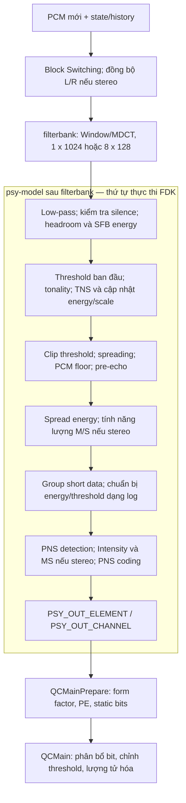

# Khảo sát hoạt động khối psymodel trong FDK-AAC

Ngày khảo sát: 07/10/2026. Báo cáo đối chiếu trực tiếp mã nguồn trong working tree. Phạm vi chính là AAC-LC, frame 1024 mẫu; mono 48 kHz là cấu hình đầu của dự án. Các nhánh stereo, short window và LFE được ghi rõ khi khác đường mono thông thường.

Phương pháp: phân tích tĩnh source và đọc artifact profiling đã lưu. Lượt khảo sát này không build/chạy lại encoder, không thu trace mới và không thay đổi thuật toán.

## 1. Vai trò và ranh giới của khối

Ranh giới dùng trong báo cáo được cập nhật theo diagram người dùng: **filterbank -> psy-model**, với psy-model gồm **SFB -> energy bank -> masking threshold**, nhóm **tonality -> TNS -> PNS** và **stereo coding**. Block Switching, PCM history và Window/MDCT thuộc phần trước khối. Định nghĩa cùng giao diện logic nằm trong [psy_model_definition.md](psy_model_definition.md).

Code FDK được gắn trực tiếp với mô tả của từng tiểu khối tại mục 2.1–2.8 và giao diện tại mục 3.1 của [tài liệu định nghĩa kèm code](psy_model_definition.md); mỗi trích đoạn có liên kết file/dòng để tra source.

Psychoacoustic Model xác định mức sai số lượng tử mục tiêu theo từng scalefactor band (SFB), để Quantization & Coding (QC) ưu tiên độ chính xác ở những vùng nhạy với thính giác. Đầu ra gồm phổ đã xử lý, năng lượng, masking threshold, min-SNR, thông tin cửa sổ/grouping và quyết định các công cụ âm học.

Về ý tưởng, mục tiêu của một band mã hóa phổ thông thường là `năng lượng nhiễu lượng tử <= masking threshold`. Đây là mục tiêu chất lượng; QC còn điều chỉnh threshold theo ngân sách bit, và các band PNS/Intensity có cách xử lý riêng.

Trong implementation này, `FDKaacEnc_psyMain()` là hàm điều phối nhận **PCM và state**, rồi gọi cả **Block Switching, filterbank và psy-model**. Bộ đếm `psy_total` đo phạm vi hàm điều phối này. Khối psy-model theo diagram nhận **phổ từ filterbank**; ranh giới đó nằm bên trong hàm FDK hiện tại.

Nguồn: [psy_main.cpp](../../../libAACenc/src/psy_main.cpp), dòng 408, 476, 576; [aacenc.cpp](../../../libAACenc/src/aacenc.cpp), dòng 791–829.



## 2. Cấu hình trước khi xử lý frame

`FDKaacEnc_psyMainInit()` tạo cấu hình long và, nếu `granuleLength > 512`, cấu hình short. Cấu hình phụ thuộc sample rate, bitrate mỗi channel hiệu dụng, bandwidth, granule length, filterbank và cờ bật các công cụ.

| Tham số | Công dụng |
|---|---|
| `sfbOffset[]`, `sfbCnt` | Biên band và số band trong bảng |
| `sfbActive`, `lowpassLine` | Phạm vi phổ được giữ và phân tích |
| `sfbMaskLowFactor[]`, `sfbMaskHighFactor[]` | Lan truyền masking về hai phía tần số |
| `sfbMask*FactorSprEn[]` | Lan truyền energy phục vụ xử lý tránh spectral hole trong QC |
| `sfbPcmQuantThreshold[]` | Sàn threshold theo độ phân giải PCM và độ rộng band |
| `sfbMinSnrLdData[]` | Ràng buộc tỷ lệ noise/signal dạng log cho bước điều chỉnh threshold |
| `maxAllowedIncreaseFactor`, `minRemainingThresholdFactor` | Giới hạn pre-echo |
| `tnsConf`, `pnsConf`, `allowMS`, `allowIS` | Điều kiện cho phép các công cụ |

Với độ dài cửa sổ `N`, source đặt `lowpassLine = floor(2 * bandwidth * N / sampleRate)`. Bảng 48 kHz có **49 SFB cho long 1024**, **14 SFB cho short 128**; số band active còn phụ thuộc bandwidth. Bộ nhớ dự trữ tối đa 51 long SFB, 15 short SFB, 4 group và 60 grouped SFB. Không đồng nhất giới hạn bộ nhớ với số band thật của một frame.

`sfbMinSnrLdData` được tính từ nghịch đảo SNR và đưa sang miền log; không đọc trực tiếp giá trị fixed-point này như SNR tính bằng dB. `allowIS` còn bị giới hạn bởi biểu thức nguyên `(bitrate / bandwidth) < 5`. Bật một công cụ trong cấu hình cũng chưa chứng minh công cụ được dùng ở mọi frame.

Nguồn: [psy_main.cpp](../../../libAACenc/src/psy_main.cpp), dòng 301–394; [psy_configuration.cpp](../../../libAACenc/src/psy_configuration.cpp), dòng 325, 421–530, 534–624; [aacEnc_rom.cpp](../../../libAACenc/src/aacEnc_rom.cpp), dòng 786–791; [psy_const.h](../../../libAACenc/src/psy_const.h), dòng 141–156.

## 3. Luồng xử lý một frame

Bảng dưới ghi toàn bộ luồng của hàm điều phối FDK. Bước 1–2 thuộc điều khiển cửa sổ/filterbank; các xử lý phổ từ bước 3 đến output ở bước 10 thuộc psy-model theo diagram. Việc cập nhật PCM history trong hàm vẫn thuộc trách nhiệm filterbank/input.

| Bước | Hoạt động trong source | Dữ liệu/kết quả |
|---|---|---|
| 1 | `BlockSwitching`, `SyncBlockSwitching` | Sequence LONG/START/SHORT/STOP; grouping; đồng bộ stereo |
| 2 | Chọn cấu hình long/short rồi gọi transform | Spectrum và `mdctSpectrum_e` |
| 3 | Zero các line từ `lowpassLine`; kiểm tra toàn phổ bằng 0 | Phổ giới hạn bandwidth; nhánh silence |
| 4 | Tính headroom, energy và `finalShift` | Spectrum được rescale; energy và threshold ban đầu theo SFB |
| 5 | Tonality, `TnsDetect`, `TnsSync`, `TnsEncode` | TNS có thể đổi spectrum; energy/scale được cập nhật |
| 6 | Clip, spreading, PCM floor, pre-echo | Threshold theo cửa sổ/SFB |
| 7 | Spread energy; tính energy Mid/Side khi có hai channel | Dữ liệu cho QC và lựa chọn stereo |
| 8 | `groupShortData` nếu SHORT; chuyển threshold sang `LdData` | Phổ và SFB layout sau grouping |
| 9 | `PnsDetect`; Intensity rồi MS; `CodePnsChannel` | Quyết định tool, metadata và cập nhật dữ liệu liên quan |
| 10 | Build output | `PSY_OUT` cho QC |

Thứ tự trên bám theo [psy_main.cpp](../../../libAACenc/src/psy_main.cpp), lần lượt tại dòng 476, 554, 589, 636, 758, 933, 1021, 1053, 1154 và 1263.

### 3.1. PCM history và Window/MDCT

Mục này mô tả phần trước psy-model để xác định chính xác boundary đầu vào.

AAC-LC nhận `nTimeSamples = 1024` mẫu mới mỗi channel. Buffer nội bộ có 2048 mẫu, gồm history và phần input mới được ghép theo lịch của filterbank.

Với LC, `blockSwitchingOffset = N + 9N/(2*8)`. Khi `N = 1024`, offset là 1600: trước transform chép 448 mẫu mới vào cuối buffer; sau transform dịch history 1024 mẫu và chép 576 mẫu còn lại. Block Switching phân tích 1024 mẫu mới. Do đó không thể tự xây buffer transform chỉ bằng cách ghép hai frame liên tiếp mà bỏ qua lịch history/look-ahead của FDK.

LONG/START/STOP dùng hình học long 1024; SHORT dùng 8 cửa sổ, mỗi cửa sổ có 128 hệ số. Đầu ra transform gồm mantissa `FIXP_DBL` và exponent chung. Source gán `psyData->mdctScale = mdctSpectrum_e`, sau đó còn có thể đổi scale trong Psy.

Nguồn: [psy_main.cpp](../../../libAACenc/src/psy_main.cpp), dòng 452–503, 524–551, 576–632.

### 3.2. Headroom, năng lượng và threshold ban đầu

Về toán học, energy của band `b` là:

```text
E[b] = sum(X[k]^2), với sfbOffset[b] <= k < sfbOffset[b+1]
```

Implementation tính bằng fixed-point: tìm headroom theo SFB, tích lũy energy với scale tạm, chọn một `finalShift` an toàn cho cả spectrum và energy, rồi hiệu chỉnh. Khi stereo, quyết định shift dùng thông tin cả hai channel. Short window giữ thêm headroom cho phép cộng energy khi grouping.

Nếu left-shift spectrum `s` bit, source giảm `mdctScale` đi `s`; energy thay đổi theo `2s` bit. Điều này giữ nguyên giá trị được biểu diễn, trừ sai số làm tròn của phép toán fixed-point. Giới hạn `finalShift <= mdctScale + 3` còn bảo vệ việc scale PCM threshold.

Threshold khởi tạo từ energy với tỷ lệ mục tiêu khoảng `10^(-29/10) = 0.001258925`. Hằng `C_RATIO = 0x02940a10` đã chứa hệ số nội bộ `2^THR_SHIFTBITS`, với `THR_SHIFTBITS = 4`; source loại hệ số này ở bước PCM floor. Không dùng giá trị nguyên của `C_RATIO` như tỷ lệ vật lý trực tiếp.

Nếu **mọi channel/window trong element đều zero** sau low-pass, source đặt `mdctScale = 0`, energy/threshold tuyến tính bằng 0 và energy dạng log về sentinel `-1.0`. Các bước threshold phía sau vẫn chạy.

Nguồn: [band_nrg.cpp](../../../libAACenc/src/band_nrg.cpp), dòng 111–183; [psy_main.cpp](../../../libAACenc/src/psy_main.cpp), dòng 433, 609–617, 636–755; [psy_configuration.h](../../../libAACenc/src/psy_configuration.h), dòng 113–118.

### 3.3. Tonality và TNS

Tonality đánh giá tính tonal/noise-like để hỗ trợ PNS. Top-level gọi hàm tonality cho cửa sổ không phải SHORT; tính toán trong hàm chỉ thực hiện khi `usePns` được bật.

TNS phân tích phổ, chọn tham số bộ lọc, đồng bộ L/R nếu stereo và lọc trực tiếp spectrum trước quantizer. Khi TNS active, source tính lại headroom/energy cho cửa sổ liên quan. Long window có thể right-shift spectrum để bảo vệ energy; `mdctScale` tăng tương ứng và threshold được scale lại. Threshold ban đầu đã được tạo trước TNS, nên không thể thay toàn bộ đoạn này bằng công thức đơn giản “energy sau TNS nhân tỷ lệ cố định”.

Nguồn: [psy_main.cpp](../../../libAACenc/src/psy_main.cpp), dòng 758–929; [tonality.cpp](../../../libAACenc/src/tonality.cpp), dòng 121–161.

### 3.4. Masking, PCM floor và pre-echo

Thứ tự thực tế là **clip threshold -> spreading -> PCM floor -> pre-echo**, sau đó spread energy bằng bộ hệ số riêng.

Spreading chạy hai lượt nối tiếp: từ thấp lên cao và từ cao xuống thấp. Mỗi band lấy giá trị lớn hơn giữa giá trị hiện tại và giá trị lan truyền từ band bên cạnh. Với lượt đi lên:

```text
T[i] = max(T[i], maskHighFactor[i] * T[i-1])
```

Lượt đi xuống dùng `maskLowFactor[i]` và `T[i+1]`. Đây là phép max có lan truyền đệ quy theo thứ tự duyệt; không phải phép cộng các đóng góp độc lập của mọi band.

PCM floor được tính theo độ rộng SFB và scale năng lượng. Trong đoạn này, source không xây một đường ATH biến thiên theo tần số; không nên tự diễn giải `sfbPcmQuantThreshold` thành một mô hình ATH đầy đủ.

Sau khi quy đổi threshold lịch sử về cùng scale, pre-echo có thể hiểu gần đúng như:

```text
Tpre = max(min(Tcur, 2 * Tprev), alpha * Tcur)
alpha = 0x0148 / 32768, xấp xỉ 0.01
```

`Tprev` là threshold lưu trước khi giới hạn pre-echo, không phải đầu ra đã giới hạn. Hàm cập nhật history sau mỗi lần gọi; với SHORT, lịch sử tiến qua từng cửa sổ, không chỉ từng frame. START/STOP reset hoặc bỏ phép so sánh phù hợp để tránh so threshold long với short. LFE bỏ qua pre-echo.

Nguồn: [spreading.cpp](../../../libAACenc/src/spreading.cpp), dòng 105–124; [pre_echo_control.cpp](../../../libAACenc/src/pre_echo_control.cpp), dòng 106–175; [psy_main.cpp](../../../libAACenc/src/psy_main.cpp), dòng 933–1029; [psy_configuration.cpp](../../../libAACenc/src/psy_configuration.cpp), dòng 325–333, 591–593.

### 3.5. Short grouping, PNS và stereo

`groupShortData()` cộng threshold/energy của các cửa sổ trong group bằng phép cộng có saturation, xây `groupedSfbOffset`, rồi **sắp xếp lại spectrum** theo group -> SFB -> window trong group -> spectral line. Sau đó các mảng `.Long` chứa dữ liệu short đã regroup; tên `.Long` không còn biểu thị block dài ở vị trí này.

`LdData` biểu diễn log2 đã scale, thường được hiểu là `log2(giá trị chuẩn hóa)/64`, với quy ước riêng cho zero và các giới hạn fixed-point. Top-level chặn threshold log không nhỏ hơn `-0.515625 = -33/64`. Phải đọc energy, threshold và `mdctScale` cùng nhau để suy ra giá trị thực.

PNS nhận thông tin tonality, energy, threshold và TNS để chọn band noise-like. Trong nhánh LC, `GetPnsParam()` chọn `IS_LOW_COMPLEXITY`, và `PnsDetect()` bỏ qua SHORT. Band PNS được mã hóa bằng noise energy; `CodePnsChannel()` còn tăng threshold log của band lên trên energy để PE phần spectral bằng 0. Vì vậy threshold tại đầu ra cho band PNS có thể là giá trị điều khiển QC, không chỉ là masking threshold thuần túy.

Stereo tính energy M/S trước grouping. Sau PNS detection, long block chạy PNS preprocessing -> Intensity Stereo -> MS Stereo -> PNS postprocessing; short block chạy Intensity -> MS trên dữ liệu đã group. MS/Intensity có thể đổi spectrum và các thống kê band; QC phải nhận dữ liệu sau các bước này.

Nguồn: [grp_data.cpp](../../../libAACenc/src/grp_data.cpp), dòng 118–261; [psy_main.cpp](../../../libAACenc/src/psy_main.cpp), dòng 1034–1258; [pnsparam.cpp](../../../libAACenc/src/pnsparam.cpp), dòng 501–519; [aacenc_pns.cpp](../../../libAACenc/src/aacenc_pns.cpp), dòng 185–205, 381–405; [fixpoint_math.h](../../../libFDK/include/fixpoint_math.h), dòng 113–114, 219.

## 4. Đầu ra và ranh giới với QC

| Nhóm dữ liệu trong `PSY_OUT_CHANNEL` | Trường chính |
|---|---|
| Phổ và scale | `mdctSpectrum`, `mdctScale` |
| Thống kê band | `sfbEnergy`, `sfbEnergyLdData`, `sfbSpreadEnergy` |
| Ràng buộc chất lượng | `sfbThresholdLdData`, `sfbMinSnrLdData` |
| Hình học band/window | `sfbCnt`, `sfbPerGroup`, `maxSfbPerGroup`, `sfbOffsets`, `lastWindowSequence`, `windowShape` |
| Grouping | `groupLen`, `groupingMask` |
| Tool metadata | `tnsInfo`, `noiseNrg`, `isBook`, `isScale` |

`PSY_OUT_ELEMENT` bổ sung `commonWindow`, `msMask[]`, `msDigest` cho cặp channel.

Trước khi gọi Psy, `EncodeFrame()` trỏ spectrum, energy, spread energy, energy log, min-SNR log và threshold log của Psy vào buffer thuộc `QC_OUT_CHANNEL`. Đây là giao diện chia sẻ bộ nhớ; không có một bản sao spectrum độc lập được xuất ở cuối Psy.

`QCMainPrepare()` tính form factor, perceptual entropy (PE) và static bit demand. Sau đó `QCMain()` phân phối ngân sách bit, gọi `AdjustThresholds()` và `EstimateScaleFactors()`, rồi thực hiện vòng lượng tử hóa/đếm bit. **Phân bổ bit cuối cùng, scalefactor và quantization nằm ở QC**; `psyMain()` cung cấp dữ liệu và ràng buộc đầu vào.

Nguồn: [interface.h](../../../libAACenc/src/interface.h), dòng 121–156; [aacenc.cpp](../../../libAACenc/src/aacenc.cpp), dòng 799–828; [qc_main.cpp](../../../libAACenc/src/qc_main.cpp), dòng 436–459, 837–878.

## 5. State và các trường hợp đặc biệt

| Nhóm | Dữ liệu | Tác động |
|---|---|---|
| `PSY_STATIC` mỗi channel trong FDK | Gộp PCM history, `mdctPers`, block-switch state với threshold history và thông tin channel | Cấu trúc source chứa state của nhiều khối chức năng |
| State của psy-model theo diagram | `sfbThresholdnm1`, `mdctScalenm1`, `calcPreEcho`; thông tin channel như `isLFE` | Pre-echo phụ thuộc lịch sử threshold/scale; PCM và MDCT history thuộc phần trước Psy |
| `PSY_CONFIGURATION` | Cấu hình long/short, SFB, bandwidth, hệ số và tool config | Cần khớp giữa baseline và DUT |
| `PSY_DYNAMIC` | Psy/TNS/PNS scratch cho tối đa hai channel của element | Top-level tái sử dụng khi xử lý các element nối tiếp |
| `PSY_OUT` | Buffer chia sẻ QC và metadata frame | Có thể tiếp tục bị QC chỉnh tại chỗ |

Mono bỏ các bước L/R, MS và Intensity. LFE có bandwidth riêng, bỏ TNS/tonality theo nhánh top-level, bỏ pre-echo và PNS. LD/ELD dùng filterbank/lịch input khác, nên các con số 2048/1024/128 và offset 1600 trong báo cáo này chỉ áp dụng phạm vi LC-1024 đã nêu.

Nguồn: [psy_data.h](../../../libAACenc/src/psy_data.h), dòng 141–167; [psy_main.h](../../../libAACenc/src/psy_main.h), dòng 113–132; [psy_main.cpp](../../../libAACenc/src/psy_main.cpp), dòng 455–465, 557–562, 759–762, 985, 1247–1251.

## 6. Chi phí xử lý theo artifact đã có

Nguồn đo là [encoder_profile.csv](../../pynq_z2/output/z2_profile/encoder_profile.csv), kèm [manifest.txt](../../pynq_z2/output/z2_profile/manifest.txt). Manifest ghi `armv7l`, bitrate 64 kb/s, afterburner bật, CPU affinity 1, input `abc_votay.wav`. CSV có 454 frame và dùng thread CPU time. Đây là **kết quả cũ**, không phải phép đo mới của lượt khảo sát này.

| Timer | Trung bình mỗi lần gọi (µs) | % CPU time của lõi frame |
|---|---:|---:|
| `frame_total` | 1409.435 | 100.000 |
| `psy_total` | 392.768 | 27.867 |
| `block_switching` | 27.430 | 1.946 |
| `window_mdct` | 143.368 | 10.172 |
| `band_energy_scaling` | 30.114 | 2.137 |
| `tonality` | 3.030 | 0.215 |
| `tns` | 130.888 | 9.287 |
| `threshold_spreading` | 11.251 | 0.798 |
| `psy_tools` | 14.446 | 1.025 |
| `qc_prepare` | 81.996 | 5.818 |
| `qc_total` | 865.959 | 61.440 |

Trong artifact này, các timer chi tiết đều có 454 lần gọi. Window/MDCT chiếm khoảng 36.50% thời gian hàm điều phối `psy_total`; TNS khoảng 33.32%. Theo ranh giới mới, residual `psy_total - block_switching - window_mdct`, tính từ tổng thời gian rồi chia 454, khoảng **221.970 µs/frame**, tương đương **15.749%** CPU time của lõi frame. Residual còn gồm overhead chưa gán timer con của hàm điều phối, nên là ước lượng chi phí phần Psy sau filterbank; đây không phải phép đo trực tiếp tại boundary mới hoặc latency của hệ thống dùng PL.

Không cộng `psy_total` với các timer con của nó. `qc_prepare` và `qc_total` nằm ngoài timer `psy_total`. Số lần gọi timer TNS/PNS không thể dùng làm số frame thực sự kích hoạt công cụ. Aggregate một input cũng không cung cấp p95/p99, wall-time deadline hoặc ảnh hưởng DMA. Muốn kết luận về workload thực tế cần campaign và per-frame trace theo [hướng dẫn profiling](../../pynq_z2/docs/encoder_block_profiling.md).

## 7. Ý nghĩa đối với tích hợp MDCT phần cứng

Thiết kế mục tiêu hiện tại đã mở rộng sang [toàn bộ Psy trên PL](psy_model_hardware_proposal.md). Các mô tả dưới đây về backend MDCT là boundary filterbank của baseline; full-PL Psy nhận raw spectrum trước low-pass và trả PSY_OUT cho QC, với PCM history/Block Switching vẫn thuộc input/filterbank.

Điểm thay backend phù hợp với kiến trúc hiện tại là lời gọi `FDKaacEnc_Transform_Real()` bên trong `psyMain()`. Backend cần trả spectrum trước low-pass theo layout của transform và exponent chính xác; sau đó tiếp tục các bước Psy trong source.

| Yêu cầu ở boundary | Lý do |
|---|---|
| 1024 mantissa `FIXP_DBL` và `mdctSpectrum_e` khớp baseline | Psy tính bình phương và chọn headroom từ đúng biểu diễn này |
| SHORT trả layout 8 x 128 trước grouping | `groupShortData()` tự rearrange ở bước sau |
| Window sequence/shape và history được quản lý đúng | Biến đổi frame tiếp theo phụ thuộc state |
| Ghi vào buffer đúng mà Psy/QC đang chia sẻ | Tránh QC đọc phổ khác với dữ liệu đã phân tích |
| Snapshot output PL trước khi resume Psy | Spectrum bị low-pass, rescale, TNS và grouping sửa tại chỗ |

Không giả định exponent PL bằng `PSY_OUT.mdctScale` cuối hàm: left-shift ban đầu làm scale giảm, còn các shift bảo vệ TNS có thể làm scale tăng. Nếu tách phần Psy còn lại sang một accelerator khác, giao diện phải chứa thêm cấu hình SFB, threshold history và tool metadata; chỉ truyền spectrum sẽ thiếu thông tin để giữ hành vi FDK.

Nguồn: [psy_main.cpp](../../../libAACenc/src/psy_main.cpp), dòng 576–595, 621, 734, 845, 918, 1061, 1270; [aacenc.cpp](../../../libAACenc/src/aacenc.cpp), dòng 805–810.

## 8. Các checkpoint để khảo sát bằng trace

| Điểm | Dữ liệu tối thiểu cần quan sát |
|---|---|
| Ngay sau transform | Frame/channel, sequence/shape, toàn bộ spectrum, exponent |
| Sau low-pass/rescale | `lowpassLine`, `sfbActive`, offsets, `finalShift`, `mdctScale`, energy |
| Sau TNS | Active/order/coefficients, spectrum, scale và energy tính lại |
| Sau pre-echo | Threshold trước/sau giới hạn; history threshold và history scale |
| Sau grouping/tools | Grouped offsets, group lengths, spectrum, energy/threshold log, PNS/MS/IS metadata |
| Trước quantization | Threshold sau QC adjustment, PE, granted bits, gains/scalefactors |

So sánh bit pattern nguyên gốc kèm scale, xác định điểm lệch đầu tiên và giữ cùng input, cấu hình, trạng thái khởi tạo, compiler/source. Corpus cần có silence, tone, noise, impulse và chuỗi LONG–START–SHORT–STOP. Chi tiết đã có trong [verification_plan.md](verification_plan.md).

## 9. Bản đồ nguồn và dấu vết khảo sát

| Nội dung | Source và dòng bắt đầu |
|---|---|
| Entry point Psy | [psy_main.cpp](../../../libAACenc/src/psy_main.cpp):408 |
| Khởi tạo Psy config | [psy_main.cpp](../../../libAACenc/src/psy_main.cpp):301; [psy_configuration.cpp](../../../libAACenc/src/psy_configuration.cpp):534 |
| SFB energy/headroom | [band_nrg.cpp](../../../libAACenc/src/band_nrg.cpp):111, 141 |
| Spreading | [spreading.cpp](../../../libAACenc/src/spreading.cpp):105 |
| Pre-echo | [pre_echo_control.cpp](../../../libAACenc/src/pre_echo_control.cpp):117 |
| Short grouping | [grp_data.cpp](../../../libAACenc/src/grp_data.cpp):118 |
| Tonality | [tonality.cpp](../../../libAACenc/src/tonality.cpp):121 |
| TNS | [aacenc_tns.cpp](../../../libAACenc/src/aacenc_tns.cpp); điểm gọi tại `psy_main.cpp`:785, 854 |
| PNS | [aacenc_pns.cpp](../../../libAACenc/src/aacenc_pns.cpp):173, 381 |
| Stereo | [ms_stereo.cpp](../../../libAACenc/src/ms_stereo.cpp):109; [intensity.cpp](../../../libAACenc/src/intensity.cpp):614 |
| Giao diện Psy/QC | [interface.h](../../../libAACenc/src/interface.h):121 |
| QC prepare/threshold adjustment | [qc_main.cpp](../../../libAACenc/src/qc_main.cpp):436, 850 |
| Timer/counter sẵn có | [aacenc_profile.h](../../../libAACenc/src/aacenc_profile.h):11 |

SHA-256 tại thời điểm khảo sát, để nhận diện nội dung working tree và artifact:

```text
psy_main.cpp          bafa52a9a934a5b89804c68f72b712bb6f4363a7ca058db04fbb68c4250ce560
psy_configuration.cpp 665f60d9060b74618ba00431a58df0deb28498469a2eb153fbace5c1281ce584
interface.h           c9cb6e3b431829da5b8ace50783a45d82a6edfdbc1562425dce3cbddbf2cf8e9
encoder_profile.csv   3c9fa69b897ecb17e80963456f854a43bb30ee2bef663ef6dd879c2bb1f2e335
```

Fingerprint source hiện tại và artifact profiling cũ được ghi riêng; manifest của phép đo cũ không đủ để chứng minh binary đó dùng chính xác các source hash hiện tại.
