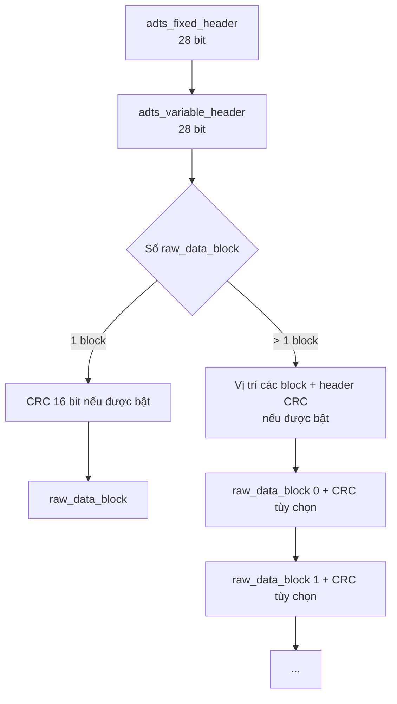
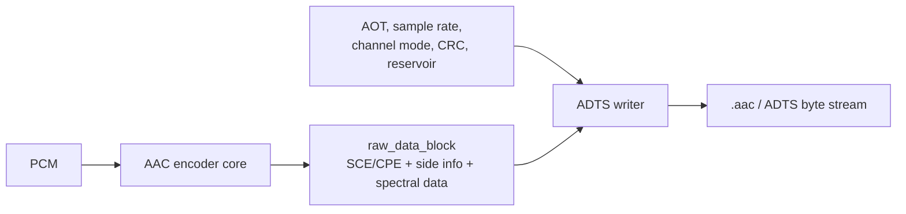

# ADTS trong ISO/IEC 13818-7 và cách áp dụng với FDK-AAC

Tài liệu này trình bày Audio Data Transport Stream (ADTS) dựa trên
ISO/IEC 13818-7:2004, tập trung vào:

- cấu trúc một ADTS frame;
- ý nghĩa và độ rộng từng trường header;
- cách tính chiều dài frame, thời gian và bitrate;
- CRC và trường hợp có nhiều `raw_data_block()`;
- ví dụ tạo và phân tích một header hoàn chỉnh;
- ánh xạ sang bộ ghi ADTS trong FDK-AAC.

Nguồn tiêu chuẩn được sử dụng:

```text
D:\A-lab\AAC\Tài liệu tham khảo\01_Tong_quan_va_tieu_chuan_AAC\
02_Tieu_chuan_MPEG_AAC\book_13818-7.pdf
```

Các phần liên quan trực tiếp trong tiêu chuẩn:

- Điều 6.2, Bảng 4–10: cú pháp ADTS;
- Điều 8.1: định nghĩa và ý nghĩa các trường;
- Bảng 31: giá trị profile;
- Bảng 35: `sampling_frequency_index`;
- Điều 8.5.2 và Bảng 42: cấu hình kênh/loa.

---

## 1. ADTS là gì?

ADTS — Audio Data Transport Stream — là lớp đóng gói một hoặc nhiều
`raw_data_block()` của AAC thành các frame có khả năng tự đồng bộ.


Mỗi ADTS frame lặp lại các thông tin cần để giải mã, chẳng hạn:

- profile AAC;
- tần số lấy mẫu;
- cấu hình kênh;
- chiều dài toàn frame;
- trạng thái bit reservoir;
- thông tin có hay không có CRC.

Nhờ đó decoder có thể:

1. tìm điểm bắt đầu frame bằng `syncword`;
2. bắt đầu giải mã từ giữa luồng;
3. bỏ qua frame lỗi và tìm lại đồng bộ;
4. xác định chính xác vị trí frame tiếp theo.

ADTS không phải thuật toán nén. Dữ liệu AAC đã nén nằm trong
`raw_data_block()`; ADTS chỉ là lớp transport đóng gói bên ngoài.

Trong ISO/IEC 13818-7, ADTS được mô tả như một transport stream không mang
tính quy phạm bắt buộc.

---

## 2. Cấu trúc tổng quát của một ADTS frame

Theo Bảng 5 của tiêu chuẩn:



Fixed header và variable header có tổng độ dài:

$$
28+28=56\ \text{bit}=7\ \text{byte}.
$$

Trường hợp thông dụng nhất là:

```text
7-byte ADTS header
+ 1 raw_data_block
```

Nếu bật CRC và frame chỉ có một raw block:

```text
7-byte ADTS header
+ 2-byte CRC
+ 1 raw_data_block
```

Khi đó phần đứng trước raw payload dài 9 byte.

---

## 3. Fixed header — 28 bit

Theo Bảng 8:

| Trường | Số bit | Ý nghĩa |
|---|---:|---|
| `syncword` | 12 | Luôn bằng `0xFFF` |
| `ID` | 1 | Với MPEG-2 AAC trong tiêu chuẩn này: `1` |
| `layer` | 2 | Luôn bằng `00` |
| `protection_absent` | 1 | `1`: không có CRC; `0`: có CRC |
| `profile` | 2 | Main, LC hoặc SSR |
| `sampling_frequency_index` | 4 | Chỉ số tần số lấy mẫu |
| `private_bit` | 1 | Bit dành cho ứng dụng riêng |
| `channel_configuration` | 3 | Chỉ số cấu hình kênh/loa |
| `original/copy` | 1 | Thông tin bản gốc/bản sao |
| `home` | 1 | Cờ sử dụng tại gia đình |

Tên `protection_absent` có ý nghĩa đảo, vì vậy cần chú ý:

```text
protection_absent = 1  -> CRC không xuất hiện
protection_absent = 0  -> CRC xuất hiện
```

### 3.1. `syncword`

`syncword` là chuỗi 12 bit:

$$
syncword=1111\ 1111\ 1111_2=0xFFF.
$$

Decoder dùng chuỗi này để nhận biết khả năng bắt đầu một ADTS frame. Tuy nhiên,
không nên chỉ tìm mọi chuỗi `0xFFF`, vì chuỗi tương tự có thể xuất hiện trong
payload. Sau khi thấy syncword, parser còn phải kiểm tra các trường khác và xác
nhận `frame_length`.

### 3.2. `ID`

Trong ISO/IEC 13818-7 về MPEG-2 AAC:

```text
ID = 1
```

Trong các luồng MPEG-4 AAC ADTS thường gặp:

```text
ID = 0
```

Do đó hai byte đầu thường có dạng:

```text
FF F9 ... -> MPEG-2 AAC, ID=1, không CRC
FF F1 ... -> MPEG-4 AAC, ID=0, không CRC
```

### 3.3. `layer`

AAC ADTS đặt:

```text
layer = 00
```

### 3.4. `profile`

Theo Bảng 31:

| `profile` | Profile MPEG-2 AAC |
|---:|---|
| `0` | Main |
| `1` | Low Complexity — AAC-LC |
| `2` | Scalable Sampling Rate — SSR |
| `3` | Reserved |

Đối với AAC-LC:

```text
profile = 1 = binary 01
```

Trong FDK, giá trị được tạo theo:

$$
profile=AOT-1.
$$

Vì AAC-LC có `AOT = 2`, nên:

$$
profile=2-1=1.
$$

### 3.5. `sampling_frequency_index`

Theo Bảng 35:

| Index | Tần số lấy mẫu |
|---:|---:|
| `0x0` | 96.000 Hz |
| `0x1` | 88.200 Hz |
| `0x2` | 64.000 Hz |
| `0x3` | 48.000 Hz |
| `0x4` | 44.100 Hz |
| `0x5` | 32.000 Hz |
| `0x6` | 24.000 Hz |
| `0x7` | 22.050 Hz |
| `0x8` | 16.000 Hz |
| `0x9` | 12.000 Hz |
| `0xA` | 11.025 Hz |
| `0xB` | 8.000 Hz |
| `0xC–0xF` | Reserved |

Ví dụ:

```text
AAC 48 kHz -> sampling_frequency_index = 3
AAC 24 kHz -> sampling_frequency_index = 6
```

ADTS trong tiêu chuẩn này không có trường mang trực tiếp một giá trị tần số tùy
ý. Decoder lấy tần số từ bảng tra bằng index.

### 3.6. `channel_configuration`

Theo Điều 8.5.2 và Bảng 42:

| Giá trị | Cấu hình |
|---:|---|
| `0` | Không khai báo trực tiếp; dùng PCE, implicit mapping hoặc thông tin ứng dụng |
| `1` | Mono — một `single_channel_element()` |
| `2` | Stereo — một `channel_pair_element()` |
| `3` | Ba kênh: center + left/right |
| `4` | Bốn loa theo mapping của Bảng 42 |
| `5` | Năm kênh |
| `6` | 5.1 |
| `7` | 7.1 theo mapping MPEG-2 AAC |

Đối với mô hình mono:

```text
channel_configuration = 1 = binary 001
```

Nếu `channel_configuration = 0`, cấu hình kênh có thể được chỉ ra bởi một
`program_config_element()` ở đầu raw block đầu tiên, bởi implicit mapping hoặc
được ứng dụng biết từ bên ngoài bitstream.

---

## 4. Variable header — 28 bit

Theo Bảng 9:

| Trường | Số bit | Ý nghĩa |
|---|---:|---|
| `copyright_identification_bit` | 1 | Một bit của chuỗi copyright 72 bit |
| `copyright_identification_start` | 1 | Đánh dấu bit đầu tiên của chuỗi copyright |
| `frame_length` | 13 | Tổng chiều dài toàn bộ ADTS frame, tính bằng byte |
| `adts_buffer_fullness` | 11 | Trạng thái bit reservoir; `0x7FF` biểu thị VBR |
| `number_of_raw_data_blocks_in_frame` | 2 | Số raw block thực tế trừ đi 1 |

### 4.1. `frame_length`

`frame_length` bao gồm toàn bộ frame:

$$
L_{frame}
=L_{fixed\ header}
+L_{variable\ header}
+L_{CRC/position}
+L_{raw\ data}.
$$

Nói cách khác, `frame_length` không phải chỉ là độ dài AAC payload.

Do trường này có 13 bit:

$$
0\le frame\_length\le8191\ \text{byte}.
$$

### 4.2. `adts_buffer_fullness`

Nếu:

```text
adts_buffer_fullness = 0x7FF
```

thì luồng được đánh dấu là variable-rate và thông tin fullness không áp dụng.

Đối với trường hợp khác, tiêu chuẩn định nghĩa:

$$
adts\_buffer\_fullness
=\left\lfloor
\frac{B_{reservoir\ available}}
{NCC\cdot32}
\right\rfloor.
$$

Trong đó:

$$
NCC
=N_{SCE}
+N_{independent\ CCE}
+2N_{CPE}.
$$

Theo quy ước đặt tên trong tiêu chuẩn, `NCC = A + I`. Với mono chứa một SCE:

$$
NCC=1.
$$

ADTS không có trường bitrate trực tiếp. Bitrate được suy ra từ chiều dài các
frame và thời gian audio mà các frame đại diện.

### 4.3. `number_of_raw_data_blocks_in_frame`

Số raw block thực tế là:

$$
N_{block}=number\_of\_raw\_data\_blocks\_in\_frame+1.
$$

Vì trường có 2 bit nên một ADTS frame có thể mang từ 1 đến 4 raw block.

Trường hợp thông dụng:

```text
number_of_raw_data_blocks_in_frame = 0
=> số block thực tế = 1
```

---

## 5. Nội dung một `raw_data_block()`

Một `raw_data_block()` có thể chứa các phần tử:

- `single_channel_element()` — SCE;
- `channel_pair_element()` — CPE;
- `coupling_channel_element()` — CCE;
- `lfe_channel_element()` — LFE;
- `data_stream_element()` — DSE;
- `program_config_element()` — PCE;
- `fill_element()` — FIL;
- `ID_END` và phần byte alignment.

Theo MPEG-2 AAC, một raw block biểu diễn:

$$
1024\ \text{mẫu PCM trên mỗi kênh}.
$$

Nếu một ADTS frame chứa $N+1$ raw block thì số mẫu được biểu diễn là:

$$
N_{sample}=1024(N+1).
$$

Thời gian của frame:

$$
T_{frame}=\frac{1024(N+1)}{f_s}.
$$

Với một raw block và $f_s=48\ \text{kHz}$:

$$
T_{frame}=\frac{1024}{48000}
\approx21.333\ \text{ms}.
$$

Số frame mỗi giây:

$$
F_{frame}=\frac{48000}{1024}=46.875.
$$

---

## 6. Sắp xếp 7 byte của header không CRC

Với header cơ sở 56 bit, các trường được phân bố như sau:

```text
Byte 0: syncword[11:4]

Byte 1: syncword[3:0]
        ID
        layer[1:0]
        protection_absent

Byte 2: profile[1:0]
        sampling_frequency_index[3:0]
        private_bit
        channel_configuration[2]

Byte 3: channel_configuration[1:0]
        original/copy
        home
        copyright_identification_bit
        copyright_identification_start
        frame_length[12:11]

Byte 4: frame_length[10:3]

Byte 5: frame_length[2:0]
        adts_buffer_fullness[10:6]

Byte 6: adts_buffer_fullness[5:0]
        number_of_raw_data_blocks_in_frame[1:0]
```

### 6.1. Công thức parser

Với `header[0]` đến `header[6]`:

```c
int syncword =
    (header[0] << 4) |
    (header[1] >> 4);

int id =
    (header[1] >> 3) & 0x01;

int protection_absent =
    header[1] & 0x01;

int profile =
    (header[2] >> 6) & 0x03;

int sampling_frequency_index =
    (header[2] >> 2) & 0x0F;

int channel_configuration =
    ((header[2] & 0x01) << 2) |
    ((header[3] >> 6) & 0x03);

int frame_length =
    ((header[3] & 0x03) << 11) |
    ( header[4]         <<  3) |
    ((header[5] & 0xE0) >>  5);

int buffer_fullness =
    ((header[5] & 0x1F) << 6) |
    ((header[6] & 0xFC) >> 2);

int number_of_raw_data_blocks =
    header[6] & 0x03;
```

---

## 7. Ví dụ tạo một ADTS header hoàn chỉnh

Giả sử một frame có cấu hình:

```text
MPEG identifier        = MPEG-2
Profile                = AAC-LC
Sampling rate          = 48 kHz
Channel configuration  = mono
CRC                    = không dùng
Frame length           = 171 byte
Buffer mode            = VBR
Raw blocks             = 1
```

### 7.1. Giá trị từng trường

```text
syncword                         = 0xFFF
ID                               = 1
layer                            = 00
protection_absent                = 1
profile                          = 01
sampling_frequency_index         = 0011
private_bit                      = 0
channel_configuration            = 001
original/copy                    = 0
home                             = 0
copyright_identification_bit     = 0
copyright_identification_start   = 0
frame_length                     = 171
adts_buffer_fullness             = 0x7FF
number_of_raw_data_blocks        = 0
```

### 7.2. Kết quả 7 byte

```text
FF F9 4C 40 15 7F FC
```

Dạng nhị phân:

```text
11111111 11111001 01001100 01000000
00010101 01111111 11111100
```

Phân chia chiều dài:

```text
Tổng ADTS frame = 171 byte
ADTS header     =   7 byte
AAC raw block   = 164 byte
```

### 7.3. Kiểm tra `frame_length`

Với ba byte liên quan:

```text
byte[3] = 0x40
byte[4] = 0x15
byte[5] = 0x7F
```

Ta có:

$$
frame\_length
=((0x40\ \&\ 0x03)\ll11)
+(0x15\ll3)
+((0x7F\ \&\ 0xE0)\gg5).
$$

$$
frame\_length=0+168+3=171\ \text{byte}.
$$

### 7.4. Bitrate tức thời của frame

Bitrate tính cả ADTS header:

$$
R_{frame}
=\frac{frame\_length\cdot8\cdot f_s}
{1024(N+1)}.
$$

Thay số:

$$
R_{frame}
=\frac{171\cdot8\cdot48000}{1024}
=64125\ \text{bit/s}.
$$

Đây là bitrate của frame đang xét. Nếu dùng VBR hoặc bit reservoir, chiều dài
các frame khác có thể thay đổi.

---

## 8. CRC và error protection

### 8.1. Một raw block

Nếu `protection_absent = 0`:

```text
fixed header
variable header
16-bit CRC
raw_data_block
```

CRC bảo vệ header và các vùng được tiêu chuẩn chỉ định trong các audio element.
Các bit `id_syn_ele` không được đưa vào phép tính CRC.

Đối với SCE, CPE, CCE và LFE, CRC bao phủ các phần đầu được chỉ định bởi tiêu
chuẩn. Với CPE, một phần của individual channel stream thứ hai cũng được bảo
vệ. PCE và DSE được bảo vệ đầy đủ. Nếu vùng cần bảo vệ ngắn hơn độ dài quy định,
phép tính CRC sử dụng zero padding.

### 8.2. Nhiều raw block

Nếu frame có nhiều raw block và bật CRC:

```text
fixed + variable header
raw_data_block_position[1]
...
raw_data_block_position[N]
header CRC
raw_data_block 0
CRC block 0
raw_data_block 1
CRC block 1
...
```

Mỗi `raw_data_block_position[i]` rộng 16 bit. Nó là offset tính bằng byte từ
đầu raw block thứ nhất đến đầu raw block thứ `i`.

Nếu giá trị mã hóa là $N$, số block thực tế là $N+1$. Tổng overhead ngoài raw
payload trong trường hợp nhiều block và bật CRC là:

$$
B_{overhead}=7+2N+2+2(N+1)=11+4N\ \text{byte}.
$$

Công thức này áp dụng cho nhánh nhiều raw block. Trường hợp một block sử dụng
cấu trúc CRC riêng với tổng header + CRC bằng 9 byte.

---

## 9. Quy trình parser ADTS

Một parser an toàn nên thực hiện:

1. Tìm khả năng xuất hiện của 12 bit `0xFFF`.
2. Kiểm tra `layer == 0`.
3. Đọc `ID` và `protection_absent`.
4. Kiểm tra `profile` và `sampling_frequency_index` không thuộc giá trị
   reserved.
5. Đọc `channel_configuration`.
6. Giải mã trường `frame_length`.
7. Kiểm tra buffer đầu vào chứa đủ `frame_length` byte.
8. Xử lý CRC và các vị trí raw block nếu có.
9. Đọc từ một đến bốn `raw_data_block()`.
10. Nhảy đến frame tiếp theo bằng:

$$
next\_frame=current\_frame+frame\_length.
$$

11. Xác nhận syncword của frame tiếp theo nếu dữ liệu còn đủ.

Không nên đồng bộ chỉ bằng cách tìm hai byte bắt đầu `FF F?`, vì xác suất nhận
nhầm dữ liệu payload là syncword sẽ cao hơn so với việc kết hợp kiểm tra
`layer`, sampling index, chiều dài và syncword kế tiếp.

---

## 10. So sánh nhanh ADTS và ADIF

| Thuộc tính | ADTS | ADIF |
|---|---|---|
| Vị trí header | Lặp lại ở mỗi frame | Một header ở đầu sequence |
| Random access/resync | Thuận lợi | Không phù hợp để bắt đầu từ giữa luồng |
| Chiều dài frame | Có trường `frame_length` | Không tổ chức theo ADTS frame |
| Streaming | Phù hợp hơn | Phù hợp với file có điểm bắt đầu xác định |
| Overhead | Lặp lại 7 hoặc nhiều hơn byte/frame | Header chỉ xuất hiện một lần |

---

## 11. Ánh xạ sang FDK-AAC

FDK hiện thực bộ ghi ADTS tại
[`libMpegTPEnc/src/tpenc_adts.cpp`](../../../libMpegTPEnc/src/tpenc_adts.cpp).

### 11.1. Khởi tạo

`adtsWrite_Init()` thiết lập:

```text
mpeg_id
layer = 0
protection_absent
profile = aot - 1
sample_freq_index
channel_mode
original = 0
home = 0
copyright fields = 0
num_raw_blocks = nSubFrames - 1
```

FDK cho phép từ 1 đến 4 subframe/raw block trong một ADTS frame.

Trong mã nguồn hiện tại:

```cpp
if (config->flags & CC_MPEG_ID) {
  hAdts->mpeg_id = 0; /* MPEG 4 */
} else {
  hAdts->mpeg_id = 1; /* MPEG 2 */
}
```

### 11.2. Tính overhead

`adtsWrite_GetHeaderBits()` bắt đầu bằng:

```text
fixed header + variable header = 56 bit
```

Sau đó hàm cộng thêm:

- CRC header hoặc CRC cho single raw block;
- bảng vị trí raw block nếu có nhiều block;
- CRC sau từng raw block nếu cần.

### 11.3. Ghi header

`adtsWrite_EncodeHeader()` gọi `FDKwriteBits()` theo đúng thứ tự:

```text
syncword
ID
layer
protection_absent
profile
sampling_frequency_index
private_bit
channel_configuration
original
home
copyright bits
frame_length
buffer_fullness
num_raw_blocks
```

FDK ghi trường chiều dài theo:

```cpp
(frame_length + headerBits) >> 3
```

Điều này cho thấy đối số `frame_length` nội bộ được cộng với overhead transport
trước khi giá trị tổng số byte được đặt vào ADTS header.

### 11.4. Hoàn tất raw block và sửa trường chưa biết trước

Với nhiều raw block, một số thông tin chỉ biết sau khi payload đã được ghi.
`adtsWrite_EndRawDataBlock()` quay lại vùng header để:

- điền `raw_data_block_position[i]`;
- cập nhật tổng `frame_length`;
- ghi header CRC;
- ghi CRC sau từng raw block.

---

## 12. Vị trí ADTS trong pipeline encoder



Quantization và Coding tạo ra phần nội dung của `raw_data_block()`, gồm:

- global gain;
- section/codebook;
- scalefactor;
- spectral Huffman data;
- các tool syntax và fill element liên quan.

ADTS được đóng ở bên ngoài AAC core payload. Vì `frame_length` phụ thuộc độ dài
payload sau cùng, transport writer chỉ có thể hoàn tất header sau khi đã biết số
bit thực tế của frame.

---

## 13. Lưu ý đối với mô hình HE-AAC v1 dự kiến

ISO/IEC 13818-7 mô tả MPEG-2 AAC và không định nghĩa HE-AAC/SBR. Do đó không
được dùng riêng tài liệu này để quyết định:

- cách biểu diễn Audio Object Type 5 — SBR;
- tần số nào phải được đặt vào ADTS header trong chế độ dual-rate;
- explicit hay implicit SBR signalling;
- quan hệ giữa AAC core sample rate và output sample rate của HE-AAC.

Trường `profile` ADTS chỉ có 2 bit, nên không thể trực tiếp chứa mọi MPEG-4 Audio
Object Type. Với HE-AAC v1, cần đối chiếu thêm ISO/IEC 14496-3 và hành vi transport
thực tế của FDK-AAC.

Ví dụ, nếu chỉ xét AAC-LC thuần ở 24 kHz thì Bảng 35 cho:

```text
sampling_frequency_index = 6
```

Nhưng với HE-AAC v1 đầu vào/đầu ra 48 kHz và AAC core dual-rate 24 kHz, không
được tự động ghi index 6 nếu chưa khóa cơ chế SBR signalling và cấu hình FDK.

---

## 14. Tóm tắt các giá trị thường dùng

Với MPEG-2 AAC-LC mono 48 kHz, một raw block, không CRC, VBR:

| Trường | Giá trị |
|---|---|
| `syncword` | `0xFFF` |
| `ID` | `1` |
| `layer` | `0` |
| `protection_absent` | `1` |
| `profile` | `1` — LC |
| `sampling_frequency_index` | `3` — 48 kHz |
| `channel_configuration` | `1` — mono |
| `adts_buffer_fullness` | `0x7FF` — VBR |
| `number_of_raw_data_blocks_in_frame` | `0` — một block |
| Header cơ sở | 7 byte |
| Số mẫu/frame | 1024 mẫu/kênh |
| Thời gian/frame tại 48 kHz | khoảng 21,333 ms |

Với `frame_length = 171`, header ví dụ là:

```text
FF F9 4C 40 15 7F FC
```

