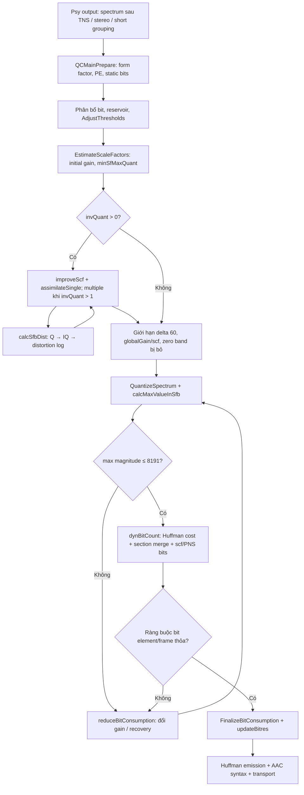
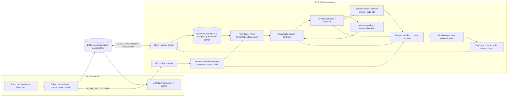
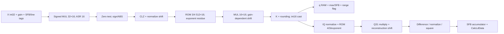
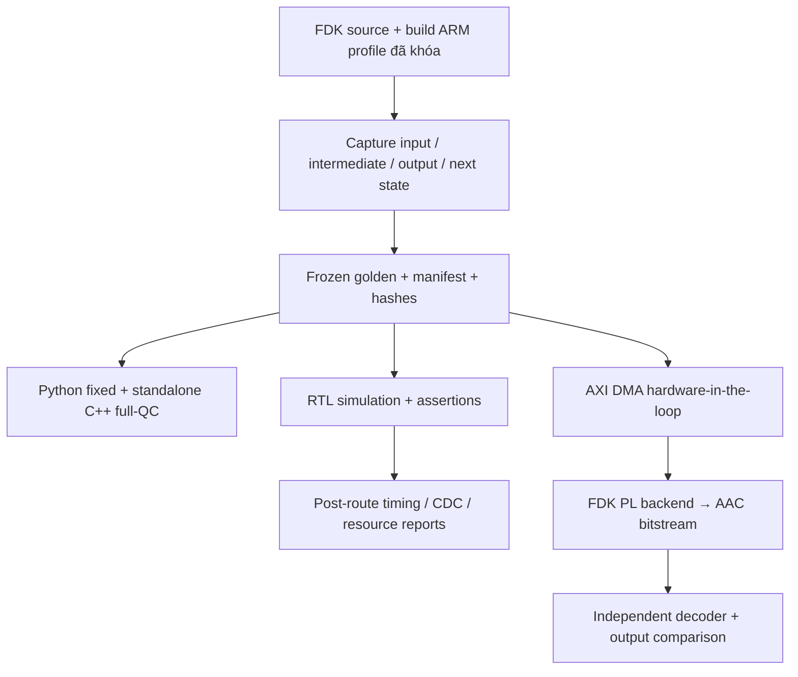

# Quantization AAC-LC: đối chiếu FDK-AAC và lộ trình đưa toàn bộ QC lên PL

Ngày phân tích: **13/09/2026**. Nền tảng mục tiêu: **PYNQ-Z2 / XC7Z020**, theo cấu hình hiện hữu trong `my_workspace`. Báo cáo mới này tổng hợp hiện trạng, mô hình toán, luận chứng hiệu năng, kiến trúc RTL/AXI và kế hoạch kiểm chứng; không thay đổi implementation hay golden đang có.

## 1. Kết luận và phạm vi “toàn bộ Quantization”

**Nên chọn đích cuối là toàn bộ vòng Quantization and Coding control trên PL, với spectrum và trạng thái tìm kiếm lưu tại PL.** QMAX đơn lẻ là mốc phát triển đầu tiên, không phải kiến trúc cuối. Lý do mạnh nhất trong chính project là `scale_factor_estimation` chiếm **47,38%** thời gian lõi encoder, còn `QuantizeSpectrum + max/SFB` chỉ chiếm **4,05%**. Tăng tốc riêng QMAX không xử lý được nút thắt chính.

Tuy nhiên, bằng chứng hiện có **không chứng minh FPGA là điều kiện bắt buộc để chạy thời gian thực mono 48 kHz**: bộ profile lưu trong repo có CPU time trung bình 1,409 ms/frame, thấp hơn chu kỳ frame 21,333 ms. Luận chứng đúng là cần mở rộng phạm vi offload nếu mục tiêu là giảm đáng kể tải Cortex-A9, tăng số luồng và tránh điều khiển từng phép thử qua PS–PL. Chưa có benchmark full-QC PL để khẳng định speedup hay công suất thực tế.

Phạm vi đích được chốt như sau:

| Công việc | Vị trí cuối cùng | Điều kiện để gọi là hoàn thành |
|---|---|---|
| Form factor, PE, bit allocation, threshold adjustment | PL | Bao phủ phần chuẩn bị/điều chỉnh QC của cấu hình AAC-LC đã khai báo |
| Ước lượng gain/scalefactor, improve/assimilate, inverse quantization, distortion | PL | Giữ hành vi fixed-point và thứ tự quyết định của FDK |
| Forward quantization, max/SFB, range check | PL | Có retry khi vượt `MAX_QUANT`, không clip để che lỗi |
| Huffman bit-cost, chọn codebook, greedy section merging, đếm scf/PNS/IS | PL | Số bit và section khớp FDK, không chỉ ước lượng entropy |
| Rate loop, recovery, giới hạn bit, finalization và state reservoir | PL | Không gọi PS trong mỗi vòng thử; state giữa các frame được quản lý đúng |
| Psychoacoustic Model, TNS/MS/IS/PNS analysis phía trước QC | PS | Chuyển spectrum **sau** xử lý Psy cùng metadata sang PL |
| Huffman phát codeword, AAC syntax writer, ADTS/transport, I/O | PS ở mốc full-QC; có lộ trình mở rộng PL | Writer chỉ dùng kết quả QC cuối cùng; không tham gia tìm nghiệm trong vòng lặp |

**Full-QC PL không đồng nghĩa toàn bộ AAC encoder trên PL.** Nếu yêu cầu sau này bao gồm cả “Coding” ở mức phát bitstream, thực hiện thêm bước 10 trong lộ trình. Các bộ đếm syntax cần cho QC vẫn phải nằm trong PL hoặc có input cố định từ descriptor; không được âm thầm chuyển chúng về PS trong từng retry.

Các nhãn bằng chứng dùng xuyên suốt:

- **[SRC]**: đọc/đối chiếu trực tiếp source hiện tại và Git baseline.
- **[RUN]**: kiểm tra Python/source chạy lại ngày 13/09/2026.
- **[ART]**: số đo có sẵn trong repo, không phải benchmark board mới.
- **[EST]**: phép tính, giả thiết hoặc ngân sách thiết kế; chưa phải kết quả RTL/Vivado/HIL.
- **[REF]**: tài liệu bên ngoài, dẫn nguồn tại đoạn sử dụng.

## 2. Baseline, bằng chứng và trạng thái hệ thống

### 2.1. Bản gốc và working tree

Git HEAD cục bộ: `35f9c13cb6df0c5d4e7ba958ef2d251c48b8d1d9`. Đây là mốc đối chiếu của repository FDK-AAC đang dùng; không coi HEAD là snapshot đầy đủ của workspace vì có nhiều thay đổi và file chưa được theo dõi.

**[SRC]** `git diff HEAD` xác nhận bảy file kernel `quantize.cpp`, `sf_estim.cpp`, `adj_thr.cpp`, `dyn_bits.cpp`, `bit_cnt.cpp`, `aacEnc_rom.cpp`, `bitenc.cpp` không đổi so với baseline. Thay đổi trong `qc_main.cpp` là thêm profiler và tách biểu thức gọi hàm thành biến tạm để đo; quantizer vẫn được gọi bằng hàm C gốc, chưa có nhánh dispatch PL.

Vì vậy cần phân biệt:

1. **Encoder FDK trong `libAACenc`**: vẫn có đầy đủ QC phần mềm của thư viện, có instrument đo thời gian.
2. **Implementation riêng trong `my_workspace/quantization_coding/quantization_reference`**: model tách rời cho spectral quantizer; chưa phải bản port đầy đủ của toàn module QC.
3. **RTL trong `my_workspace/window_mdct`**: có source MDCT/FFT và `board/pynq_z2/mdct_axi_lite.vhd`; đó là tài sản của MDCT, không phải Quantization RTL. Không tìm thấy `.v/.sv/.vhd` Quantization trong cây Quantization đã kiểm tra.

Nguồn baseline công khai: [FDK-AAC mirror](https://github.com/mstorsjo/fdk-aac), [AOSP external/aac](https://android.googlesource.com/platform/external/aac/). Các kết luận arithmetic dưới đây dựa trực tiếp vào source cục bộ đã khóa, không dựa vào phiên bản `master` trực tuyến có thể thay đổi.

### 2.2. Kết quả xác minh mới

**[RUN]** Dùng Python 3.11.9, chạy lại 5 unit test hiện hữu và tái thực thi audit trong thư mục scratch riêng; không ghi đè golden hoặc bằng chứng ngày 06/09.

| Kiểm tra | Kết quả ngày 13/09/2026 | Phạm vi chứng minh |
|---|---|---|
| Unit test hiện hữu | **5/5 PASS** | Forward, kích thước ROM, inverse half-scale sơ bộ, inactive-band traversal |
| `zero_long` | 64 slot, 64 active, 0 mismatch | Tái tạo golden bằng Python fixed |
| `smoke_long` | 128 slot, 128 active, 0 mismatch; max magnitude 9 | Tái tạo golden bằng Python fixed |
| `grouped_short_deadzone` | 96 slot, 72 active, 0 mismatch; max magnitude 6 | Group traversal/dead-zone synthetic |
| Tổng vector | **288 slot**, **264 trace**; q, maxima, mask, trace khớp | Chưa phải 288 frame audio; cả ba case đều ngắn hơn 1024 lines |
| ROM source → Python → C++ literals | 6 bảng khớp, kích thước 512/4/4/512/56/56 | Không thay thế dump ROM từ binary ARM |
| WAV/CSV/AAC profile | SHA256 trùng artifact lưu | Xác nhận các file đang phân tích |
| ADTS parser | 454 frame, 77.772 byte; AOT=2, 48 kHz, mono | Kiểm tra cấu trúc; chưa chạy decoder trong phiên này |

Kết quả máy đọc được của lần chạy mới: [`tmp/quantization_review_20260913/results.json`](../tmp/quantization_review_20260913/results.json). Audit gốc được tái dùng từ [`checks.py`](audit_2026-09-06/checks.py), chỉ đổi thư mục đầu ra khi nạp bằng Python. Không build/chạy lại C++ harness, FDK native binary, RTL, Vivado hoặc board trong phiên này. Tuyên bố “FDK 0 mismatch” trong README là thông tin lịch sử; kết quả Python hiện tại là **reproducibility**, không phải kiểm tra lại bằng oracle FDK độc lập.

README đang nói chưa có artifact Cortex-A9 đã lỗi thời so với [`output/z2_profile`](../../pynq_z2/output/z2_profile). Không dùng phần trăm tiến độ trung bình của tài liệu cũ làm mức hoàn thiện full-QC: thiếu các khối control/search là thiếu chức năng, không thể suy ra từ số file hoặc số dòng code.

## 3. Luồng FDK-AAC thực tế và đối chiếu implementation

### 3.1. Block diagram của baseline

Các entry source quan trọng: [`aacenc.cpp`](../../../libAACenc/src/aacenc.cpp), dòng 775–1004; [`qc_main.cpp`](../../../libAACenc/src/qc_main.cpp), các hàm `QCMainPrepare` (436), `QCMain` (789), `reduceBitConsumption` (1135), `calcMaxValueInSfb` (1235), `updateBitres` (1265), `FinalizeBitConsumption` (1299), `crashRecovery` (1411).

Hai vòng cần phân biệt: tìm scalefactor có analysis-by-synthesis trong `sf_estim.cpp`, và vòng kiểm tra range/bit trong `QCMain`. Không được coi tổng số lần quantization là số lần gọi `QuantizeSpectrum` cuối vòng: `calcSfbDist` còn gọi quantize theo từng line trong quá trình thử gain.

### 3.2. Bảng so sánh trực tiếp

| Khối | FDK gốc | Implementation riêng hiện có | Mức hoàn thiện và nút thắt |
|---|---|---|---|
| Forward spectral quantizer | `quantize.cpp:119`, `:286`; nhân fixed-point, CLZ, ROM, shift, rounding, cast SHORT | `quantization_fixed.py:quantize_line`, `quantize_spectrum`; C++ `QuantizeLine`, `QuantizeSpectrum` bám cùng trình tự | Model có độ chi tiết tốt; thiếu xác nhận độc lập toàn miền/target. 2 phép nhân cho mỗi line đi vào nhánh khác zero, cộng CLZ/lookup/shift |
| Geometry/SFB | Active bands theo `sfbCnt`, `sfbPerGroup`, `maxSfbPerGroup`, offsets | Có grouped walker, active mask, trace | Hỗ trợ traversal; grouped-short synthetic chưa chứng minh đầy đủ frame tám short windows thực |
| Max magnitude/SFB | Hàm riêng trong `qc_main.cpp`, quét lại q | Model gộp max khi quantize | Đây là tối ưu quét bộ nhớ có ích; inactive maxima cần giữ semantics khi tích hợp |
| Inverse quantizer | `quantize.cpp:199`; ROM 4/3, exponent/mantissa, half-scale | Có Python/C++ helper | Chưa có direct FDK inverse oracle; test hiện hữu chỉ kiểm tra gần đúng một điểm |
| Fixed-point distortion/energy | `calcSfbDist`, `calcSfbQuantEnergyAndDist`: IQ, difference, normalize, square, reduce, `CalcLdData` | Float có `band_distortion`; chưa có bản port fixed-point hoàn chỉnh | Thiếu khối quan trọng của Afterburner và golden RTL |
| Form factor/PE/threshold | `CalcFormFactor`, `peCalculation`, `AdjustThresholds`, state liên frame | Chủ yếu tài liệu; dùng implementation FDK trên PS | Sqrt, log, quét SFB và quyết định threshold chưa được chuyển |
| Chọn scalefactor | `improveScf`, `assimilateSingleScf`, hai multiple routines, min/max/delta constraints | Float `search_band_gain` duyệt gain từ -80 đến 255 | **336 thử gain độc lập theo band** trong float không phải port thuật toán FDK; không tính đầy đủ scf side bits/quan hệ lân cận |
| Gain normalization | `sf_estim.cpp:1046–1277`; seed gain → `globalGain` và `scf`; sửa spectrum tại band bỏ | Model nhận gain/scf có sẵn | Không tự tạo đầu vào QC từ threshold; chưa là quantizer tự điều khiển |
| Range/retry/bit reservoir | `QCMain`, `reduceBitConsumption`, `crashRecovery` | `strict_range` chủ yếu ném exception | Chưa có vòng tự tìm nghiệm hợp lệ, state reservoir, minimum/maximum bit demand |
| Huffman/coding | `bit_cnt.cpp`, `dyn_bits.cpp`: 11 spectral books, zero book, sign/escape, sectioning, scf/noise | Chưa có standalone implementation tương ứng | Thiếu cả datapath cost và bộ điều khiển section |
| Bitstream | `bitenc.cpp`, transport library | Encoder gốc làm trên PS | Không có custom hardware emission/packing |
| RTL/AXI/backend | FDK gốc là phần mềm | Quantization chưa có RTL/AXI/HIL | Model ready cho prototype forward; full-QC reference và hardware chưa hoàn tất |

Source riêng: [Python fixed](../quantization_reference/python_ref/quantization_fixed.py), [Python float](../quantization_reference/python_ref/quantization_float.py), [C++ reference](../quantization_reference/cpp_ref/quantization_ref.cpp), [FDK harness](../quantization_reference/tools/fdk_quant_harness.cpp), [verification](../quantization_reference/verification/compare_models.py).

### 3.3. Những sai lệch contract/verification phải xử lý

1. **Signed multiply trước ABS.** FDK nhân số có dấu rồi arithmetic-shift/truncate, sau đó mới lấy magnitude. Model đang làm đúng; sơ đồ ABS trước multiplier trong `hardware_mapping.md` có thể dẫn RTL sai. Counterexample **[RUN]**: `gain=-40`, `x=1048573` cho `q=0`, nhưng `x=-1048573` cho `q=-1`; intermediate lần lượt 262143 và -262144. Không áp dụng đối xứng lẻ tuyệt đối cho fixed-point.
2. **MAX_QUANT là ràng buộc QC, không phải lệnh saturation của kernel.** **[RUN]** `x=2147483647`, `gain=-76` cho `q=19470`, `total_shift_after=0`; default model ném lỗi >8191. RTL cần trả q/max/range flag để controller tăng gain. Phân biệt trường hợp này với shift âm vi phạm tiền điều kiện arithmetic. C++ CLI hiện chưa có tùy chọn xuất retry-domain như Python CLI.
3. **Inverse domain.** Output IQ FDK ở half-scale; distortion so với `mdctSpectrum >> 1`. Cộng/square/log cùng width/shift mới tái tạo FDK; dùng MSE float trực tiếp sẽ sai ngưỡng quyết định.
4. **Gain width.** `globalGain`, `scf`, gain nội bộ là INT; có gain âm. Không dùng 8-bit unsigned vì thấy `global_gain` syntax dài 8 bit. Giữ INT32 ở descriptor v1; chỉ thu hẹp RTL sau range proof.
5. **Untouched state.** Walker gốc chỉ chạm active SFB. Output mới khởi tạo zero trong model không tự tương đương với buffer FDK dùng lại. Kiểm thử sentinel cho q và maxima; driver phải copyback đúng active ranges hoặc trả mutation mask.
6. **Checker chưa đủ điều kiện sign-off.** `compare_models.py` cho `exact_match=true` khi q khớp dù thiếu max/mask/trace; `summary.json` chưa được kiểm tra. Đã tái hiện lại bằng thư mục chỉ có q. Bắt buộc field theo từng profile DUT; không yêu cầu trace nội bộ ở backend không xuất trace.
7. **Golden chưa độc lập.** `run_regression.py` tự sinh lại expected, `--cpp` và `--fdk` đều optional; chạy không có backend vẫn có thể exit 0. Generator còn ghi provenance verified-through-FDK dù lần chạy không gọi FDK. Tách generate khỏi verify, khóa hash expected, ghi rõ PASS/FAIL/SKIP.
8. **Coverage còn hẹp.** Max q hiện chỉ 9; chưa đủ cho escape book 11, ±8191, near-boundary, recovery, real 1024-line frame và cross-frame reservoir. Harness tự tính maxima, không gọi hàm max thật của `qc_main.cpp`; cần oracle cho cả Q và max.

## 4. Mô hình toán và arithmetic dùng cho RTL

### 4.1. Quantization, reconstruction và bài toán tối ưu

Đặt $X_i$ là mantissa int32 đầu vào thực tế tại QC; $x_i=X_i/2^{31}$, không tự coi đó là MDCT chưa qua Psy. Với SFB $b$:

$$
g_b=G-s_b,\qquad \Delta_b=2^{g_b/4}.
$$

Mô hình số thực của quantizer đang dùng trong project:

$$
q_i=\operatorname{sgn}(x_i)
\left\lfloor |x_i|^{3/4}2^{-3g_b/16}+\rho\right\rfloor,
\qquad
\rho=\begin{cases}0.4054 & \text{normal},\\0.23 & \text{dead-zone}.\end{cases}
$$

$$
\widehat{x}_i=\operatorname{sgn}(q_i)|q_i|^{4/3}2^{g_b/4},\qquad
D_b=\sum_{i\in b}(x_i-\widehat{x}_i)^2,
\qquad \mathrm{NMR}_b=10\log_{10}\frac{D_b}{T_b}.
$$

Đây là mô hình toán để giải thích; LUT/truncation của fixed-point không bảo đảm cho cùng output ở mọi ngưỡng. $T_b$ và $D_b$ phải cùng miền scale. Đối với band bị PNS/IS thay thế, dùng semantics của tool tương ứng, không áp công thức spectral thông thường một cách máy móc.

Bài toán khái niệm:

$$
\min_{\{g_b,c_b,\mathcal S\}}\sum_b w_bD_b
\quad\text{với}\quad
B_{\mathrm{spec}}+B_{\mathrm{scf}}+B_{\mathrm{section}}
+B_{\mathrm{tools}}+B_{\mathrm{static}}\le B_{\mathrm{available}},
\quad \max_i|q_i|\le8191.
$$

$c_b$ là codebook, $\mathcal S$ là phân chia sections. FDK dùng heuristic có state, không giải tối ưu toàn cục biểu thức này; tăng gain làm bước lượng tử thô hơn nhưng số bit sau Huffman/sectioning không được giả định giảm nghiêm ngặt ở mọi bước.

### 4.2. Forward fixed-point chính xác cho nhánh 32×16

Với `ARCH_PREFER_MULT_32x16`, gọi $Q[r]$, $E[r]$ là ROM Q15 và $M[j]$ là ROM 3/4 Q15. Ký hiệu ASR là dịch phải số học và wrap là lấy lại width two’s-complement:

$$
r=(-g_b)\mathbin{\&}3,\qquad
a=\operatorname{wrap}_{32}\!\left(\operatorname{ASR}(X_iQ[r],16)\right).
$$

Nếu $a=0$, trả zero. Nếu không:

$$
\begin{aligned}
\ell&=\operatorname{CLZ}_{32}(|a|)-1,\qquad n=|a|\ll\ell,\\
j&=(n\gg21)\mathbin{\&}511,\\
u&=\operatorname{ASR}(-g_b,2)+2-\ell,\\
p&=M[j]E[u\mathbin{\&}3],\\
d&=12-3\operatorname{ASR}(u,2),\qquad d\ge0,\\
q_i&=\operatorname{wrap}_{16}\left[
\operatorname{sgn}(a)\left((K+\operatorname{ASR}(p,\min(d,31)))\gg15\right)\right].
\end{aligned}
$$

$K=13284$ normal hoặc $7536$ dead-zone. ROM 3/4 có 512 entry; index 9 bit. Công thức mask 511 ở trên tương đương mask `~MANT_SIZE` trong source **trong miền normalized hợp lệ**. Không thay signed ASR bằng phép chia truncate-to-zero.

Giai đoạn đầu cần product đầy đủ signed 48 bit cho 32×16; giai đoạn sau product signed 32 bit cho 16×16. Không bỏ bit thấp trước khi xác định đúng vị trí truncate. `fMult` Q31 của helper hiện tại có semantics:

$$
\operatorname{fMult}(a,b)=\operatorname{wrap}_{32}
\left[\operatorname{ASR}(ab,32)\ll1\right],
$$

không tự thay bằng $(ab)\gg31$ vì có thể khác 1 LSB.

### 4.3. Inverse, distortion, scalefactor và reservoir

**[SRC]** `FDKaacEnc_invQuantizeLines` dùng ROM 4/3 gồm 512×32 bit và bảng exponent theo `gain & 3`, `specExp`. Miền giải thích của output raw:

$$
X_{i,\mathrm{IQ}}\approx 2^{30}\widehat{x}_i,
\qquad e_i=\left|\,|X_{i,\mathrm{IQ}}|-|X_i\gg1|\,\right|.
$$

`calcSfbDist` normalize $e_i$, dùng `fPow2`, dịch scale, cộng theo thứ tự FDK rồi gọi `CalcLdData`; `LD_DATA_SHIFT=6`, tức biểu diễn log2 có scale 1/64. Không suy ra đây là accumulator MSE 64-bit thông thường. Nếu mở rộng accumulator RTL để tránh overflow, vẫn phải tái tạo chính xác các điểm narrowing của baseline.

Form factor và seed scalefactor có ý nghĩa gần đúng:

$$
F_b\propto\sum_{i\in b}\sqrt{|x_i|},\qquad
g_b^{(0)}\approx
\left\lfloor8.8585\big[\log_{10}(6.75T_b)-\log_{10}(F_b)\big]\right\rfloor.
$$

Các hằng scale `FORM_FAC_SHIFT`, `0.09375` và log-domain conversion phải giữ theo `sf_estim.cpp`, không triển khai seed bằng công thức float này để sign-off. FDK còn tính `minSfMaxQuant`, cải thiện gain theo distortion, assimilate các SFB và giới hạn chênh lệch scf bằng 60. Khi `invQuant=2`, hai routine multiple cũng hoạt động; đó là phần reference riêng hiện chưa có.

Mapping sang syntax ở `bitenc.cpp:158–166`:

$$
\mathrm{global\_gain}_{\mathrm{syntax}}
=G-s_{\mathrm{first}}+100-4(\mathrm{LOG\_NORM\_PCM}-\mathrm{mdctScale}).
$$

Vì thế internal $G$ không phải trường 8-bit `global_gain` trên bitstream. Việc Psy đổi `mdctScale` phải được phản ánh ở output descriptor.

Mô hình reservoir khái niệm giữa frame:

$$
B_{\mathrm{avg}}=R_b\frac{N}{f_s},\qquad
V_{t+1}=V_t+B_{\mathrm{avg},t}-B_{\mathrm{used},t}.
$$

Ví dụ 64 kb/s, 48 kHz, $N=1024$: $B_{\mathrm{avg}}=1365.333$ bit/frame; padding, transport, fill, giới hạn reservoir và phân bổ element quyết định ngân sách nguyên thực tế. RTL phải port `AdjustBitrate`/padding state và update của FDK, không chỉ clamp phương trình khái niệm này.

## 5. Luận chứng định lượng cho full-QC PL

### 5.1. Profile đang có: nút thắt nằm ở đâu?

Nguồn **[ART]**: [CSV](../../pynq_z2/output/z2_profile/encoder_profile.csv), [manifest](../../pynq_z2/output/z2_profile/manifest.txt), [SHA256SUMS](../../pynq_z2/output/z2_profile/SHA256SUMS). Manifest ghi `armv7l`, kernel Xilinx 6.6.10, CPU affinity 1, bitrate 64000, Afterburner=1. WAV được đọc lại: mono PCM16 48 kHz, 462848 mẫu, dài 9,6427 s. Đường dẫn trong SHA256SUMS chứa mốc `20260827T065218Z`; không coi ngày viết báo cáo là ngày benchmark.

| Khối | Trung bình µs/call | Max µs/call | % frame |
|---|---:|---:|---:|
| `frame_total` | 1409,435 | 1937,932 | 100,000 |
| `window_mdct` | 143,368 | 211,027 | 10,172 |
| `qc_prepare` | 81,996 | 135,951 | 5,818 |
| `qc_total` | 865,959 | 1381,791 | 61,440 |
| ↳ `adjust_thresholds` | 56,651 | 90,499 | 4,019 |
| ↳ `scale_factor_estimation` | **667,795** | **1156,966** | **47,380** |
| ↳ `quantize_and_max_sfb` | **57,097** | 107,372 | **4,051** |
| ↳ `huffman_bit_count` | 60,984 | 106,443 | 4,327 |
| `qc_finalize` | 4,410 | 8,148 | 0,313 |
| `bitstream_write` | 41,194 | 70,646 | 2,923 |

Tất cả các dòng trên trong CSV có 454 calls và 1 call/frame. Các dòng thụt mũi tên nằm **bên trong `qc_total`**, không cộng lại với parent. Tổng `prepare + total + finalize` là **952,365 µs/frame = 67,571%**; scalefactor lớn hơn QMAX khoảng **11,70 lần**. Max của từng block không xảy ra nhất thiết cùng frame, nên không cộng các cột max để tuyên bố worst-case hệ thống.

`thread_cpu_time` không tính thời gian thread bị scheduler dừng hoặc ngủ chờ DMA. `frame_total` không bao gồm toàn bộ đọc WAV/ghi file. Manifest chưa khóa compiler, CPU governor/frequency, hash binary và toàn working-tree; không có repeated runs, percentile hoặc histogram vòng tìm kiếm. Đây là bằng chứng định hướng có giá trị, chưa phải WCET/latency certification.

### 5.2. Amdahl: vì sao không dừng ở QMAX

Với tỷ lệ offload $p$, speedup nội bộ $s$, overhead giao tiếp $T_o$:

$$
S=\frac{T_0}{T_0(1-p)+T_0p/s+T_o}.
$$

| Phạm vi offload | Tỷ lệ CPU time loại bỏ tối đa | Trần speedup khi PL và giao tiếp bằng 0 |
|---|---:|---:|
| QMAX | 4,051% | **1,042×** |
| Chỉ `qc_total` | 61,440% | **2,593×** |
| Toàn QC: prepare + main + finalize | 67,571% | **3,084×** |
| QC cùng MDCT | 77,743% | **4,493×** |

Các trần là **[EST] từ profile hiện tại**, không phải tốc độ phần cứng đạt được. Nếu còn giữ một phần `qc_prepare` trên PS, phải trừ đúng phần đó khỏi $p$.

Ví dụ full-QC có $s=8$, overhead tổng 50 µs/frame: $S\approx2.251$; với $s=10$, $S\approx2.340$. Để full-QC đạt **3×** trong khi MDCT vẫn giữ nguyên, toàn bộ compute PL cộng overhead chỉ được khoảng **12,742 µs/frame**. Ngân sách này rất chặt, nên không đặt “3× chắc chắn” làm cam kết trước đo.

Nếu chỉ offload QMAX, thời gian service tổng phải nhỏ hơn **57,097 µs** mới có lợi trên trung bình của bộ mẫu hiện tại. Service 60 µs đã làm speedup khoảng 0,998×. Dùng tỷ lệ 47,38% để quảng bá lợi ích QMAX là tính sai boundary.

### 5.3. Chi phí tính toán và mức song song có thể khai thác

Gọi $A\le1024$ là số lines active/channel, $C$ là số channel, $S\le60$ là số grouped SFB theo cấu hình bộ nhớ FDK hiện tại; $R$ là số lượt quét QMAX; $K_b$ là số phép thử distortion của band $b$.

$$
W_{\mathrm{QMAX}}=O(CRA),\qquad
W_{\mathrm{search}}=O\!\left(C\sum_b K_bA_b\right)
+W_{\mathrm{assimilation}}.
$$

Mỗi nonzero line của QMAX cần nhân 32×16, CLZ/normalize, LUT và nhân 16×16 rồi shift/round. Một lượt 1024 lines không-zero có **2048 phép nhân forward**, trước khi cộng max reduction. Distortion trial còn có IQ, nhân 32×32, square/scale và accumulator; `calcSfbDist` xử lý theo từng line và `CalcLdData` ở cuối band. Đưa chỉ lượt QMAX cuối cùng lên PL bỏ lại những lần quantize tốn kém nằm trong search.

Huffman bit-cost có tối đa 12 cột gồm zero book và 11 spectral books; LUT/cost có thể song song theo book. Greedy merge lại có phụ thuộc giữa các section: mỗi lần merge phải chọn lợi ích lớn nhất và sửa hàng xóm. Với $S$ bands, phần scan chọn merge có thể bậc $O(S^2)$ trong cách triển khai tuần tự; $S$ nhỏ hơn 1024 nhưng critical path quyết định cần FSM hoặc comparator tree có đăng ký.

`aacenc.cpp:717–731` đặt `invQuant=2` khi useRequant bật, và `maxIterations=5` cho nhánh không low-delay. **5 là mốc retry trước crash recovery, không phải số phép thử distortion và không phải WCET toàn QC.** CSV 1 call/frame của QMAX không đo $K_b$; cần counter riêng cho search và recovery trước chốt cycle budget.

### 5.4. PS–PL: bandwidth nhỏ, giao dịch nhỏ lặp lại mới đáng ngại

Chỉ tính spectrum raw, một lượt QMAX cần:

$$
D_{\mathrm{in}}=4N=4096\ \mathrm{B},\quad
D_{\mathrm{out}}=2N=2048\ \mathrm{B},\quad
D_{\mathrm{roundtrip}}=6144\ \mathrm{B/channel}.
$$

Ở 48 kHz/1024, frame rate là 46,875 frame/s. **[EST]** Các mức $R$ dưới đây là tình huống giao tiếp minh họa, không phải số lượt đo được hoặc giới hạn retry FDK:

| Số lượt gửi/nhận toàn spectrum $R$ | Mono MB/s, decimal | Stereo MB/s | Dữ liệu stereo mỗi frame |
|---:|---:|---:|---:|
| 1 | 0,288 | 0,576 | 12 KiB |
| 4 | 1,152 | 2,304 | 48 KiB |
| 8 | 2,304 | 4,608 | 96 KiB |

Zynq-7000 có bốn HP interfaces 64-bit; chọn một đường 64-bit chạy 100 MHz cho thiết kế này cho trần lý thuyết **800 MB/s** trước hiệu suất bus/DDR. Thông số cổng từ [AMD UG585, HP DMA](https://docs.amd.com/r/en-US/ug585-zynq-7000-SoC-TRM/PL-DMA-via-AXI-High-Performance-HP-Interface); 100 MHz là giả thiết thiết kế, không phải throughput board đã đo. Không cộng bốn cổng để giả định DDR đạt 3,2 GB/s hữu ích.

Như vậy **không có bằng chứng bão hòa bandwidth HP** với một luồng AAC mono/stereo. Chi phí đáng quan tâm là setup DMA, cache maintenance, copy, interrupt/wait và vòng phụ thuộc buộc CPU chờ:

$$
T_{\mathrm{hybrid}}\approx
\sum_{j=1}^{J}\left(T_{\mathrm{setup},j}+T_{\mathrm{cache},j}
+\frac{D_j}{B_{\mathrm{eff}}}+T_{\mathrm{PL},j}+T_{\mathrm{sync},j}\right).
$$

Ví dụ **[EST]**, nếu $B_{\mathrm{eff}}=100$ MB/s, truyền 6144 B mất 61,44 µs; thêm 20 µs setup/cache/sync đã thành **81,44 µs trước compute**. Ở 400 MB/s, hai khoản thành **35,36 µs trước compute**. Cả 100/400 MB/s và 20 µs là điểm khảo sát, phải thay bằng microbenchmark trên board.

Nếu một thiết kế gửi lệnh từng SFB/trial, giả sử 60 bands × 8 trials = **480 transactions/channel/frame**. Với overhead giả định 5 µs/transaction, riêng overhead đạt **2,4 ms**; 20 µs thành 9,6 ms. Đây không phải workload đã đo, nhưng cho thấy boundary quá nhỏ có thể xóa lợi ích arithmetic. Giữ spectrum ở PL mà vẫn PS điều khiển từng trial giảm byte, nhưng chưa loại được chuỗi chờ này.

Với full-QC PL:

$$
D_{\mathrm{full}}=C(4N+M_{\mathrm{in}}+2N+M_{\mathrm{out}}),
\qquad J\approx1\ \text{job/frame},
$$

không nhân theo số vòng tìm kiếm. Nếu **tạm dành** $M_{\mathrm{in}}=M_{\mathrm{out}}=2$ KiB/channel, tổng là **10 KiB/channel/frame**, tương đương 0,480 MB/s mono hoặc 0,960 MB/s stereo. Đây là envelope để lập ngân sách; serialize đủ tool metadata/state có thể làm gói lớn hơn. Spectrum/trial q/cost/section trung gian đều ở BRAM. Không bắt buộc full-QC dùng ít byte hơn QMAX khi $R=1$: ưu thế chính là chuyển đúng workload và bỏ round-trip trong search.

### 5.5. Độ trễ và điều kiện ra quyết định

$$
T_{\mathrm{frame}}=\frac{1024}{f_s}
=\begin{cases}21.333\ \mathrm{ms},& f_s=48\ \mathrm{kHz},\\23.220\ \mathrm{ms},& f_s=44.1\ \mathrm{kHz}.\end{cases}
$$

CPU time lõi trung bình của mẫu hiện tại tương ứng khoảng **6,61% một core ở mono 48 kHz**. Đây không phải tổng tải process/system hay bảo đảm không drop frame. Đưa QC lên PL giảm processing latency và giải phóng CPU; không làm mất window overlap/look-ahead hoặc frame duration vốn có của AAC-LC.

**Quyết định kỹ thuật:** triển khai full-QC theo từng gate vì QMAX-only có trần lợi ích thấp và search có thể tái dùng datapath cùng dữ liệu cục bộ. **Điều kiện kiểm chứng lợi ích:** trên cùng corpus/config, service PL cả DMA phải thấp hơn CPU scope thay thế; p99/max latency phù hợp deadline; CPU time hệ thống giảm; tài nguyên/timing của overlay gộp MDCT+QC đạt. Không khẳng định tiết kiệm năng lượng khi chưa đo power: CPU idle hơn không tự chứng minh tổng PS+PL tiêu thụ ít hơn.

## 6. Kiến trúc full-QC trên PL

### 6.1. Block diagram hệ thống đích

Diagram biểu diễn dataflow logic; controller không chạy lại toàn scalefactor search trong mỗi gain retry nếu FDK không làm như vậy. State `calculateQuant` và channel constraints quyết định phần nào phải recompute. Output phải có đủ mutation/state cho FDK writer, không chỉ q.

**Không nối thẳng MDCT RTL sang quantizer để bỏ PS.** `psy_main.cpp` còn rescale, TNS, grouping, PNS/MS/IS; QC cần spectrum đã biến đổi và threshold đồng bộ. Giai đoạn hiện tại vẫn có PL-MDCT → PS-Psy → PL-QC. Chỉ ghép đường stream trực tiếp khi các tác động Psy đã được triển khai/đồng bộ tương đương.

### 6.2. Datapath và pipeline

Đích đầu tiên là **1 line/clock khi không stall**, sau khi pipeline đầy; latency nhiều stage không mâu thuẫn II=1. Tách register tại multiplier, CLZ/barrel-shifter, BRAM-ROM output và reduction. Tags `frame_id/channel/sfb/line/last_in_sfb/candidate_id` đi cùng dữ liệu qua mọi stage; stall phải giữ cả payload lẫn tags.

Không cache $|x|^{3/4}$ trước gain như một biến đổi đại số để mặc định bit-exact: thứ tự signed multiply/truncate và LUT index FDK phụ thuộc gain. Có thể cache kết quả của **đúng bộ khóa** `(spectrum_version, band, gain, dzone, arithmetic_profile)`; invalidate khi zeroing/recovery sửa spectrum. Ban đầu chạy tuần tự giữ thứ tự quyết định, sau đó tối ưu cache khi có trace chứng minh.

DSP48E1 có multiplier **25×18**, nên không mặc định 32×16 chỉ dùng một DSP; có thể cần tách partial products hoặc time-multiplex. 32×32 và square cũng cần mapping thực tế. Thông số primitive từ [AMD UG479](https://docs.amd.com/api/khub/documents/gu4oRPFEh_Pm2uaAlfY6Kg/content). Mức dùng DSP chỉ được chốt bằng synthesis, không suy ra từ số dấu nhân trong C.

### 6.3. Memory, state và ngân sách tài nguyên

**[EST]** Dự toán logical storage cho stereo, $N=1024,S=60$, trước mapping BRAM:

| Vùng | Phép tính | Dung lượng |
|---|---:|---:|
| Spectrum working | 2×1024×4 | 8 KiB |
| Spectrum snapshot để rollback/fallback | 2×1024×4 | 8 KiB |
| q accepted | 2×1024×2 | 4 KiB |
| q candidate | 2×1024×2 | 4 KiB |
| 8 mảng SFB int32/channel, ví dụ threshold/gain/dist/minScf | 2×60×8×4 | 3,75 KiB |
| Cost table, 12 columns/SFB | 2×60×12×4 | 5,625 KiB |
| ROM forward/inverse chính | 512×2 + 512×4 | 3 KiB |
| Hai bảng exponent 56 entry và Q/E | 56×4×2 + 8×2 | 464 B với serialization 32-bit exponent |

Tổng các hàng là khoảng **36,83 KiB**, chưa gồm PE/adj-threshold state bổ sung, section structures, control ROM, Huffman tables, FIFO và DMA. IQ có thể stream vào accumulator để không cần lưu thêm 8 KiB reconstructed spectrum. Cấu hình vật lý và số cổng RAM có thể làm số BRAM lớn hơn dung lượng lý thuyết.

XC7Z020 có 53.200 LUT và 140 BRAM36 theo [AMD DS190](https://www.amd.com/content/dam/xilinx/support/documents/data_sheets/ds190-Zynq-7000-Overview.pdf). Không dùng tổng tài nguyên chip như số tài nguyên còn trống: phải lấy utilization overlay MDCT+DMA hiện tại rồi trừ đi. Đặt ngân sách khảo sát ban đầu cho QC **≤40 BRAM36, ≤64 DSP, ≤12.000 LUT** là **mục tiêu cấp phát**, không phải estimate đã synthesize hoặc bảo đảm thiết kế fit. Nếu vượt ngân sách, ưu tiên sharing và giảm số lanes trước khi thay arithmetic golden.

Tổ chức bank theo channel và accepted/candidate để không copy toàn frame sau từng thử. Chọn pointer/swap khi candidate được chấp nhận; lưu thông tin undo cho sửa từng band. State reservoir và threshold adaptation được commit theo frame order; ping-pong cho DMA không cho phép hai frame dùng cùng reservoir đầu vào rồi commit tùy ý.

### 6.4. Cycle model để chốt pipeline

Với datapath II=1, latency pipeline $L$, băng active $A$:

$$
T_Q\approx\frac{A+L+S\,c_{\mathrm{boundary}}+c_{\mathrm{stall}}}{f_{\mathrm{PL}}}.
$$

Một lượt 1024 lines tại 100 MHz có phần stream tối thiểu **10,24 µs/channel**, chưa tính setup/flush/stall. Nếu datapath Q→IQ→D cũng đạt II=1, giả sử 8 trial/band và 12 cycles overhead/trial/band:

$$
C_D=8(1024+60\times12)=13952\ \text{cycles},
\qquad T_D=139.52\ \mu s/channel.
$$

Đây là **[EST] minh họa**, không phải dự báo độ trễ toàn QC: chưa có PE/sqrt/log, assimilation, cost/merge, retry/recovery, DMA. Cũng không khẳng định mọi band có 8 trials. Cycle model cuối phải dùng histogram thực tế và bound từng FSM; ghi riêng `cycles_compute`, `cycles_stall`, `trial_count`, `lines_evaluated`, `merge_count`, `retry_count`.

## 7. Giao tiếp AXI và tích hợp FDK

### 7.1. Bus và protocol

Chọn **AXI4-Lite** cho cấu hình/status; **AXI DMA + AXI4-Stream** cho frame payload, memory side vào **S_AXI_HP0**. CPU dùng M_AXI_GP0 để truy cập control. Không gửi 1024 mẫu bằng hàng nghìn MMIO write. Cấu trúc MM2S/S2MM, mode simple/SG, clock/reset theo [AMD PG021](https://docs.amd.com/r/en-US/pg021_axi_dma).

| Offset đề xuất | Thanh ghi | Quy ước |
|---:|---|---|
| 0x00 | `ID_VERSION` | ABI major/minor + build identifier |
| 0x04 | `CONTROL` | START, ABORT, SOFT_RESET; START bị từ chối khi BUSY |
| 0x08 | `STATUS` | BUSY, DONE, ERROR, RANGE_RETRY, TIMEOUT; sticky flags clear W1C |
| 0x0C | `FRAME_ID` | Gắn job và result; không dùng để cho phép reorder reservoir |
| 0x10 | `PROFILE` | AAC-LC mode, channel count, invQuant, dzone, tool capability |
| 0x14 | `INPUT_BYTES` | Kiểm tra packet length |
| 0x18 | `OUTPUT_CAPACITY` | Chặn ghi quá bộ đệm |
| 0x1C | `WATCHDOG_CYCLES` | Bound lỗi; không thay điều kiện hội tụ thuật toán |
| 0x20 | `ERROR_CODE` | Geometry / unsupported mode / arithmetic / protocol / recovery fail |
| 0x24 | `OUTPUT_BYTES` | Byte count thực tế |
| 0x28–0x3C | Counters/IRQ | Compute, stall, trial, retry, IRQ enable/status; có thể mở rộng ABI |

Địa chỉ DDR và transfer length của DMA cấu hình trong **register map của AXI DMA**, không nhập nhằng với register accelerator ở bảng trên. Descriptor byte order little-endian; payload numeric có width xác định, không memcpy nguyên struct C chứa pointer/padding sang PL.

Input descriptor gồm: magic/version/frame_id, N/channels/AOT/sample rate/bitrate, window/group layout, `mdctScale`, active offsets, spectrum; energy/threshold/minSnr/spreadEnergy và các trường PE/adj-thr thực sự đọc; TNS/MS/PNS/IS decisions/noiseNrg/isScale; channel-element mapping, bit limits, transport/extension overhead và state initialization/version. Không giả định chỉ spectrum/scf là đủ cho full-QC.

Output gồm: final q, gain/scf, maxima/range, section boundaries/codebooks, bit breakdown, tool fields có thay đổi, spectrum mutation mask hoặc các band cần zero, reservoir/adj-thr next state, status/counters. Ở bản debug xuất thêm trace; production chỉ xuất kết quả cuối. Lập bảng field-by-field từ `interface.h`, `qc_data.h`, `adj_thr.h` và read/write set từng hàm trước khóa ABI.

Stream 64-bit có `TKEEP` và `TLAST`; một packet/frame hoặc packet có header nhiều channel nhưng phải thống nhất. Có length mismatch/early-late TLAST checker, backpressure, FIFO và timeout. Chỉ đổi payload khi `TVALID && TREADY`; giữ ổn định khi bị stall. Cổng HP của PS là AXI3, cần interconnect/protocol conversion phù hợp từ master AXI4; không coi pin AXI4 có thể nối tùy ý với HP.

### 7.2. Driver, cache và trình tự submit

1. Cấp phát/reuse input/output DMA buffers đúng alignment và địa chỉ device; đóng gói descriptor từ trạng thái Psy/QC trước khi mutation. Snapshot state đầu job để rollback.
2. Đồng bộ cache input cho device; chuẩn bị S2MM output trước MM2S để output không bị nghẽn do chưa có receiver. Dùng Linux DMA API trong C driver hoặc buffer API của PYNQ cho bring-up, không dùng virtual address như physical address.
3. Ghi mode/length/frame_id, arm nhận, khởi động transfer và core theo protocol đã test. Dùng memory barrier tại ownership transition.
4. Chờ IRQ một lần/job hoặc polling có bound trong benchmark. Thu elapsed wall time riêng; CPU-thread timer không đủ để đo wait.
5. Sau DMA done, đồng bộ/invalidate output cho CPU, kiểm tra version/id/status/length, áp mutation và state commit đúng một lần, rồi gọi writer FDK.
6. Khi error/timeout: abort, dừng/reset DMA/core theo trình tự, bỏ result chưa hoàn chỉnh, phục hồi snapshot rồi fallback toàn scope phần mềm. Không dùng state đã update một nửa để chạy lại.

Cổng HP không tự làm coherent với CPU cache; cơ chế coherency là một phần của driver contract. Cơ chế HP/ACP và bộ nhớ xem [AMD UG585](https://docs.amd.com/r/en-US/ug585-zynq-7000-SoC-TRM/Zynq-7000-SoC-Documents). Không đưa cost Python notebook vào con số latency C runtime production.

### 7.3. Điểm gắn và bảo toàn call order

Không chỉ thay `FDKaacEnc_QuantizeSpectrum()` rồi gọi đó là full-QC. Adapter cuối phải bao phủ prepare/main/finalize/state cho AAC-LC, với compile-time hoặc runtime `qc_backend = software | pl`. Giữ đường software làm oracle/fallback.

`aacenc.cpp` có xử lý extension payload và transport overhead giữa `QCMainPrepare` và `QCMain`; `FinalizeBitConsumption` còn phối hợp writer/counting. Trước gom thành một job phải lập dependency graph và serialize các giá trị overhead đã biết. Với mốc đầu AAC-LC/ADTS không ancillary, boundary dễ khóa hơn; mở rộng ancillary/transport phải bảo toàn ordering và error semantics. Không chuyển con trỏ payload hoặc handle transport vào RTL. Phần tính count-only syntax của các mode được hỗ trợ phải được port/đối chiếu để vòng retry/recovery không quay về PS.

## 8. Lộ trình triển khai chi tiết và tiêu chí nghiệm thu

Các mốc dưới đây đi đến **full-QC**, không dừng ở co-processor arithmetic. Thời lượng là **[EST] planning cho một kỹ sư có kinh nghiệm**, các gate correctness mới quyết định chuyển bước; không phải lịch đã đo.

### Bước 0 — Khóa phạm vi và đo workload (1–2 tuần)

- Chọn cấu hình đầu: AAC-LC, 1024 samples, mono 48 kHz, ADTS/CBR 64 kb/s, Afterburner bật; bắt đầu từ mode chuẩn mà profile hiện có dùng. Sau đó mở stereo, 44,1 kHz, các bitrate và window modes.
- Ghi git revision + working-tree diff/hash, compiler/options, ARM feature macros, CPU governor/frequency, ROM checksums, input/output hashes. Profile SW có/không instrument để ước lượng timer overhead.
- Thêm counters/timers cho `improveScf`, single/multiple assimilation, `calcSfbDist`, quant-energy/dist, line trials, gain retry, merge, recovery; dump per-frame, không chỉ aggregate.
- Microbenchmark DMA ở 4/8/16/32 KiB, một chiều và round-trip, cache modes, CPU IRQ/poll. Chạy corpus đa dạng và ít nhất ba lượt cùng config.
- **Gate:** có p50/p95/p99/max elapsed + CPU time, $K_b$/$R$ distribution, bus bytes/transactions và budget tài nguyên overlay hiện tại.

**Trạng thái 21/09/2026:** instrumentation và bộ chạy tái lập đã được triển khai;
xem [profiling/README.md](../profiling/README.md). Gate vẫn **PENDING** cho tới khi
có campaign thật trên Cortex-A9, corpus speech/music, DMA overlay có IRQ/APM và
post-route utilization report của overlay hiện tại. Không dùng số đo trên máy
phát triển hoặc estimate trong báo cáo để thay các artifact này.

### Bước 1 — Hoàn chỉnh golden full-QC và checker (2–4 tuần)

- Tách generator khỏi verify; expected bất biến có hash. Bắt buộc FDK oracle cho sign-off; thiếu executable là SKIP/FAIL, không PASS.
- Sửa contract dấu/gain/untouched/retry; thêm wrapper FDK max thật, inverse và distortion. Trace đầy đủ input, accepted/rejected gain, q, D, scf, costs, sections, state trước/sau.
- Port fixed-point primitives còn thiếu: `sqrtFixp`, `CalcLdData`, exp/scale functions và saturation/wrap tại đúng vị trí source sử dụng; sau đó PE/threshold/search/coding controller thành model standalone có state.
- Dùng source FDK ARM làm chuẩn bit-level; model float chỉ hỗ trợ giải thích sai số và thử nghiệm chất lượng.
- **Gate:** C++/Python fixed và FDK khớp tại mọi boundary được port trên corpus thật, bao gồm Afterburner=0/2, LONG/START/SHORT/STOP và retry-domain. Inverse/distortion không sign-off bằng test “sai số gần đúng”.

### Bước 2 — RTL forward QMAX không AXI (1–2 tuần)

- Tạo `rtl/qc_pkg.vhd`, `q_gain_rom.vhd`, `q_pow34_rom.vhd`, `q_line_pipe.vhd`, `sfb_walker.vhd`, `qmax_core.vhd`; theo VHDL hiện có của MDCT để tái dùng flow.
- Pipeline signed multiply → ABS → CLZ/normalize → ROM → multiply/shift → round/cast; `max_sfb`, `max_all`, range flag đồng bộ tags.
- Testbench file-driven hoặc cocotb; randomized ready/valid, sentinel inactive, all-zero, signed edges, toàn index ROM/gain residue.
- **Gate:** output/flags 0 mismatch so FDK, II/latency đo bằng simulation; synthesis OOC đạt 100 MHz mục tiêu. QMAX pass chưa phải full-QC pass.

### Bước 3 — RTL inverse + distortion/energy và primitive toán (2–3 tuần)

- Tạo `iq_line_pipe`, `sfb_dist_accum`, `sfb_energy_accum`, `ld_math_core`, `form_factor_core`; chia sẻ ROM/multiplier nơi không làm II vượt budget.
- Kiểm soát half-scale, zero log sentinel, overflow/narrowing và thứ tự accumulation; fixed-point round phải giống source ở mọi stage.
- Đo khả năng pipeline Q→IQ→D và backpressure khi `CalcLdData` chưa trả kết quả band trước; FIFO kết quả SFB hoặc time-multiplex có scheduler rõ.
- **Gate:** q/IQ/D/energy/form factor khớp oracle tại intermediate checkpoints, incl zero, near-threshold, maximum range; cycle budget thực thay thế giả thiết ở mục 6.4.

### Bước 4 — Scalefactor search hoàn toàn bằng FSM trên PL (3–5 tuần)

- Tách FSM `seed → improve → relevant-lines → assimilateSingle → multiple1 → multiple2 → clamp → normalizeGain`.
- Port điều kiện nhánh/tie-break, hàng xóm SFB, sentinel `FDK_INT_MIN`, `minSfMaxQuant`, `minScfCalculated`, candidate/accepted spectra và zero-band mutations.
- Dùng RAM pointer/swap hoặc undo theo band. Controller chỉ dispatch local datapath; không dùng ARM hoặc soft CPU để ra quyết định trial nếu mốc yêu cầu RTL full-QC.
- Tối ưu speculative trials/caching chỉ sau bản tuần tự bit-exact. Khi song song, commit theo thứ tự FDK để không đổi heuristic.
- **Gate:** scf/globalGain, q search, D và spectrum mutation khớp FDK; kiểm thử invQuant=0/2. Không còn RPC từng band/trial qua PS.

### Bước 5 — Huffman bit-cost và sectioning (2–3 tuần)

- Tạo tuple packer 2/4 lines, LUT length cho codebooks 1–11, zero detection, sign bits, escape-length logic và invalid cost sentinel.
- Ban đầu time-multiplex book engine; sau profiling có thể nhân bản LUT/accumulator theo book. Cost table 12×S cần bandwidth RAM được định rõ.
- Port `gmStage0/1/2`, side-info long/short, merge-gain selection/tie-break; sau đó `scfCount`, `noiseCount`, IS scales. Không thay greedy merging FDK bằng section size cố định của bài báo.
- **Gate:** cost từng book, chọn book, section boundaries và tổng dynamic bits khớp FDK; bao phủ magnitude 0/1/2/4/7/12/15/16/8191, dấu và escape, zero/PNS/IS bands.

### Bước 6 — PE, threshold, bit allocation và rate/reservoir controller (3–5 tuần)

- Port `QCMainPrepare`, state `adj_thr`, bit allocation, threshold adaptation; count-only static/tool/extension/fill cần cho cấu hình đã hỗ trợ.
- Port `QCMain` constraints, `calculateQuant`, gain tăng/giảm, per-channel/per-element demand, `maxIterations`, recovery/error; không thay bằng “for 5 lần rồi accept”.
- Port finalization, padding, fill và reservoir update; version persistent state để checkpoint. Watchdog là lỗi có rollback/fallback, không là nghiệm lượng tử hóa hợp lệ.
- **Gate:** full-QC standalone RTL đạt output/state equivalence nhiều frame liên tục; không cần PS tính scf/section/rate loop. Freeze ABI v1 sau rà đủ read/write sets.

### Bước 7 — AXI/DMA wrapper và bring-up (1–2 tuần)

- Gắn AXI-Lite register slave, stream packet parser/serializer, length validation, IRQ, watchdog, counters, CDC/reset; thử simple DMA trước SG.
- Simulation wrapper với backpressure, bất kỳ TLAST sai, transfer thiếu/dư, reset/abort khi busy, invalid metadata, hai jobs liên tiếp và stale result id.
- Build Vivado block design, constraints, bitstream/HWH; tích hợp từng core bằng debug mode, từ QMAX đến full-QC.
- **Gate:** HIL 0 mismatch cùng input, bytes/latency counters nhất quán với ILA; không treo khi timeout, không ghi ngoài output capacity.

### Bước 8 — FDK backend, stereo và đầy đủ tools AAC-LC (2–4 tuần)

- Gắn full-QC adapter tại boundary có đủ metadata/overhead; xử lý alias buffer Psy/QC và commit mutation đúng. Driver C/C++ dùng reusable DMA buffers; notebook chỉ làm thử board.
- Mở SCE/CPE, common window, MS/PNS/IS/TNS metadata, grouped short và chuyển LONG→START→SHORT→STOP→LONG; tiếp theo các sample rate/bitrate trong capability matrix, VBR nếu project sử dụng.
- Mode không hỗ trợ phải từ chối hoặc fallback rõ ràng; cho đến khi đủ matrix mục tiêu, trạng thái là “full-QC của subset đã khai báo”, không “toàn FDK-AAC”. SBR/PS/LD/ELD/ER không tự nằm trong phạm vi AAC-LC này.
- **Gate full-QC:** PS chỉ submit nhận kết quả cuối và ghi stream; toàn bộ QC trên PL cho mọi mode AAC-LC đã cam kết, input không hỗ trợ được xử lý rõ.

### Bước 9 — Tối ưu pipeline và nghiệm thu hệ thống (2–3 tuần)

- Dùng stall counters tìm thiếu cổng RAM/ROM, latency log/sqrt, section scan hoặc DMA. Ưu tiên BRAM banking, register boundary, cache trial hợp lệ, overlap load next job trước khi nhân bản lanes.
- Post-route timing toàn overlay đạt 100 MHz, không có unconstrained path/CDC lỗi; ghi WNS/TNS, LUT/FF/DSP/BRAM, clocks và tool version.
- So sánh SW, MDCT-PL-only, QMAX-only và full-QC cùng config; đo CPU time, elapsed p50/p99/max, frame throughput, bytes/transactions, interrupt count và power nếu có thiết bị.
- **Gate:** bitstream/decoded output và state đạt mục 9; lợi ích service và CPU time được chứng minh bằng số đo lặp. Nếu bottleneck chuyển về PS Psy/transport, báo rõ Amdahl mới.

### Bước 10 — Mở rộng Coding emission lên PL khi cần full QC + bitstream (2–4 tuần bổ sung)

- Dùng section/codebook đã chốt để đọc Huffman codeword ROM, sign/escape emission; scf differential encoding, variable-length bit FIFO và byte packing.
- Port AAC-LC syntax writer, count-versus-emitted-bits assertion, fill/alignment và raw_data_block. Có thể giữ ADTS/transport ở PS nếu đầu ra là AAC payload; nếu yêu cầu cả ADTS hardware, port riêng header/length/checks.
- **Gate:** byte-for-byte với software cho cùng mode; output capacity không dựa trên bitrate trung bình vì reservoir gây frame lớn. Xử lý flush/padding, final partial beat/TKEEP và lỗi overrun.

Các bước 0–9 có tổng dải khoảng **19–33 tuần** nếu làm tuần tự theo các ước lượng trên; đây chỉ là dự toán công sức, không phải dự báo chắc chắn. Bước 7 có thể bring-up sớm sau bước 2, nhưng full-QC chỉ nghiệm thu sau bước 8–9.

## 9. Kế hoạch verification và tiêu chí pass/fail

### 9.1. Chuỗi oracle và coverage

| Lớp kiểm chứng | Test bắt buộc | PASS |
|---|---|---|
| Numeric primitive | Signed boundaries, shift 0/31, zero CLZ/log, wrap/saturate đúng hàm, ROM checksum | 0 mismatch với build-profile oracle; invalid domain có error xác định |
| Quantizer | Normal/dead-zone, gain residue 0..3, LUT index boundaries, q threshold, ±8191 và range retry | q/max/active/status khớp; không clip hoặc sửa dấu |
| Search | Near masking threshold, accepted/rejected trials, empty bands, scf delta 60, all assimilation paths | scf/G/candidate decisions và mutations khớp |
| Coding/rate | All books, sign/escape, long/short section length, PNS/IS, under/overshoot, recovery | Exact cost/section/bit usage và error behavior |
| Stateful stream | Silence→impulse→music, nhiều bitrate, reservoir empty/full, channel transitions trong mode cho phép | State trước/sau mọi frame khớp, commit đúng một lần |
| AXI | Random stalls, TLAST/length errors, dirty caches, abort/reset/timeout, queue reuse | Không deadlock, loss/duplication, overwrite hoặc stale state |
| Encoder | Corpus WAV thật, long/short, mono/stereo, Afterburner bật/tắt, flush | Target bit-exact: AAC bytes bằng SW và decode thành công |

Corpus đề xuất gồm silence, DC, impulse, sine/sweep, white/pink noise, gần clipping, speech, âm nhạc ổn định và transient/applause. Vector random dùng seed cố định; thu test thật tại đúng boundary sau Psy và trong search. Với prototype, đặt mục tiêu ít nhất 10.000 frames/cấu hình chủ chốt và một lượt chạy board liên tục ≥1 giờ là **kế hoạch coverage**, không phải số đã đạt.

### 9.2. Chất lượng và hiệu năng

Mốc bit-exact yêu cầu **0 mismatch**, không thay bằng “SNR đủ cao”. So toàn output q/scf/sections/bits/state và AAC bytes với SW cùng config; decode bằng decoder độc lập, kiểm tra samples/channels/rate, lỗi decode và flush. Nếu mở nhánh approximation riêng (ROM nhỏ, interpolation, single-loop noise model), đặt tên profile khác, so NMR/bitrate/chất lượng và nghe thử; không gọi nhánh đó bit-exact FDK.

Điều kiện latency:

$$
T_{\mathrm{remaining\ PS}}+T_{\mathrm{DMA/cache}}+T_{\mathrm{QC,PL}}
+T_{\mathrm{writer}}+T_{\mathrm{scheduler}}<T_{\mathrm{frame}}
$$

với headroom do hệ thống quy định. Có thể đặt mục tiêu full-QC service ban đầu **≤350 µs mono/frame**, mục tiêu tối ưu **≤200 µs** trên corpus mục tiêu; đây là engineering targets từ scope CPU 952,365 µs, chưa phải bound đã chứng minh. Đánh giá cùng frequency/governor/input và afterburner; không dùng số x86 thay ARM, không dùng average thay p99/max, không cộng parent/detail, không lấy clock FPGA làm speedup.

## 10. Tài liệu tham khảo và khả năng áp dụng

Tìm kiếm web được thực hiện ngày 13/09/2026; các bản PDF cục bộ bổ sung được đọc trực tiếp khi có. Năm công bố dưới đây lấy từ bài/metadata tác giả, không lấy mốc “crawled/published” của máy tìm kiếm. Phân biệt rõ encoder quantization, decoder inverse quantization và silicon ASIC/FPGA.

### 10.1. Chuẩn và mô hình tham chiếu thuật toán

| Tài liệu | Nội dung hữu ích | Cách áp dụng và giới hạn |
|---|---|---|
| **ISO/IEC 14496-3:2019**, Edition 5, *Information technology — Coding of audio-visual objects — Part 3: Audio*. [ISO catalog](https://www.iso.org/standard/76383.html) | Chuẩn audio MPEG-4, nền tảng syntax/semantics AAC | Khóa conformant bitstream và reconstruction. Phiên này kiểm tra catalog, không đọc toàn bộ chuẩn trả phí và không gán số điều khoản chưa kiểm tra |
| **Fraunhofer FDK AAC Codec Library**, baseline cục bộ `35f9c13…`. [AOSP](https://android.googlesource.com/platform/external/aac/), [mirror](https://github.com/mstorsjo/fdk-aac) | Implementation tham chiếu trực tiếp cho arithmetic/control/ROM | Golden bit-level phải là đúng source/build profile đang dùng; không coi mọi compiler/architecture tự cho cùng primitive |
| **Pablo Delgado, Markus Lohwasser (2016)**, *Complexity Scaling of Audio Algorithms: Parametrizing the MPEG Advanced Audio Coding Rate-Distortion Loop*, DAFx-16. [Fraunhofer](https://publica.fraunhofer.de/entities/publication/ec2ba63f-5ef2-4d1e-8c97-6b070d71585e), [conference PDF](https://dafx16.vutbr.cz/dafxpapers/33-DAFx-16_paper_12-PN.pdf) | Tham số hóa complexity của vòng R-D trong AAC fixed-point, cân bằng chất lượng/workload | Hữu ích thiết kế instrumentation và profile Afterburner. Là nghiên cứu thuật toán; không cung cấp số timing/resource cho PL project này |
| **Olivier Derrien, Pierre Duhamel, Maurice Charbit, Gaël Richard (2006)**, *A New Quantization Optimization Algorithm for the MPEG Advanced Audio Coder Using a Statistical Subband Model of the Quantization Noise*, IEEE TASLP 14(4), 1328–1339. [DOI 10.1109/TSA.2005.858041](https://doi.org/10.1109/TSA.2005.858041) | Mô hình thống kê noise theo subband để dự đoán distortion và tổ chức tối ưu theo một vòng | Bản PDF cục bộ đã đọc phần mô hình/tổng quan. Là phương án algorithmic alternative, không phải port FDK và không phải FPGA implementation |

### 10.2. Kiến trúc phần cứng liên quan

| Tài liệu | Kiến trúc/số liệu được xác nhận | Bài học cho thiết kế này |
|---|---|---|
| **Yan-Chen Lu, Chun-Fu Shen, Chi-Kuang Chen (2004)**, *A Novel Hardware Accelerator Architecture for MPEG-2/4 AAC Encoder*, ICME, vol. 2, 1139–1142. [DOI 10.1109/ICME.2004.1394418](https://doi.org/10.1109/ICME.2004.1394418) | Accelerator AMBA AHB: frame buffer, pow-3/4/QNT, Huffman **length**/section selection. Verify trên **Virtex-II + ARM922T**; kết quả **0,18 µm ASIC**: **24.600 gates, 125 MHz**, speedup ứng dụng **1,5×** | Bằng chứng trực tiếp cho offload AAC encoder rate-loop. **125 MHz/gates là ASIC**, không là kết quả FPGA Z2. Giữ phần distortion/software và section heuristic riêng, nên không chứng minh full-QC FDK đã có sẵn |
| **Tsung-Han Tsai, Chuh-Chu Yen (2002)**, *A High Quality Re-quantization/Quantization Method for MP3 and MPEG-4 AAC Audio Coding*, ISCAS, vol. III, 851–854. [DOI 10.1109/ISCAS.2002.1010358](https://doi.org/10.1109/ISCAS.2002.1010358) | Xấp xỉ/interpolation cho power law quantize/requantize, phân tích finite word length, hướng giảm phép nhân/bộ nhớ | Bản PDF cục bộ đã đọc. Phù hợp nghiên cứu phương án pow-3/4 và 4/3 tiết kiệm tài nguyên; không thay LUT golden nếu giữ bit-exact. Không gán số LUT/Fmax FPGA vì bài này không được dùng như benchmark FPGA |
| **Renato Coral Sampaio, Pedro de Azevedo Berger, Ricardo Pezzuol Jacobi (2012)**, *Hardware and Software Co-Design for the AAC Audio Decoder*, SBCCI. [DOI 10.1109/SBCCI.2012.6344447](https://doi.org/10.1109/SBCCI.2012.6344447), [luận văn tác giả](https://repositorio.unb.br/jspui/bitstream/10482/15175/1/2013_RenatoCoralSampaio.pdf) | Bản bài báo cục bộ: **Cyclone II, NIOS II/s, 50 MHz, 6 channels**; tăng tốc Huffman decoding, spectral tools và filterbank | Tham khảo phân hoạch/cổng bộ nhớ và IQ hardware. **Là decoder**, không có bài toán encoder scalefactor/rate-loop; không dùng throughput này để dự đoán encoder full-QC |

Bài Lu là tham chiếu phần cứng gần nhất với yêu cầu encoder trong tập nguồn đã xác minh. Chưa xác minh được công trình công khai nào có **đúng full FDK-AAC QC bit-exact trên XC7Z020**; lộ trình ở báo cáo là thiết kế đề xuất từ source và profile, không phải tái tạo một IP đã được bài báo chứng minh.

Các PDF nội bộ tương ứng, giúp truy lại nội dung khi DOI cần quyền truy cập:

- [Lu 2004 – AAC encoder accelerator](<../../../../Tài liệu tham khảo/02_Kien_truc_he_thong_va_trien_khai_HW_SW/01_Bo_ma_hoa/A_novel_hardware_accelerator_architecture_for_MPEG-2_4_AAC_encoder.pdf>), đã kiểm tra cả bốn trang bằng ảnh render; đặc biệt Figure 2–4 và Table 2.
- [Derrien 2006 – statistical quantization model](<../../../../Tài liệu tham khảo/03_Cac_khoi_chuc_nang_AAC/03_Luong_tu_hoa_va_rate_loop/ANew Quantization Optimization Algorithm for the.pdf>).
- [Tsai & Yen 2002 – quantization/requantization](<../../../../Tài liệu tham khảo/03_Cac_khoi_chuc_nang_AAC/03_Luong_tu_hoa_va_rate_loop/A_high_quality_re-quantization_quantization_method_for_MP3_and_MPEG-4_AAC_audio_coding.pdf>).
- [Sampaio và cộng sự – AAC decoder HW/SW](<../../../../Tài liệu tham khảo/02_Kien_truc_he_thong_va_trien_khai_HW_SW/02_Bo_giai_ma/Hardware and Software Co-Design for the AAC .pdf>).

### 10.3. Tài liệu triển khai FPGA/AXI

| Nguồn chính thức | Dùng ở giai đoạn nào |
|---|---|
| [AMD UG585 – Zynq-7000 TRM, HP DMA](https://docs.amd.com/r/en-US/ug585-zynq-7000-SoC-TRM/PL-DMA-via-AXI-High-Performance-HP-Interface) | PS/PL topology, HP memory path, coherency boundary |
| [AMD PG021 – AXI DMA](https://docs.amd.com/r/en-US/pg021_axi_dma) | MM2S/S2MM, packet/length, IRQ, simple/SG, reset và programming sequence |
| [AMD UG479 – DSP48E1](https://docs.amd.com/api/khub/documents/gu4oRPFEh_Pm2uaAlfY6Kg/content) | Multiplier 25×18, partial products, pipeline register và sharing |
| [AMD DS190 – Zynq-7000 Overview](https://www.amd.com/content/dam/xilinx/support/documents/data_sheets/ds190-Zynq-7000-Overview.pdf) | Đối chiếu tài nguyên XC7Z020; phải dùng utilization sau route của overlay thực để sign-off |

## 11. Hồ sơ bàn giao cần có khi kết thúc triển khai

1. Golden full-QC đã khóa source/build/hash; checker bắt buộc field và báo SKIP trung thực.
2. RTL datapath + toàn FSM search/rate/section/PE, testbench, assertion/coverage và danh sách mode AAC-LC hỗ trợ.
3. ABI/register/packet specification, driver/backend FDK, ownership/cache/rollback contract.
4. Vivado scripts, constraints, post-route timing/resource/CDC reports, `.bit/.hwh` tương ứng.
5. HIL và end-to-end report: input/config/hash, 0 mismatch, decode, p99/max latency, CPU time, bus bytes/transactions, iteration distributions và repeated-run statistics.

**Ưu tiên thực hiện ngay:** khóa golden/retry/verification, đo sâu scalefactor search, rồi làm QMAX→IQ/distortion→scalefactor FSM. Đây là đường phát triển có thể kiểm chứng để đi từ model hiện có đến full-QC PL; không đánh đồng model forward đã chạy với một accelerator Quantization hoàn chỉnh.
