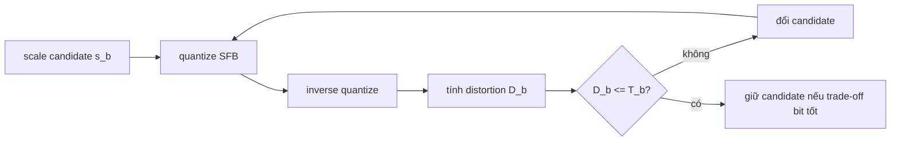
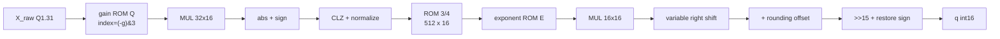
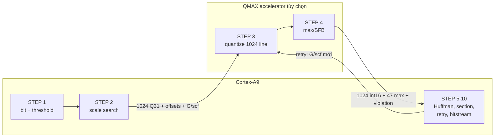

# Quantization và Coding trong FDK-AAC — trình bày step by step từ 1024 hệ số MDCT

> Tài liệu này chỉ đi theo **một luồng dữ liệu duy nhất**. Điểm bắt đầu là một
> channel có 1024 hệ số MDCT và metadata do Psychoacoustic Model cung cấp. Mỗi
> bước đều nêu rõ: input, phép biến đổi, output và kết quả của cùng một frame ví
> dụ.
>
> Baseline mã nguồn: FDK-AAC tại commit
> `35f9c13cb6df0c5d4e7ba958ef2d251c48b8d1d9`.

## 1. Toàn bộ luồng trong một hình

```mermaid
flowchart LR
    A["1024 MDCT Q1.31<br/>+ SFB/threshold/bit budget"]
    --> B["STEP 1<br/>Điều chỉnh threshold<br/>và cấp bit"]
    --> C["STEP 2<br/>Tìm scale cho từng SFB<br/>globalGain + scf"]
    --> D["STEP 3<br/>Quantize 1024 line<br/>Q1.31 -> int16"]
    --> E["STEP 4<br/>Max magnitude/SFB<br/>range check 8191"]
    --> F["STEP 5<br/>Tính Huffman cost<br/>cho từng SFB/book"]
    --> G["STEP 6<br/>Ghép section<br/>chọn codebook cuối"]
    --> H["STEP 7<br/>Mã hóa scalefactor<br/>DPCM + Huffman"]
    --> I["STEP 8<br/>Sinh spectral codeword"]
    --> J["STEP 9<br/>Cộng bit và kiểm tra budget"]
    --> K["STEP 10<br/>Ghi AAC bitstream"]

    J -- "quá budget" --> L["Sửa gain/constraint"]
    L --> D
```



Quantization không chỉ là phép $|x|^{3/4}$. Trong FDK, khối Quantization/Coding
gồm hai phần:

- **phần điều khiển:** bit allocation, threshold, scalefactor search, retry;
- **phần datapath:** lượng tử 1024 line, Huffman cost, section và ghi codeword.

## 2. Frame ví dụ sẽ dùng xuyên suốt

### 2.1. Cấu hình frame

Ví dụ dùng cấu hình gần mô hình HE-AAC v1 dự kiến triển khai:

| Thông tin | Giá trị ví dụ |
|---|---|
| Input hệ thống | HE-AAC v1 mono, PCM 48 kHz |
| AAC core sample rate | 24 kHz trong chế độ dual-rate SBR |
| Window | `LONG_WINDOW` |
| Số hệ số MDCT của AAC core | 1024 |
| `mdctScale` | 0 |
| `sfbCnt` | 47 |
| `sfbPerGroup` | 47 |
| `maxSfbPerGroup` | 47 |
| PNS | tắt trong ví dụ |
| Intensity Stereo | không dùng vì mono |
| Dead-zone quantizer | tắt, dùng offset AAC $0.4054$ |
| Afterburner/inverse quantization | bật |
| Dynamic-bit budget minh họa | 60 bit |

Vì là long window nên frame có một group, chứa 47 SFB.

### 2.2. Bảng SFB thật của FDK ở AAC core 24 kHz

FDK định nghĩa 47 độ rộng SFB trong `p_FDKaacEnc_24000_long_1024`. Sau khi cộng
dồn, ta có 48 offset:

```text
sfbOffsets = [
    0,   4,   8,  12,  16,  20,  24,  28,
   32,  36,  40,  44,  52,  60,  68,  76,
   84,  92, 100, 108, 116, 124, 136, 148,
  160, 172, 188, 204, 220, 240, 260, 284,
  308, 336, 364, 396, 432, 468, 508, 552,
  600, 652, 704, 768, 832, 896, 960, 1024
]
```

Do đó:

- SFB 0 chứa line 0…3;
- SFB 1 chứa line 4…7;
- SFB 2 chứa line 8…11;
- …;
- SFB 46 chứa line 960…1023.

### 2.3. Mảng 1024 hệ số MDCT

Ta đặt tám hệ số đầu có giá trị, 1016 hệ số còn lại bằng 0:

$$
\begin{aligned}
\mathbf{x}[0:7]
&=[0.50,-0.25,0,0.25,\ 0.25,-0.50,0.25,0.02],\\
\mathbf{x}[8:1023]&=0.
\end{aligned}
$$

Trong FDK, spectrum được lưu bằng signed Q1.31:

$$
X_{raw}[k]\approx x[k]\,2^{31}.
$$

Mảng input thực của ví dụ là:

```text
mdctSpectrum[0:7] = [
   1073741824,
   -536870912,
             0,
    536870912,
    536870912,
  -1073741824,
    536870912,
     42949672
]

mdctSpectrum[8:1023] = 0
```

Đây vẫn là một input đủ 1024 phần tử; tài liệu chỉ viết gọn phần đuôi toàn 0.

### 2.4. Metadata đi cùng 1024 hệ số

Nếu xét **toàn bộ QC**, chỉ có 1024 hệ số MDCT là chưa đủ. FDK còn cần:

| Nhóm input | Biến FDK | Dùng ở bước nào |
|---|---|---|
| Geometry SFB | `sfbOffsets`, `sfbCnt`, `sfbPerGroup`, `maxSfbPerGroup` | Chia 1024 line thành band |
| Scale MDCT | `mdctScale` | Ánh xạ internal gain sang `global_gain` bitstream |
| Năng lượng | `sfbEnergyLdData[47]` | PE và ước lượng scalefactor |
| Masking threshold | `sfbThresholdLdData[47]` | Distortion được phép |
| Form factor | `sfbFormFactorLdData[47]` | Ước lượng scalefactor ban đầu |
| Min-SNR/spread energy | `sfbMinSnrLdData`, `sfbSpreadEnergy` | Giới hạn threshold, tránh spectral hole |
| Rate control | bitrate, static bits, extension bits, reservoir | Cấp dynamic bits |
| PNS | `noiseNrg[47]` | Chọn PNS book và mã hóa noise energy |
| Intensity Stereo | `isBook[47]`, `isScale[47]` | Chọn IS book; ví dụ mono không dùng |
| Window | `lastWindowSequence` | Quyết định section-length syntax |
| Chế độ | `invQuant`, `dZoneQuantEnable` | Afterburner và offset quantizer |

Trong ví dụ số:

$$
E_0=\sum_{k=0}^{3}|x_k|^2=0.375,
$$

$$
E_1=\sum_{k=4}^{7}|x_k|^2=0.3754,
$$

còn $E_2\ldots E_{46}=0$. Ta dùng allowed distortion sau threshold adjustment:

$$
T_0=0.020,\qquad T_1=0.018.
$$

Các giá trị $E,T$ ở đây được viết trong miền số thực để dễ đọc. FDK lưu chúng
trong `LD_DATA` fixed-point. Các band 2…46 có năng lượng bằng 0 nên sẽ là zero
band. `noiseNrg[]` được đặt `NO_NOISE_PNS`, `isBook[]=0`.

---

## 3. STEP 1 — Cấp bit và điều chỉnh threshold

### Input của STEP 1

- `sfbEnergyLdData[47]`;
- threshold ban đầu và `sfbMinSnrLdData[47]`;
- form factor/spread energy;
- số bit trung bình của frame;
- static bits, SBR extension bits, fill/alignment bits;
- mức bit reservoir hiện tại.

### Phép biến đổi

Ở mức khái niệm, số bit có thể cấp cho spectral data là:

$$
B_{dyn,grant}
=B_{frame}+B_{reservoir,spend}
-B_{static}-B_{extension}-B_{fill/alignment}.
$$

FDK không chỉ thực hiện một phép trừ. `FDKaacEnc_AdjustThresholds()` phân phối bit
theo Perceptual Entropy, min-SNR, avoid-hole, CBR/VBR và trạng thái reservoir.

Quan hệ điều khiển:

$$
B_{used}>B_{grant}
\Rightarrow T_b\uparrow
\Rightarrow \text{cho phép nhiều distortion hơn}
\Rightarrow \text{ít bit hơn}.
$$

### Output của STEP 1

- `grantedDynBits` cho channel/element;
- threshold cuối cùng `sfbThresholdLdData[47]`.

### Kết quả của frame ví dụ

Ta giả sử sau khi FDK đã trừ static bits và SBR payload:

```text
grantedDynBits = 60
T[0] = 0.020
T[1] = 0.018
T[2:46] tương ứng zero band
```

STEP 1 chưa thay đổi 1024 hệ số MDCT. Nó chỉ xác định chất lượng/bit target cho
STEP 2.

---

## 4. STEP 2 — Tìm scale cho từng SFB

Mục tiêu của STEP 2 là tìm một giá trị scale nguyên cho mỗi band sao cho:

- distortion không vượt threshold nếu còn đủ bit;
- $|q_k|\le8191$;
- chênh lệch scalefactor có thể mã hóa;
- tổng Huffman cost phù hợp bit budget.

### Input của STEP 2

- `mdctSpectrum[1024]`;
- `sfbOffsets[48]`;
- energy, threshold và form factor của 47 SFB;
- `invQuant` và `dZoneQuantEnable`.

### Phép biến đổi 2.1 — ước lượng ban đầu

`FDKaacEnc_EstimateScaleFactorsChannel()` tạo scale ban đầu từ threshold và form
factor. Dạng số thực gần với comment trong source là:

$$
s_b^{(0)}\approx
\left\lfloor8.8585
\left[\log_{10}(6.75T_b)-\log_{10}(F_b)\right]
\right\rfloor.
$$

Source thật dùng phép toán log fixed-point; công thức trên dùng để hiểu ý nghĩa,
không phải datapath bit-exact.

### Phép biến đổi 2.2 — analysis-by-synthesis

Khi Afterburner bật, FDK thử candidate scale:



Forward và inverse quantizer số thực là:

$$
q_k=\operatorname{sgn}(x_k)
\left\lfloor |x_k|^{3/4}2^{-3s_b/16}+k_q\right\rfloor,
$$

$$
\hat x_k=\operatorname{sgn}(q_k)|q_k|^{4/3}2^{s_b/4},
$$

$$
D_b=\sum_{k\in b}\left(|x_k|-|\hat x_k|\right)^2.
$$

Với $k_q=0.4054$, các candidate gần điểm quyết định của ví dụ là:

| Candidate $s_b$ | `q` SFB 0 | $D_0$ | `q` SFB 1 | $D_1$ | Đạt threshold? |
|---:|---|---:|---|---:|---|
| -10 | `[2,-1,0,1]` | 0.013699 | `[1,-2,1,0]` | 0.014099 | Có |
| -9 | `[2,-1,0,1]` | 0.004048 | `[1,-2,1,0]` | 0.004448 | Có |
| **-8** | `[2,-1,0,1]` | **0.016890** | `[1,-2,1,0]` | **0.017290** | Có |
| -7 | `[1,-1,0,1]` | 0.045561 | `[1,-1,1,0]` | 0.045961 | Không |

Candidate -8 là giá trị thô nhất trong bảng vẫn đạt cả hai threshold. Ví dụ chọn:

$$
s_0=s_1=-8.
$$

Các band 2…46 không có năng lượng; FDK đặt spectrum của chúng bằng 0.

### Phép biến đổi 2.3 — đổi sang `globalGain` và `scf[]`

FDK không đưa trực tiếp 47 scale tuyệt đối sang các bước sau. Nó đổi thành:

$$
G=\max_b(s_b),
$$

$$
scf[b]=G-s_b.
$$

Giá trị quantizer thực sự dùng tại SFB $b$ là:

$$
QSS_b=G-scf[b]=s_b.
$$

### Output của STEP 2

- `globalGain = G`;
- `scf[47]`;
- spectrum của zero band được clear;
- các kết quả distortion tạm dùng bởi scalefactor search.

### Kết quả của frame ví dụ

```text
globalGain = -8
scf[0]     = 0
scf[1]     = 0
scf[2:46]  = 0       # zero bands

QSS[0]     = -8 - 0 = -8
QSS[1]     = -8 - 0 = -8
QSS[2:46]  = -8, nhưng input các band này đã bằng 0
```

`globalGain`, `scf[]` và trường `global_gain` 8 bit trong AAC bitstream không
phải cùng một giá trị. Việc ánh xạ ra bitstream nằm ở STEP 7.

---

## 5. STEP 3 — Lượng tử hóa toàn bộ 1024 hệ số

Đây là hàm `FDKaacEnc_QuantizeSpectrum()`.

### Input của STEP 3

```text
mdctSpectrum[1024] : signed Q1.31
sfbOffsets[48]
sfbCnt             : 47
sfbPerGroup        : 47
maxSfbPerGroup     : 47
globalGain         : -8
scf[47]            : toàn 0 trong ví dụ
dZoneQuantEnable   : 0
```

### Phép biến đổi 3.1 — duyệt SFB

FDK thực hiện logic tương đương:

```text
for sfb = 0 .. 46:
    start = sfbOffsets[sfb]
    stop  = sfbOffsets[sfb + 1]
    gain  = globalGain - scf[sfb]

    for k = start .. stop - 1:
        quantSpec[k] = quantizeLine(mdctSpectrum[k], gain)
```

Như vậy output vẫn giữ đúng 1024 vị trí; chỉ kiểu dữ liệu đổi từ Q1.31 `int32`
sang chỉ số lượng tử `int16`.

### Phép biến đổi 3.2 — công thức dễ hiểu

Với $x=X_{raw}/2^{31}$ và $g=G-scf[b]$:

$$
q=\operatorname{sgn}(x)
\left\lfloor |x|^{3/4}2^{-3g/16}+0.4054\right\rfloor.
$$

Ví dụ line 0:

$$
x=0.5,\qquad g=-8,
$$

$$
|x|^{3/4}2^{-3g/16}
=0.5^{3/4}2^{1.5}
\approx1.68179,
$$

$$
q=\lfloor1.68179+0.4054\rfloor=2.
$$

### Phép biến đổi 3.3 — datapath fixed-point thật của FDK

RTL golden phải làm theo block diagram này, không gọi `pow()`:



Cho một line, FDK thực hiện:

$$
r=(-g)\ \&\ 3,
\qquad
s_q=((-g)\gg2)+1,
$$

$$
a_0=(X_{raw}\cdot Q[r])\gg16,
$$

$$
\ell=CLZ(|a_0|)-1,
\qquad
a_n=|a_0|\ll\ell,
$$

$$
i=(a_n\gg21)\ \&\ 0x1FF,
$$

$$
t=s_q-\ell+1,
\qquad
a_p=M_{3/4}[i]\cdot E[t\ \&\ 3],
$$

$$
s=12-3(t\gg2),
\qquad
a_s=a_p\gg\min(s,31),
$$

$$
|q|=(a_s+13284)\gg15.
$$

Sau cùng FDK phục hồi dấu và narrow sang `int16`. Nó không clip mỗi line về
$\pm8191$.

#### Tính fixed-point đầy đủ cho line 0

| Stage | Giá trị |
|---|---:|
| `X_raw` | 1073741824 |
| `gain` | -8 |
| `(-gain)&3` | 0 |
| `quantTableQ[0]` | 16384 |
| `a0 = (X_raw*16384)>>16` | 268435456 |
| `CLZ(a0)-1` | 2 |
| normalized `a_n` | 1073741824 |
| ROM $3/4$ index | 0 |
| `mTab_3_4[0]` | 19484 |
| `t` | 2 |
| `quantTableE[2]` | 11585 |
| `a_p = 19484*11585` | 225722140 |
| right shift `s` | 12 |
| `a_s` | 55107 |
| `a_s + 13284` | 68391 |
| `(a_s+13284)>>15` | **2** |

### Output của STEP 3

`quantSpec[1024]`, signed `int16`.

### Kết quả của frame ví dụ

```text
quantSpec[0:7] = [2, -1, 0, 1, 1, -2, 1, 0]
quantSpec[8:1023] = 0
```

Viết dưới dạng mảng 1024 phần tử:

$$
\mathbf q=[2,-1,0,1,1,-2,1,0,
\underbrace{0,0,\ldots,0}_{1016\ \text{phần tử}}].
$$

---

## 6. STEP 4 — Tìm max magnitude theo từng SFB

Đây là `FDKaacEnc_calcMaxValueInSfb()`.

### Input của STEP 4

- `quantSpec[1024]` từ STEP 3;
- `sfbOffsets[48]`;
- geometry 47 SFB.

### Phép biến đổi

Với mỗi SFB:

$$
m_b=\max_{sfbOffsets[b]\le k<sfbOffsets[b+1]}|q_k|.
$$

Sau đó:

$$
m_{all}=\max_{0\le b<47}m_b.
$$

### Output của STEP 4

- `maxValueInSfb[47]`;
- `maximumQuantizedValue`;
- điều kiện range `maximumQuantizedValue > 8191`.

### Kết quả của frame ví dụ

```text
SFB 0: max(abs([2,-1,0,1])) = 2
SFB 1: max(abs([1,-2,1,0])) = 2
SFB 2..46: max(abs(0))       = 0

maxValueInSfb = [2, 2, 0, 0, ..., 0]   # 47 phần tử
maximumQuantizedValue = 2
```

Vì:

$$
2\le8191,
$$

frame vượt qua range check. Nếu lớn hơn 8191, FDK tăng gain rồi quay lại STEP 3;
không được clip coefficient.

---

## 7. STEP 5 — Tính Huffman cost cho mỗi SFB và mỗi codebook

Đây là `FDKaacEnc_buildBitLookUp()` gọi `FDKaacEnc_bitCount()`.

### Input của STEP 5

- `quantSpec[1024]`;
- `maxValueInSfb[47]`;
- `sfbOffsets[48]`;
- PNS/IS metadata.

### Phép biến đổi

FDK thử các spectral codebook 0…11 cho từng band. Codebook không chứa được
`maxValueInSfb[b]` sẽ nhận `INVALID_BITCOUNT`.

| Book | Nhóm coefficient | LAV | Cách xử lý dấu |
|---:|---:|---:|---|
| 0 | zero band | 0 | không ghi spectral data |
| 1, 2 | bộ bốn | 1 | dấu nằm trong codeword |
| 3, 4 | bộ bốn | 2 | sign bit riêng |
| 5, 6 | cặp | 4 | dấu nằm trong codeword |
| 7, 8 | cặp | 7 | sign bit riêng |
| 9, 10 | cặp | 12 | sign bit riêng |
| 11 | cặp | 16 + escape | sign và escape bit riêng |

Với book có sign bit riêng:

$$
C_b(c)=\sum L_{table}(tuple)+\#\{q_k\ne0\}+L_{escape}.
$$

### Output của STEP 5

Một bảng:

```text
bitLookUp[sfb][codebook]
```

Trong frame ví dụ, bảng của hai SFB khác 0 là:

| Codebook | SFB 0 `[2,-1,0,1]` | SFB 1 `[1,-2,1,0]` |
|---:|---:|---:|
| 0, 1, 2 | invalid | invalid |
| 3 | 13 | 11 |
| **4** | **10** | **10** |
| 5 | 12 | 12 |
| 6 | 10 | 10 |
| 7 | 12 | 12 |
| 8 | 11 | 11 |
| 9 | 12 | 12 |
| 10 | 12 | 12 |
| 11 | 13 | 13 |

Book 4 và book 6 cùng có cost 10. `FDKaacEnc_findBestBook()` quét từ book nhỏ
đến lớn và chỉ thay khi cost mới nhỏ hơn, nên book 4 được chọn.

Đối với SFB 2…46:

```text
maxValueInSfb = 0
book 0 cost   = 0
book được chọn = 0
```

Output tạm sau STEP 5:

```text
SFB 0  -> book 4, spectral cost 10
SFB 1  -> book 4, spectral cost 10
SFB 2  -> book 0, spectral cost 0
...
SFB 46 -> book 0, spectral cost 0
```

---

## 8. STEP 6 — Ghép các SFB thành section

AAC không gửi một codebook ID cho từng SFB riêng lẻ nếu nhiều SFB liên tiếp dùng
cùng codebook. FDK ghép chúng thành section để giảm side information.

### Input của STEP 6

- best book ban đầu của 47 SFB;
- `bitLookUp[47][12]`;
- loại window để biết số bit của `sect_len`.

### Phép biến đổi

FDK dùng ba stage:

1. Stage 0: chọn book rẻ nhất cho từng SFB;
2. Stage 1: ghép các SFB liền kề có cùng book;
3. Stage 2: thử greedy merge hai section khác book nếu tổng bit giảm.

Với hai section $A,B$:

$$
B_{merge}=B_{side}(|A|+|B|)
+\min_c\left[C_A(c)+C_B(c)\right],
$$

$$
G_{merge}=B_{split}-B_{merge}.
$$

Chỉ merge nếu $G_{merge}>0$.

### Kết quả Stage 1 của frame ví dụ

```text
SFB 0,1      cùng book 4 -> section A
SFB 2..46    cùng book 0 -> section B
```

Ta thu được:

```text
section A: sfbStart=0, sfbCnt=2,  codeBook=4
section B: sfbStart=2, sfbCnt=45, codeBook=0
```

Stage 2 không ghép A và B: nếu ép 45 zero bands dùng book 4, số Huffman bit tăng
rất lớn; book 0 lại không biểu diễn được hai band khác 0.

### Tính section side bits

Với long window:

- `sect_cb`: 4 bit;
- mỗi `sect_len` increment: 5 bit;
- escape value: 31.

Section A có length 2:

```text
codeBook = 4 -> 0100
sect_len = 2 -> 00010

section A side data = 010000010 = 9 bit
```

Section B có length 45. FDK ghi một escape 31 rồi phần còn lại 14:

```text
codeBook       = 0  -> 0000
sect_len escape=31 -> 11111
sect_len remain=14 -> 01110

section B side data = 00001111101110 = 14 bit
```

### Output của STEP 6

```text
noOfSections = 2
huffsection[0] = {start=0, count=2,  book=4}
huffsection[1] = {start=2, count=45, book=0}

sideInfoBits = 9 + 14 = 23 bit
huffmanBits  = 10 + 10 = 20 bit
```

---

## 9. STEP 7 — Mã hóa scalefactor và trường `global_gain`

### 9.1. Scalefactor DPCM

#### Input

- `scf[47]` từ STEP 2;
- `maxValueInSfb[47]`;
- section list từ STEP 6.

#### Phép biến đổi

Đối với spectral section khác book 0/PNS/IS, FDK mã hóa:

$$
\Delta scf_b=scf_{last}-scf_b.
$$

Zero section không cần scalefactor spectral.

#### Kết quả ví dụ

Section A chứa SFB 0 và 1:

```text
firstScf = 0
scf[0]   = 0 -> delta 0
scf[1]   = 0 -> delta 0
```

Bảng scalefactor Huffman của FDK cho:

```text
delta 0 -> codeword 0, length 1
```

Do đó:

```text
scalefactor payload = 00
scalefacBits = 2
```

SFB 2…46 thuộc zero section nên không phát sinh scalefactor bit.

### 9.2. Ánh xạ internal gain sang `global_gain` 8 bit

#### Input

- `globalGain = -8`;
- `scf[firstScf] = 0`;
- `mdctScale = 0`;
- `LOG_NORM_PCM = -15` trong FDK.

#### Phép biến đổi

`FDKaacEnc_encodeGlobalGain()` tính:

$$
global\_gain_{syntax}
=globalGain-scf[firstScf]+100
-4(LOG\_NORM\_PCM-mdctScale).
$$

Thay số:

$$
global\_gain_{syntax}
=-8-0+100-4(-15-0)=152.
$$

#### Output

```text
global_gain = 152 decimal = 10011000 binary
```

Đây là lý do không được nối trực tiếp `globalGain=-8` vào trường bitstream.

---

## 10. STEP 8 — Sinh spectral Huffman codeword

### Input của STEP 8

- section A dùng codebook 4;
- `quantSpec[0:7]`;
- section B dùng codebook 0 nên không ghi spectral coefficient.

### Phép biến đổi cho SFB 0

Vector signed:

```text
[2, -1, 0, 1]
```

Book 4 tra bảng bằng magnitude tuple:

```text
(2, 1, 0, 1)
```

FDK ROM trả:

```text
base codeword = 0x6D
base length   = 7 bit
```

Chỉ hệ số khác 0 mới có sign bit. Dấu `[+, -, +]` tạo:

```text
sign bits = 010
```

Ghép lại:

$$
(0x6D\ll3)\;|\;0b010=0x36A.
$$

Output SFB 0:

```text
1101101010   # 10 bit
```

### Phép biến đổi cho SFB 1

```text
signed tuple    = [1, -2, 1, 0]
magnitude tuple = (1, 2, 1, 0)
base codeword   = 0x6E
base length     = 7
sign bits       = 010
```

$$
(0x6E\ll3)\;|\;0b010=0x372.
$$

Output SFB 1:

```text
1101110010   # 10 bit
```

### Output của STEP 8

```text
spectral payload = 1101101010 1101110010
huffmanBits = 20
```

Section B là book 0 nên 1016 hệ số zero không tạo spectral codeword nào.

---

## 11. STEP 9 — Cộng bit và quyết định có phải quantize lại hay không

Đây là kết quả của `FDKaacEnc_dynBitCount()`.

### Input của STEP 9

- `huffmanBits = 20`;
- `sideInfoBits = 23`;
- `scalefacBits = 2`;
- `noiseNrgBits = 0`;
- `grantedDynBits = 60`.

### Phép biến đổi

$$
B_{dyn}
=B_{huffman}+B_{side}+B_{scf}+B_{PNS}.
$$

### Kết quả của frame ví dụ

$$
B_{dyn}=20+23+2+0=45\ \text{bit}.
$$

So với budget:

$$
45\le60.
$$

### Output của STEP 9

```text
dynBitsUsed = 45
constraint = fulfilled
calculateQuant = 0
```

Frame không cần retry.

### Nếu vượt budget thì dữ liệu biến đổi thế nào?

Giả sử budget nhỏ hơn 45 và rate-control quyết định tăng `globalGain` một đơn
vị:

```text
globalGain: -8 -> -7
scf: giữ nguyên 0
QSS: -8 -> -7
```

STEP 3 chạy lại và output 8 line đầu trở thành:

```text
quantSpec[0:7] = [1, -1, 0, 1, 1, -1, 1, 0]
```

Magnitude nhỏ hơn thường làm Huffman cost giảm nhưng distortion tăng. Sau đó
FDK bắt buộc chạy lại STEP 4, 5, 6, 7, 8 và 9; không được dùng lại max/codebook
của iteration cũ.

---

## 12. STEP 10 — Ghi bitstream

### Input của STEP 10

`QC_OUT_CHANNEL` chứa:

```text
globalGain      = -8
scf[47]         = [0, 0, ..., 0]
quantSpec[1024] = [2,-1,0,1,1,-2,1,0,0,...,0]
maxValueInSfb   = [2,2,0,...,0]
sectionData     = 2 sections
dynBitsUsed     = 45
```

### Phép biến đổi

`FDKaacEnc_WriteBitstream()` ghi theo thứ tự khái quát:

```text
element syntax
  -> global_gain
  -> ICS/window/grouping information
  -> section data
  -> scalefactor/PNS/IS data
  -> pulse/TNS/gain-control flags và data
  -> spectral Huffman data
  -> extension/fill/alignment
  -> transport bên ngoài
```

Các bit đã tính được trong ví dụ:

| Trường | Payload | Số bit |
|---|---|---:|
| `global_gain` | `10011000` | 8 |
| section A | `010000010` | 9 |
| section B | `00001111101110` | 14 |
| scalefactor deltas | `00` | 2 |
| spectral SFB 0 | `1101101010` | 10 |
| spectral SFB 1 | `1101110010` | 10 |

Không được nối sáu chuỗi trên rồi gọi là một AAC frame hoàn chỉnh: giữa chúng
còn ICS và tool syntax. Bảng chỉ cho thấy output của phần Quantization/Coding
được writer sử dụng như thế nào.

### Output cuối của khối Quantization/Coding

Có hai mức output:

1. **Output cấu trúc cho bitstream writer:** `quantSpec`, `globalGain`, `scf`,
   `sectionData`, các bit count.
2. **Output sau writer:** các trường global gain, section, scalefactor và spectral
   Huffman đã nằm trong AAC core payload.

---

## 13. Bảng tóm tắt input/output của từng step

| Step | Input chính | Biến đổi | Output của ví dụ |
|---:|---|---|---|
| 0. Nhận frame | 1024 Q1.31 MDCT + 47 SFB + Psy/rate metadata | kiểm tra geometry | frame long 24 kHz, offsets kết thúc tại 1024 |
| 1. Bit/threshold | energy, threshold, reservoir, static/ext bits | PE + threshold adjustment | budget 60 bit, $T=[0.020,0.018]$ |
| 2. Scale search | MDCT + threshold + form factor | forward/inverse/distortion | `globalGain=-8`, `scf[47]=0` |
| 3. Quantize | 1024 Q1.31 + gain/scf/offsets | ROM, MUL, CLZ, shift, rounding | `[2,-1,0,1,1,-2,1,0,0×1016]` |
| 4. Max/SFB | 1024 `int16` | max absolute theo band | `[2,2,0×45]`, max all = 2 |
| 5. Bit cost | quantSpec + max/SFB | thử codebook 0…11 | book 4 cho SFB 0–1; book 0 cho SFB 2–46 |
| 6. Section | best book + cost | merge liền kề/greedy | `{0,2,book4}`, `{2,45,book0}` |
| 7. Scale coding | scf + sections + mdctScale | DPCM + gain mapping | scf payload `00`, syntax gain 152 |
| 8. Spectral coding | quantSpec + book 4 | Huffman table + sign | 20 spectral bit |
| 9. Budget check | mọi dynamic bit count | cộng và so budget | 45/60 bit, accept |
| 10. Writer | QC_OUT + ICS/tool metadata | bit packing | AAC core payload fields |

## 14. Ranh giới phần cứng dự kiến

Trong mô hình PYNQ-Z2 hiện tại, bản đầu vẫn chạy toàn bộ STEP 1–10 trên Cortex-A9.
Nếu profile HE-AAC chứng minh cần tăng tốc QC, QMAX chỉ thay STEP 3 và STEP 4:



### Input QMAX

```text
mdctSpectrum[1024]  : int32 Q1.31
sfbOffsets[48]      : uint16/int
scf[47]             : int16/int
globalGain          : signed int
sfbCnt              : 47 trong ví dụ
sfbPerGroup         : 47
maxSfbPerGroup      : 47
dZoneQuantEnable    : 1 bit
```

### Output QMAX

```text
quantSpec[1024]     : int16
maxValueInSfb[47]   : uint16
maximumQuantizedValue
rangeViolation      : maximumQuantizedValue > 8191
```

Psychoacoustic Model phải chạy trước QMAX. Không nối thẳng MDCT PL sang QMAX vì
TNS, low-pass, scale và các công cụ stereo có thể sửa spectrum trước
quantization.

## 15. Những quy tắc bắt buộc khi hiện thực

1. `mdctSpectrum` là signed Q1.31 và có `mdctScale` đi kèm.
2. QSS mỗi band luôn là `globalGain - scf[sfb]`.
3. ROM $3/4$, gain Q/E phải lấy literal FDK, không sinh lại bằng `pow()` trong
   golden RTL.
4. Signed right shift phải là arithmetic shift.
5. Truncate và narrowing cast phải đúng thứ tự FDK.
6. Không saturate `quantSpec` về $\pm8191$; phải phát hiện violation và retry.
7. Khi gain đổi, phải tính lại quantSpec, max/SFB, Huffman cost và section.
8. Với short window, input vẫn có tổng cộng 1024 coefficient nhưng geometry là
   tám window 128 line và có window grouping; không dùng nguyên bảng 47 SFB của
   ví dụ long-window.
9. `globalGain` nội bộ không phải trường `global_gain` 8 bit.
10. Bit-exact QMAX chỉ chứng minh đúng số học; speedup phải bao gồm DMA, cache và
    số lần retry.

## 16. Source map và tài liệu tham khảo

| Nội dung | Source trong repository |
|---|---|
| Bảng 47 SFB ở 24 kHz | [`libAACenc/src/aacEnc_rom.cpp`](../../../libAACenc/src/aacEnc_rom.cpp) |
| Khởi tạo `sfbOffsets` | [`libAACenc/src/psy_configuration.cpp`](../../../libAACenc/src/psy_configuration.cpp) |
| Threshold/bit allocation | [`libAACenc/src/adj_thr.cpp`](../../../libAACenc/src/adj_thr.cpp) |
| Scalefactor search | [`libAACenc/src/sf_estim.cpp`](../../../libAACenc/src/sf_estim.cpp) |
| Forward/inverse quantizer | [`libAACenc/src/quantize.cpp`](../../../libAACenc/src/quantize.cpp) |
| Max/SFB và QC retry | [`libAACenc/src/qc_main.cpp`](../../../libAACenc/src/qc_main.cpp) |
| Huffman bit count/codeword | [`libAACenc/src/bit_cnt.cpp`](../../../libAACenc/src/bit_cnt.cpp) |
| Sectioning/dynamic bits | [`libAACenc/src/dyn_bits.cpp`](../../../libAACenc/src/dyn_bits.cpp) |
| Bitstream writer | [`libAACenc/src/bitenc.cpp`](../../../libAACenc/src/bitenc.cpp) |
| Python fixed golden | [`quantization_reference/python_ref/quantization_fixed.py`](../quantization_reference/python_ref/quantization_fixed.py) |

Tài liệu ngoài:

1. [ISO/IEC 14496-3:2019 — Coding of audio-visual objects, Part 3: Audio](https://www.iso.org/standard/76383.html).
2. [AOSP FDK-AAC `quantize.cpp`](https://android.googlesource.com/platform/external/aac/+/577fcbb/libAACenc/src/quantize.cpp).
3. [Standalone FDK-AAC source mirror](https://github.com/mstorsjo/fdk-aac).
4. [P. Delgado, M. Lohwasser — Complexity scaling of the MPEG AAC rate-distortion loop](https://publica.fraunhofer.de/entities/publication/ec2ba63f-5ef2-4d1e-8c97-6b070d71585e).

