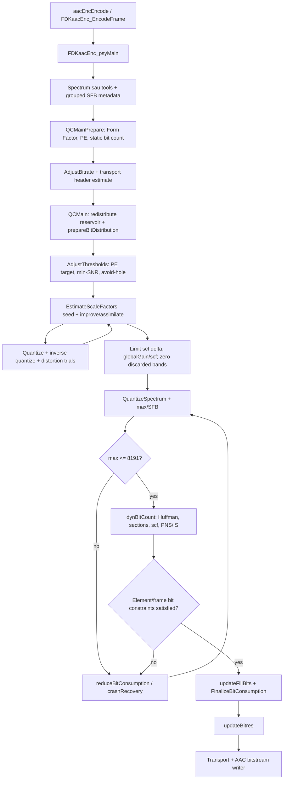

# Khảo sát source và thiết kế đề xuất cho Quantization Analysis

Ngày khảo sát ban đầu: 12/10/2026. Phần khảo sát dưới đây giữ nguyên cơ sở
thiết kế trước triển khai. Instrumentation Quantization đã được bổ sung;
vị trí hook thực, cách chạy và bằng chứng native hiện ở
[quant_analysis.md](quant_analysis.md). Linux execution vẫn chưa được xác minh.

## 1. Phạm vi và bằng chứng hiện có

Yêu cầu là chạy AAC-LC implementation gốc của FDK, quan sát dữ liệu và vòng lặp
QC, xuất TXT/PNG và giữ raw fixed-point cho verification VHDL. Bitstream phải
giống từng byte giữa build normal và debug khi input/configuration giống nhau.

`CMakeLists.txt` hiện khai báo FDK-AAC 2.0.3. Ref Git `master` trỏ tới
`35f9c13cb6df0c5d4e7ba958ef2d251c48b8d1d9`. Cây source hiện có thay đổi của
workspace và đã tổ chức lại CPP theo thư mục chức năng; commit trên không đủ
để nhận diện toàn bộ source đang chạy. Khi thực thi phải lưu SHA-256 của source,
binary, WAV, trace và bitstream cùng compiler/build options.

Bộ khảo sát Psy đã có `my_workspace/psychoacoustic_model/tools/fdk_psy_trace.cpp`, `my_workspace/psychoacoustic_model/tools/run_psy_analysis.py`,
`libAACenc/src/psy_debug.h`, `psy_debug_api.h` và
`libAACenc/src/psy_model/psy_debug.cpp`. Nó chạy `aacEncEncode()` từ WAV, giữ
encoder state, chọn frame/channel và so normal/debug bitstream. Có thể tái sử
dụng WAV reader và quy ước frame/context của bộ này.

`my_workspace/INPUT/data/abc_votay.wav` theo manifest khảo sát Psy là PCM16 mono 48 kHz,
462848 sample frames. Các manifest cũ là bằng chứng lịch sử, không thay cho
verification mới của Quantization.

Môi trường hiện tại là Windows; kiểm tra `wsl --list --quiet` cho biết WSL chưa
được cài. Do đó chưa có bằng chứng chạy chương trình mới trên Linux Server.
Không tự cài WSL hay thay cấu hình hệ thống để thực hiện khảo sát source.

## 2. Call flow thực tế đã xác minh



Đây là dataflow tổng quát. Nhánh improve/assimilation phụ thuộc `invQuant` và
trạng thái thực tế; không chạy lại toàn bộ scalefactor search trong mỗi rate
retry. `calculateQuant` quyết định channel nào cần lượng tử hóa lại.

Trong `encoder/aacenc.cpp`, các pointer của `PSY_OUT_CHANNEL` trỏ vào buffer
`QC_OUT_CHANNEL`. Psy và QC dùng chung spectrum, energy và threshold. Snapshot
đầu vào phải được dump sau `psyMain()` nhưng trước `QCMainPrepare()`, vì PE
weighting, threshold adjustment và scalefactor search có thể sửa những buffer
này tại chỗ.

## 3. Bảng source/function và vị trí quan sát

Mọi đường dẫn dưới đây đã được tìm thấy trong repository. Số dòng là điểm
tham chiếu lúc khảo sát và sẽ dịch khi thêm hook.

| Stage | Source/function hiện có | Điểm dump dự kiến và dữ liệu |
|---|---|---|
| Frame + Psy/QC interface | `libAACenc/src/encoder/aacenc.cpp`, `FDKaacEnc_EncodeFrame`, khoảng 778–828 | Frame begin; snapshot sau `psyMain` trước prepare; frame end sau writer |
| QC preparation | `libAACenc/src/quantization/qc_main.cpp`, `FDKaacEnc_QCMainPrepare`, 436 | Trước/sau Form Factor, PE và count-only static syntax |
| Form Factor | `libAACenc/src/quantization/sf_estim.cpp`, `FDKaacEnc_FDKaacEnc_CalcFormFactorChannel`, 133; `FDKaacEnc_CalcFormFactor`, 167 | Từng SFB: accumulator `formFactor` trước `CalcLdData`, output `sfbFormFactorLdData`; optional sqrt term theo line |
| PE preparation | `libAACenc/src/quantization/line_pe.cpp`, `FDKaacEnc_prepareSfbPe`, 116 | Energy/threshold/form-factor LD, width, `avgFormFactorLdData`, `sfbNLines` |
| PE per SFB | Cùng file, `FDKaacEnc_calcSfbPe`, 161 | `logDataRatio`, nhánh C1/C2/C3, `tmpPe`, `tmpConstPart`, `tmpNActiveLines`, tổng channel |
| PE weighting + total | `libAACenc/src/quantization/adj_thr.cpp`, `FDKaacEnc_peCalculation`, 908; `FDKaacEnc_calcPe`, 885 | Weighting factors, weighted energy/threshold, `PE_DATA`, PE offset; từng lần gọi native |
| Average bits | `libAACenc/src/quantization/qc_main.cpp`, `FDKaacEnc_AdjustBitrate`, 470 | Bitrate, Fs, frame length, padding state trước/sau, `avgTotalBits` |
| Reservoir redistribution | Cùng file, `FDKaacEnc_BitResRedistribution`, 739 | Total/element reservoir trước/sau |
| Bit distribution | Cùng file, `FDKaacEnc_prepareBitDistribution`, 616; `FDKaacEnc_distributeElementDynBits`, 505 | Header/static/extension overhead, granted/max dynamic bits, total available bits |
| Granted PE | `libAACenc/src/quantization/adj_thr.cpp`, `FDKaacEnc_DistributeBits`, 2723; `FDKaacEnc_bitresCalcBitFac`, 2347 | Reservoir parameters, bit factor mantissa/exponent, granted PE, PE correction và adaptive state |
| Threshold wrapper | Cùng file, `FDKaacEnc_AdjustThresholds`, 2804 | Entry/exit, CBR/VBR branch, restore weighting |
| Threshold iteration | Cùng file, `FDKaacEnc_adaptThresholdsToPe`, 1889 | First guess; mỗi second guess; correctThresh; reduceMinSnr; allowMoreHoles; PE target/current; reduction mantissa/exponent; avoid-hole flags |
| Scalefactor seed | `libAACenc/src/quantization/sf_estim.cpp`, `FDKaacEnc_EstimateScaleFactorsChannel`, 1067 | Energy/threshold terms, `scfFract`, seed trước/sau bound `minSfMaxQuant`; inactive sentinel |
| Scalefactor optimization | Cùng file, `FDKaacEnc_improveScf`, 387; `FDKaacEnc_assimilateSingleScf`, 469; `FDKaacEnc_assimilateMultipleScf`, 642; `FDKaacEnc_FDKaacEnc_assimilateMultipleScf2`, 773 | Candidate gain, distortion, local PE/delta cost nếu native code tính, accept/reject và array sau mỗi stage |
| Gain normalization | Cùng file, phần cuối `FDKaacEnc_EstimateScaleFactorsChannel` | Absolute band gain trước normalize; `globalGain`; relative `scf`; spectrum zeroing mask |
| Forward nonlinear quantizer | `libAACenc/src/quantization/quantize.cpp`, `FDKaacEnc_quantizeLines`, 117; `FDKaacEnc_QuantizeSpectrum`, 279 | Input/output và intermediate tại multiply, CLZ, LUT index/value, exponent/shift, rounding và SHORT cast |
| Inverse/distortion trials | Cùng file, `FDKaacEnc_invQuantizeLines`, 181; `FDKaacEnc_calcSfbDist`, 321; `FDKaacEnc_calcSfbQuantEnergyAndDist`, 372 | Native inverse output, half-scale comparison, normalized difference/square, energy/distortion LD; invalid-range early return |
| Range + rate loop | `libAACenc/src/quantization/qc_main.cpp`, `FDKaacEnc_QCMain`, 789; `FDKaacEnc_calcMaxValueInSfb`, 1236 | QSS/G/scf, q/max, flags, iteration/constraint state trước/sau mỗi pass |
| Gain retry/recovery | Cùng file, `FDKaacEnc_reduceBitConsumption`, 1135; `FDKaacEnc_crashRecovery`, 1412 | Direction, gain change, maxIterations, recovery branch, spectrum/tool mutations và error |
| Actual dynamic bits | `libAACenc/src/coding/dyn_bits.cpp`, `FDKaacEnc_dynBitCount`; `FDKaacEnc_gmStage0/1/2` | Native bit breakdown, section start/count/book, merge decisions; không suy bit count từ entropy |
| Reservoir commit | `libAACenc/src/quantization/qc_main.cpp`, `FDKaacEnc_updateBitres`, 1266; `FDKaacEnc_FinalizeBitConsumption`, 1300 | Fill/alignment/total bits và reservoir state trước/sau commit |
| Bitstream global gain | `libAACenc/src/coding/bitenc.cpp`, `FDKaacEnc_encodeGlobalGain`, 158 | Internal gain, firstScf, mdctScale và 8-bit syntax gain dùng bởi writer |

## 4. Input cần thiết và giới hạn của Psy TXT

`PSY_OUT_CHANNEL` được khai báo trong `libAACenc/src/interface.h`, gồm geometry,
window sequence/shape/grouping, `mdctScale`, `groupLen`, TNS, PNS `noiseNrg`,
IS book/scale và pointer tới spectrum/energy/spread energy/energy LD/min-SNR
LD/threshold LD. Stereo còn có `commonWindow`, MS digest và MS mask.

QC cần thêm `QC_STATE`, `ELEMENT_BITS`, `PE_DATA` và `ATS_ELEMENT` trong
`qc_data.h`, `line_pe.h`, `adj_thr_data.h`. Những cấu trúc này chứa bitrate mode,
padding history, bit reservoir, PE correction/history, bits-to-PE factors,
min-SNR/avoid-hole parameters, maximum iterations và các constraints.

Vì vậy các file `01_sfb_offsets.txt`…`06_pns_energy.txt` riêng lẻ chưa đủ để chạy
QC độc lập đúng FDK. Phương án chính là native WAV encode. Khi chọn frame 10,
các frame 0…9 vẫn encode để tạo đúng state; chỉ log frame yêu cầu.

Chế độ `--input my_workspace/psychoacoustic_model/output/psy --wav ...` sẽ đối chiếu snapshot Psy cuối với giao
diện native trên cùng frame/channel/configuration. Nó không thay buffer native.
Chế độ chỉ có `--input` sẽ báo rõ thiếu state. Không tự suy hoặc điền state bằng
giá trị gần đúng.

## 5. Fixed-point và các điểm dễ nhầm

| Đại lượng | Native representation | Quy tắc hiển thị/trace |
|---|---|---|
| MDCT | `FIXP_DBL`, signed 32 Q31 + `mdctScale` | `raw * 2^(mdctScale-31)`; ghi trước và sau QC zeroing |
| Energy/spread energy | `FIXP_DBL`, Q31 | Energy linear dùng exponent `2*mdctScale`; giữ log và linear thành trường riêng |
| Energy/threshold/form-factor LD | signed 32, log2/64 trong Q31 | `log2_value = 64*raw/2^31`; reconstruct với exponent đúng epoch; sentinel không exponentiate như data |
| Form Factor accumulator | `FIXP_DBL`, Q31; `FORM_FAC_SHIFT=6` | Native sum `sqrtFixp(abs(x)) >> 6`; display correction dùng `6 + mdctScale/2` |
| PE per SFB | `INT`, signed 32; scaled với `PE_CONSTPART_SHIFT` | Macro hiện là `FRACT_BITS=16`; `sfbPe/2^16`; tổng channel đã shift và có truncation |
| Scalefactor/gain | `INT`, signed 32 | Seed/optimized absolute gain khác relative `scf` dùng bởi quantizer |
| Quantized coefficient | `SHORT`, signed 16 | Integer code index, không có Q31 exponent |
| Max quantized magnitude | `UINT` | Native range constraint `MAX_QUANT=8191`; không giả định có coefficient clipping |
| Reduction/bit factor | Mantissa + exponent native | Dump cả hai; không đoán exponent chỉ từ raw magnitude |

Form Factor theo source là tổng căn bậc hai của magnitude, không phải tổng
`abs(x)^(3/4)`. Kết quả LD được dùng để ước lượng relevant lines/PE và seed
scalefactor.

Trong scale search, SFB không mã hóa spectral data được đánh dấu `FDK_INT_MIN`.
Sau tối ưu, native code đổi thành:

$$
G=\max_b s_b,\qquad scf[b]=G-s_b,\qquad QSS_b=G-scf[b].
$$

Code này chỉ áp dụng cho band hợp lệ/khác sentinel; band bỏ được native code
clear spectrum và gán relative scf bằng 0. Cần lưu riêng zeroing mask.

Global gain được ghi ra bitstream theo:

$$
G_{syntax}=G-scf[firstScf]+100-4(LOG\_NORM\_PCM-mdctScale).
$$

`LOG_NORM_PCM=-15` trong source hiện tại. Không xem `G` nội bộ là cùng giá trị
với trường `global_gain` 8 bit.

Native inverse quantizer trả spectrum half-scale; `calcSfbDist` so với
`mdctSpectrum[i] >> 1`. Vì vậy reconstructed inverse dùng exponent
`mdctScale+1` khi hiển thị cùng miền với input. Sai số hiển thị phải so hai
spectrum đã đưa về cùng scale. Distortion LD do native tính được giữ riêng với
sai số signed và squared-error phục vụ đồ thị.

Với SHORT, chỉ đọc các SFB/lines native active theo group stride/offsets. Các
slot padding hoặc chưa khởi tạo phải ghi `native_valid=0`/`NA`; không dump như
zero hợp lệ. Cần lấy bit-width/primitive profile từ build thực tế, đặc biệt
`FIXP_QTD`, vì target-specific primitives có thể khác.

## 6. Phải phân biệt ba loại vòng lặp

1. **Threshold adaptation:** first guess, second guesses đến tolerance PE hoặc
   `maxIter2ndGuess`, rồi các bước correction/min-SNR/avoid-hole nếu cần. Mỗi
   lần gọi `calcPe` phải có phase và iteration ID riêng.
2. **Scalefactor optimization:** `improveScf` và assimilation thử gain theo band
   hay nhóm band, tính distortion và cost, nhận hoặc bỏ candidate. Các trial
   không phải rate-loop frame iteration.
3. **Rate/range loop:** kiểm tra `MAX_QUANT`, đếm dynamic bits, kiểm tra
   element/frame minimum/maximum constraints, điều chỉnh gain theo hai chiều,
   recovery hoặc lỗi. Một pass không nhất thiết chạy lại tất cả channel.

`08_iteration_trace.txt` cần event sequence tăng dần và trường `loop_kind`,
`phase`, frame/element/channel/SFB, iteration/candidate ID, giá trị liên quan và
reason. Nếu native code không tính một PE/bit count ở một trial thì để NA; không
tạo số rồi gán là kết quả FDK.

## 7. So sánh phương án triển khai

| Phương án | Giá trị và chi phí | Quyết định đề xuất |
|---|---|---|
| Instrument native encoder + WAV runner | Giữ full state và exact call order, quan sát đủ stage; cần hook ở nhiều file | Chọn |
| Replay QC từ Psy TXT | Cần đủ checkpoint QC/adaptive/transport state; các file hiện có chưa chứa đủ | Chưa triển khai như một backend độc lập |
| Standalone quantizer harness | Hữu ích kiểm tra kernel, nhưng không bao phủ PE/threshold/search/rate control | Giữ làm công cụ riêng; không dùng thay chương trình yêu cầu |

## 8. Thiết kế đề xuất để review

### Instrumentation

Thêm `QUANT_DEBUG` và `BUILD_QUANT_TRACE` trong CMake, mặc định OFF.
`QUANT_OBSERVE(...)` compile-away khi debug tắt. Sink tách khỏi Psy sink, chạy
một encoder trên một thread/process theo phạm vi AAC-LC mono/stereo. Context
frame/channel/element/SFB/trial được đặt rõ ở từng wrapper.

Sink chỉ đọc giá trị/array tại điểm đã khởi tạo. Không thêm phép tính float vào
native path, không sửa state, không gọi lại các thuật toán control để có số
liệu. Lỗi ghi file được giữ ở sink và báo cho runner; không sửa native decision.
Để tái tạo spectrum cuối cho đồ thị, dùng original inverse quantizer với bản
sao q và output buffer debug riêng sau nghiệm được chấp nhận.

### Tổ chức file dự kiến

```text
libAACenc/src/quant_debug.h
libAACenc/src/quant_debug_api.h
libAACenc/src/quantization/quant_debug.cpp
my_workspace/quantization_coding/tools/fdk_quant_trace.cpp
my_workspace/quantization_coding/tools/run_quant_analysis.py
my_workspace/quantization_coding/tools/quant_trace_data.py
my_workspace/quantization_coding/tools/analyze_quant_outputs.py
my_workspace/quantization_coding/tools/plot_quant_stages.py
my_workspace/quantization_coding/tools/quant_analysis_requirements.txt
my_workspace/quantization_coding/run_quant_analysis.sh
my_workspace/quantization_coding/tests/quant_analysis/
my_workspace/quantization_coding/docs/quant_analysis.md
```

Native hooks ở các source đã liệt kê tại mục 3. Tái sử dụng `my_workspace/fdk_model_testing/tools/wav_pcm.cpp`;
runner vẫn gọi public FDK encoder API và thực hiện encode/flush gốc.

### Output và CLI

Giữ các tên TXT/PNG 01…08 và `quantization_overview.png` như yêu cầu. Tạo
subdirectory `frame_XXXXXX/channel_N/` cho bảng chi tiết; bảng theo nhiều frame
được đặt tại root của campaign. Có `native_trace.jsonl`, `survey_manifest.json`,
`validation.json`, `encoded.aac` và vector kèm metadata/raw checksum.

Mỗi event giữ raw signed decimal/hex, bit width, fraction bits, exponent,
native-valid mask, phase/candidate/iteration, source/function và sequence ID.
Giá trị Python reconstructed chỉ phục vụ hiển thị, không thay native raw.

CLI đề xuất:

```bash
./run_quant_analysis.sh --wav my_workspace/INPUT/data/abc_votay.wav --frame 0 --channel 0
./run_quant_analysis.sh --wav my_workspace/INPUT/data/abc_votay.wav --frames 0:50 \
    --channel all --bitrate 32000 --verify-bitstream
./run_quant_analysis.sh --input my_workspace/psychoacoustic_model/output/psy --wav my_workspace/INPUT/data/abc_votay.wav \
    --frame 10 --channel 0
```

Range kết thúc exclusive, `0:50` là frame 0…49. Hỗ trợ `--stages`,
`--no-iteration-log`, `--line-trace`, `--output-dir`, `--plots-dir`,
`--afterburner`, binary/build overrides. Stage selection chỉ chọn log.
`--line-trace` thu intermediate từng coefficient; log iteration mặc định bật.
Đưa schema và mức log vào manifest để không nhầm dữ liệu bị tắt với số 0.

### Kiểm chứng và campaign

Build normal/debug cùng source/options ngoại trừ macro debug. Encode cùng WAV
và configuration; so toàn bộ ADTS từng byte, SHA-256, packet count và decode
status nếu có decoder. Debug bật nhưng không thu trace cũng phải khớp normal.

Kiểm tra LONG/START/SHORT/STOP, mono/stereo, Afterburner on/off, nhiều bitrate,
PNS hoạt động tự nhiên, zero/inactive bands, gain trials, rate retries, stage
subset và lỗi frame/channel/range/file. Giữ nguyên sentinel của FDK.

Campaign dùng WAV gốc và PCM test đầu vào silence/sine/noise/transient. Output
của các tín hiệu test vẫn phải do FDK encode thật tạo ra. Speech/music sử dụng
WAV được cung cấp/hiện có, không tự gán nhãn tín hiệu giả thành speech/music.

Chỉ tuyên bố hoàn thành khi có dữ liệu/PNG thật, validation pass và bitstream
normal/debug giống nhau. Nếu Linux chưa có môi trường chạy, báo riêng kết quả
build/test native đã thực hiện và phần Linux chưa xác minh.

## 9. Tài liệu và source tham chiếu

- [Psy analysis đang có](../../psychoacoustic_model/docs/psy_analysis.md).
- [Encoder call order](../../../libAACenc/src/encoder/aacenc.cpp).
- [QC state](../../../libAACenc/src/qc_data.h).
- [Psy/QC interface](../../../libAACenc/src/interface.h).
- [QC preparation, allocation và rate loop](../../../libAACenc/src/quantization/qc_main.cpp).
- [Form Factor và scalefactor search](../../../libAACenc/src/quantization/sf_estim.cpp).
- [PE weighting và threshold adjustment](../../../libAACenc/src/quantization/adj_thr.cpp).
- [PE per SFB](../../../libAACenc/src/quantization/line_pe.cpp).
- [Original forward/inverse quantizers và distortion](../../../libAACenc/src/quantization/quantize.cpp).
- [Dynamic bits và sections](../../../libAACenc/src/coding/dyn_bits.cpp).
- [Bitstream writer](../../../libAACenc/src/coding/bitenc.cpp).

