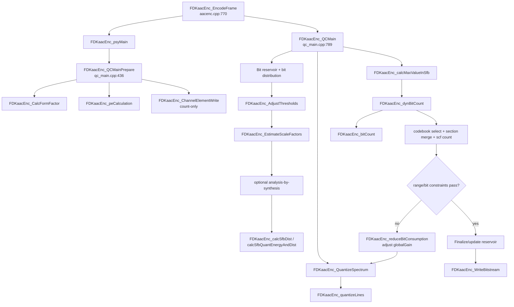

# Bước 1 — Reverse-engineer Quantization trong FDK-AAC AAC-LC

## 1. Baseline và kết luận chính

Phân tích này bám repository cục bộ tại commit `35f9c13cb6df0c5d4e7ba958ef2d251c48b8d1d9`. Mọi line number bên dưới ứng với baseline đó.

Năm kết luận phải khóa trước khi viết model:

1. **FDK không có một hàm “Quantization” duy nhất.** Quantizer số học nằm trong `quantize.cpp`, còn scalefactor search, threshold/bit allocation, Huffman cost và outer rate loop nằm ở các module khác.
2. **Input thật của spectral quantizer không phải MDCT thô.** Đó là spectrum 1024 line sau các xử lý Psy/TNS/stereo/grouping. `PSY_OUT_CHANNEL::mdctSpectrum` alias trực tiếp `QC_OUT_CHANNEL::mdctSpectrum` ([`aacenc.cpp:797–810`](../../../../libAACenc/src/aacenc.cpp)).
3. **AAC-LC không bật dead-zone mode trong baseline này.** `dZoneQuantEnable=1` chỉ khi `isLowDelay != 0` và bitrate thỏa điều kiện ([`qc_main.cpp:401–411`](../../../../libAACenc/src/qc_main.cpp)); vì thế AAC-LC dùng offset `-0.0946 + 0.5 = 0.4054`, không phải `0.23`.
4. **Quantizer không clip output về 8191.** Nó cast sang `SHORT`; encoder tránh overflow bằng lower-bound cho scalefactor và kiểm tra `MAX_QUANT=8191` sau quantization. Standalone model phải có chế độ strict để báo input vi phạm, không âm thầm saturate.
5. **Inverse quantization chỉ thuộc scalefactor analysis-by-synthesis, không thuộc forward datapath cuối.** Nó được dùng khi `AACENC_AFTERBURNER` bật; `useRequant` được ánh xạ thành `invQuant=2` ([`aacenc.cpp:717–731`](../../../../libAACenc/src/aacenc.cpp)).

## 2. Ranh giới phạm vi

### 2.1 Spectral quantizer kernel

Khối hẹp, deterministic sau khi có gain:

```text
{mdctSpectrum, sfbOffsets, sfb geometry, globalGain, scf, mode}
    -> effective_gain_per_sfb = globalGain - scf[sfb]
    -> normalize |X|
    -> LUT/power 3/4 + gain residue + shifts
    -> rounding offset + sign restore
    -> quantSpec
    -> maxValueInSfb + maxValueAll
```

### 2.2 Quantization control environment

Khối rộng, stateful và iterative:

```text
Psy energy/threshold/form factor + bit budget/reservoir
    -> PE + threshold adaptation
    -> initial scalefactor estimate
    -> optional quantize/inverse-quantize/distortion search
    -> globalGain/scf representation
    -> spectral quantization
    -> codebook/section/Huffman bit count
    -> adjust globalGain or crash recovery
    -> repeat until constraints pass
```

Hai phạm vi cần có model phần mềm riêng. RTL đầu tiên không nên kéo cả reservoir, PE và variable-iteration controller vào cùng quantizer datapath.

## 3. Call graph từ encoder



Top-level sequence được xác nhận tại [`aacenc.cpp:823–995`](../../../../libAACenc/src/aacenc.cpp). Thân outer loop nằm tại [`qc_main.cpp:905–1127`](../../../../libAACenc/src/qc_main.cpp).

### 3.1 Source/function map

| Giai đoạn | File | Hàm chính | Vai trò trong luồng |
|---|---|---|---|
| Frame orchestration | `aacenc.cpp` | `FDKaacEnc_EncodeFrame()` | Gọi Psy, QC prepare/main/finalize và bitstream theo đúng thứ tự. |
| QC prepare | `qc_main.cpp` | `FDKaacEnc_QCMainPrepare()` | Form factor, PE ban đầu, static-bit count. |
| PE/bit allocation | `adj_thr.cpp`, `line_pe.cpp` | `FDKaacEnc_peCalculation()`, `FDKaacEnc_DistributeBits()` | Biến energy/threshold thành PE và granted bit/PE. |
| Threshold control | `adj_thr.cpp` | `FDKaacEnc_AdjustThresholds()` | Sửa masking threshold theo CBR/VBR, reservoir, min-SNR và avoid-hole. |
| Initial/optimized SF | `sf_estim.cpp` | `FDKaacEnc_EstimateScaleFactors()` | Estimate absolute scale, optional analysis-by-synthesis, xuất `globalGain/scf`. |
| Forward quantizer | `quantize.cpp` | `FDKaacEnc_QuantizeSpectrum()`, `FDKaacEnc_quantizeLines()` | SFB traversal và nonlinear `3/4` quantization. |
| Reconstruction/metric | `quantize.cpp` | `FDKaacEnc_invQuantizeLines()`, `FDKaacEnc_calcSfbDist()`, `FDKaacEnc_calcSfbQuantEnergyAndDist()` | Candidate reconstruction và distortion/energy theo SFB trong search. |
| Range reduction | `qc_main.cpp` | `FDKaacEnc_calcMaxValueInSfb()` | Max magnitude mỗi SFB/toàn channel và `MAX_QUANT` check. |
| Huffman cost | `bit_cnt.cpp` | `FDKaacEnc_bitCount()` | Cost cho từng spectral codebook, sign và escape bits. |
| Sectioning | `dyn_bits.cpp` | `FDKaacEnc_dynBitCount()`, `FDKaacEnc_noiselessCounter()`, `gmStage0/1/2` | Chọn/merge codebook sections và cộng dynamic bits. |
| Rate feedback | `qc_main.cpp` | `FDKaacEnc_reduceBitConsumption()`, `FDKaacEnc_crashRecovery()` | Đổi global gain hoặc zero band khi constraint fail. |
| Syntax emission | `bitenc.cpp` | `FDKaacEnc_encodeGlobalGain()`, `FDKaacEnc_encodeScaleFactorData()`, `FDKaacEnc_encodeSpectralData()` | Chuyển kết quả QC thành AAC syntax/Huffman codeword. |

## 4. Data pipeline theo frame/channel/SFB

### 4.1 Trước QC

1. Filterbank tạo spectrum và exponent `mdctScale`.
2. Psy có thể thay spectrum bằng low-pass, TNS và stereo tools.
3. Short windows được gom group; `sfbOffsets[]` mô tả layout grouped thực trong buffer.
4. Psy xuất energy, masking threshold, min-SNR, PNS/IS/TNS/MS metadata.

Do alias buffer, không có bước copy MDCT giữa Psy và QC: Psy ghi ngay vào `QC_OUT_CHANNEL::mdctSpectrum[1024]` ([`psy_main.cpp:468–474`](../../../../libAACenc/src/psy_main.cpp)).

### 4.2 Prepare và bit allocation

`FDKaacEnc_QCMainPrepare()`:

- tính `sfbFormFactorLdData` bằng tổng `sqrt(abs(spec))` theo SFB ([`sf_estim.cpp:132–173`](../../../../libAACenc/src/sf_estim.cpp));
- tính PE từ energy/threshold;
- chạy bitstream writer với bitstream null để đếm static syntax bits ([`qc_main.cpp:436–459`](../../../../libAACenc/src/qc_main.cpp)).

Sau khi reservoir và static/extension bits được trừ, `FDKaacEnc_AdjustThresholds()` điều chỉnh allowed distortion cho phù hợp granted PE/bits. Đây là feedback từ Psychoacoustic Model và Bit Allocation sang scalefactor estimation, không phải phép toán của line quantizer.

### 4.3 Scalefactor estimation

`FDKaacEnc_EstimateScaleFactorsChannel()` thực hiện:

1. Đánh dấu band không hoạt động bằng `FDK_INT_MIN`.
2. Với band có `energyLdData > thresholdLdData`, tính estimate từ form factor và threshold ở miền log.
3. Tính `maxSpec` và lower bound `minSfMaxQuant` để tránh magnitude lượng tử vượt 8191 ([`sf_estim.cpp:1085–1150`](../../../../libAACenc/src/sf_estim.cpp)).
4. Nếu `invQuant > 0`, thử gain lân cận bằng quantize→inverse-quantize→distortion (`FDKaacEnc_improveScf`).
5. Nếu `invQuant > 1`, chạy thêm `assimilateSingleScf`, `assimilateMultipleScf` và `assimilateMultipleScf2` để đánh đổi distortion, estimated spectral PE và scalefactor Huffman bits ([`sf_estim.cpp:1170–1200`](../../../../libAACenc/src/sf_estim.cpp)).
6. Giới hạn chênh scalefactor tối đa 60.
7. Chọn max absolute scale là `globalGain`, đổi mỗi active band sang `scf = maxSf - absoluteScf`, và zero spectrum cho inactive band ([`sf_estim.cpp:1202–1273`](../../../../libAACenc/src/sf_estim.cpp)).

Do đó `scf[]` được chuyển cho `FDKaacEnc_QuantizeSpectrum()` là offset không âm so với `globalGain`, không còn là absolute candidate dùng trong phần đầu của search.

## 5. Forward spectral quantizer

### 5.1 Giao diện FDK

```cpp
void FDKaacEnc_QuantizeSpectrum(
    INT sfbCnt,
    INT maxSfbPerGroup,
    INT sfbPerGroup,
    const INT *sfbOffset,
    const FIXP_DBL *mdctSpectrum,
    INT globalGain,
    const INT *scalefactors,
    SHORT *quantizedSpectrum,
    INT dZoneQuantEnable);
```

Implementation tại [`quantize.cpp:278–301`](../../../../libAACenc/src/quantize.cpp). Mỗi active SFB gọi line kernel với:

```text
gain = globalGain - scalefactors[sfb]
```

Biểu thức real-number để hiểu ý nghĩa, chưa phải bit-exact specification:

```text
u = |X|^(3/4) * 2^(-3*gain/16)
q = sign(X) * floor(u + k)

k = 0.4054  khi dZoneQuantEnable = 0  (AAC-LC baseline)
k = 0.23    khi dZoneQuantEnable = 1  (LD/ELD condition)
```

FDK không tính `pow()`. [`quantize.cpp:116–169`](../../../../libAACenc/src/quantize.cpp) tách gain theo modulo 4, normalize magnitude bằng CLZ, tra LUT mantissa `FDKaacEnc_mTab_3_4[512]`, nhân LUT exponent/gain, shift, cộng `k`, trích 16 bit và phục hồi dấu. LUT gain ở [`aacEnc_rom.cpp:571–714`](../../../../libAACenc/src/aacEnc_rom.cpp).

Hàm chỉ ghi các line thuộc `maxSfbPerGroup` active band trong mỗi group; nó không clear phần còn lại của `quantizedSpectrum[1024]`. Để vector standalone deterministic mà vẫn phân biệt được hành vi kernel, wrapper sẽ prefill output bằng zero và dump thêm active-line mask; kernel port không được bị ghi sai thành “tự clear 1024 line”.

### 5.2 Rounding, clipping và saturation

- `FL2FXCONST_DBL` chuyển constant sang signed Q1.31 với round-nearest và saturate constant ([`common_fix.h:191–201`](../../../../libFDK/include/common_fix.h)).
- Offset `k` được dịch phải 16 bit trước khi cộng với accumulator.
- Kết quả magnitude được trích bằng arithmetic right shift rồi cast sang signed 16-bit.
- Không có `min(max(q,-8191),8191)` trong line kernel.
- `FDKaacEnc_calcMaxValueInSfb()` tính max sau đó; nếu `>8191`, outer loop đánh dấu constraint fail và tăng `globalGain` để quantize thô hơn ([`qc_main.cpp:945–980`](../../../../libAACenc/src/qc_main.cpp)).

Hệ quả cho verification: vector nominal phải có `abs(q)<=8191`; vector stress vi phạm precondition phải được gắn nhãn riêng. Python model không được tự ý clip vì sẽ che mất bug gain/range của RTL.

## 6. Inverse quantization và distortion

`FDKaacEnc_invQuantizeLines()` dùng LUT `4/3`, exponent table và shift theo gain, thay vì `pow()` ([`quantize.cpp:180–267`](../../../../libAACenc/src/quantize.cpp)). Ý nghĩa lý thuyết là:

```text
X_hat ∝ sign(q) * |q|^(4/3) * 2^(gain/4)
```

Trong code-domain FDK có headroom: distortion so `abs(invQuantSpec)` với `abs(mdctSpectrum >> 1)`. Bước 2 phải suy ra và kiểm chứng factor này từ từng LUT/shift; không được coi comment công thức là đủ để làm bit-exact.

`FDKaacEnc_calcSfbDist()`:

1. forward-quantize từng line;
2. báo invalid bằng zero return nếu `abs(q)>MAX_QUANT`;
3. inverse-quantize;
4. cộng square error trong miền fixed-point;
5. trả `CalcLdData(sum_error)`.

`CalcLdData(v)` biểu diễn xấp xỉ `log2(v)/64` trong Q1.31 (`LD_DATA_SCALING=64`). `FDKaacEnc_calcSfbQuantEnergyAndDist()` trả cả quantized energy và distortion log-domain ([`quantize.cpp:312–400`](../../../../libAACenc/src/quantize.cpp)).

## 7. Outer quantization/rate-distortion loop

`FDKaacEnc_QCMain()` thực hiện vòng lặp theo element/channel:

1. Quantize những channel có `calculateQuant=1`.
2. Tính `maxValueInSfb[]` và reject coefficient vượt 8191.
3. `FDKaacEnc_dynBitCount()` tính spectral Huffman bits, section side bits, scalefactor bits và PNS-energy bits ([`dyn_bits.cpp:617–642`](../../../../libAACenc/src/dyn_bits.cpp)).
4. So tổng bit với granted/available bits, max dynamic bits và min frame demand.
5. `FDKaacEnc_reduceBitConsumption()` thay `globalGain` ±1; gain tăng là quantization thô hơn, rồi đặt `calculateQuant=1` ([`qc_main.cpp:1135–1181`](../../../../libAACenc/src/qc_main.cpp)).
6. Sau `maxIterations` (AAC-LC: 5), crash recovery có thể zero/thay band để cứu bit budget.

Huffman coding không thay công thức quantizer nhưng nó đóng vòng feedback: `quantSpec` quyết định codebook/section/cost; cost quyết định có đổi `globalGain` và quantize lại hay không.

## 8. Input/output contract

### 8.1 Contract cho spectral quantizer standalone

| Trường | Tên FDK / type | Kích thước | Scaling / range hợp lệ | Ý nghĩa và scope |
|---|---|---:|---|---|
| Spectrum | `QC_OUT_CHANNEL::mdctSpectrum`, `FIXP_DBL` = signed 32-bit | 1024/channel | Q1.31 raw `[-1,1)`; physical/block-floating value gắn với exponent `mdctScale` | Spectrum sau Psy/TNS/stereo; mỗi frame, mỗi channel. |
| MDCT exponent | `PSY_OUT_CHANNEL::mdctScale`, `INT` | 1/channel | integer exponent; physical convention phải được khóa ở Bước 2 | Không truyền trực tiếp vào quantizer, nhưng cần trong metadata và bitstream global gain. |
| SFB count | `sfbCnt`, `INT` | scalar | `0..60` | Tổng slot SFB grouped của channel/frame. |
| SFB/group | `sfbPerGroup`, `INT` | scalar | long: một group; short: stride mỗi group | Bước nhảy khi duyệt grouped SFB. |
| Active SFB/group | `maxSfbPerGroup`, `INT` | scalar | `0..51` long, `0..15` short | Số band thực sự quantize mỗi group. |
| SFB offsets | `PSY_OUT_CHANNEL::sfbOffsets`, `INT` | `sfbCnt+1`, storage 61 | monotonic, `0..1024` | Biên line trong grouped spectrum, mỗi frame/channel. |
| Global gain | `QC_OUT_CHANNEL::globalGain`, `INT` | scalar | storage signed 32-bit; valid khi mọi shift hợp lệ và syntax global gain sau hiệu chỉnh nằm trong 8 bit | Gain nền của channel/frame. |
| Scalefactor offsets | `QC_OUT_CHANNEL::scf`, `INT` | storage 60 | active band `0..60`; inactive band 0 sau finalize | Offset theo SFB so với `globalGain`; mỗi frame/channel/SFB. |
| Effective gain | `globalGain - scf[sfb]`, `INT` | 1/SFB | phải thỏa precondition shift/LUT và output range | QSS được line quantizer dùng. |
| Quantizer mode | `dZoneQuantEnable`, `INT` | scalar | `{0,1}`; AAC-LC baseline = 0 | Chọn rounding/dead-zone offset. |
| Quantized spectrum | `QC_OUT_CHANNEL::quantSpec`, `SHORT` | 1024/channel | storage `[-32768,32767]`, accepted AAC spectral range `[-8191,8191]` | Output chính, mỗi frame/channel/line. |
| Max/SFB | `QC_OUT_CHANNEL::maxValueInSfb`, `UINT` | storage 60 | `0..8191` sau khi constraints pass | Output reduction cho range check/Huffman. |
| Global max | return của `FDKaacEnc_calcMaxValueInSfb`, `INT` | scalar | `0..8191` khi pass | Range status mỗi channel/frame. |

`FIXP_DBL`, `INT`, `SHORT` được định nghĩa tại [`common_fix.h:108–171`](../../../../libFDK/include/common_fix.h) và [`machine_type.h:176–192`](../../../../libSYS/include/machine_type.h). `MAX_GROUPED_SFB=60` tại [`psy_const.h:141–154`](../../../../libAACenc/src/psy_const.h). Cấu trúc output tại [`qc_data.h:177–199`](../../../../libAACenc/src/qc_data.h).

### 8.2 Input bổ sung cho full control environment

| Nhóm | Trường FDK chính | Scope / vai trò |
|---|---|---|
| Psychoacoustic | `sfbEnergyLdData[]`, `sfbThresholdLdData[]`, `sfbMinSnrLdData[]`, `sfbSpreadEnergy[]`, `sfbFormFactorLdData[]` | Q1.31 log-domain khi có hậu tố `LdData`; mỗi SFB/channel/frame. |
| Tools | `noiseNrg[]`, `isBook[]`, `isScale[]`, `tnsInfo`, `toolsInfo.msMask[]` | PNS/IS/TNS/MS decisions; mỗi SFB hoặc channel element. |
| Rate control | `grantedDynBits`, `maxDynBits`, `avgTotalBits`, `bitResTot`, `bitResTotMax`, `bitrateMode` | State element/frame và state xuyên frame. |
| Quality mode | `invQuant`, `maxIterations` | `invQuant=0` default; `2` khi Afterburner; AAC-LC max iterations 5. |
| Coding | `syntaxFlags`, window sequence/grouping, channel mapping | Chọn codebooks/syntax và static-bit demand. |

### 8.3 Output bổ sung cho full control environment

| Output | Type / size | Vai trò |
|---|---|---|
| `globalGain`, `scf[]`, `quantSpec[]`, `maxValueInSfb[]` | Như contract hẹp | Payload spectral và gain đã hội tụ. |
| `sectionData.huffsection[60]` | `SECTION_INFO` | Codebook, SFB start/count và bit cost theo section. |
| `sectionData.{huffmanBits,sideInfoBits,scalefacBits,noiseNrgBits}` | `INT` scalar | Breakdown expected cho verification. |
| `dynBitsUsed`, `usedDynBits`, `totalBits` | `INT` | Kết quả rate control theo element/frame. |
| `iteration_count`, `constraint flags` | Chưa được lưu trong public output | Phải bổ sung vào instrumentation C++ để debug. |

## 9. Test-vector format đề xuất

Không dùng file text rời không metadata. Mỗi case nên có manifest JSON và các file integer thập phân/hex, tất cả đều ghi raw code-word:

```text
vectors/
  my_workspace/INPUT/data/<case_id>/
    manifest.json
    input_mdct_q31.txt
    sfb_offsets.txt
    scalefactor.txt
    global_gain.txt
    quantized_spectrum_prefill.txt
  expected/<case_id>/
    quantized_spectrum_ref.txt
    max_value_in_sfb_ref.txt
    intermediate_results.jsonl
    section_data_ref.json
    bit_count_ref.json
```

`manifest.json` tối thiểu:

```json
{
  "schema_version": 1,
  "source_commit": "35f9c13cb6df0c5d4e7ba958ef2d251c48b8d1d9",
  "aot": "AAC-LC",
  "sample_rate_hz": 48000,
  "channel": 0,
  "frame_index": 0,
  "window_sequence": "LONG_WINDOW",
  "mdct_scale": 0,
  "sfb_cnt": 0,
  "sfb_per_group": 0,
  "max_sfb_per_group": 0,
  "dzone_quant_enable": 0,
  "quant_output_prefill": "zero",
  "integer_encoding": "signed-decimal",
  "endianness": "not-applicable-text"
}
```

`intermediate_results.jsonl` nên có một record mỗi line với `sfb`, `line`, `input_raw`, `gain`, `sign`, `accu_after_gain`, `clz_shift`, `lut_index_3_4`, `total_shift_before`, `gain_table_index`, `accu_after_pow`, `total_shift_after`, `rounding_offset_raw`, `output_raw`. Trường không quan sát được vì hàm hiện là `static` sẽ được thêm qua instrumentation trong Bước 4.

## 10. Đề xuất chia sub-block cho hardware

| Sub-block | Chức năng | Kiến trúc phù hợp | Khuyến nghị |
|---|---|---|---|
| SFB walker/gain generator | Duyệt offsets, phát `globalGain-scf` | Counter + small RAM | PL, ghép quantizer. |
| Normalize/address generation | abs/sign, CLZ, LUT index, exponent decomposition | CLZ + combinational control | PL. |
| `3/4` quantizer datapath | ROM 512, gain ROM 4, multiply, shifts, rounding | BRAM/ROM + DSP + barrel shift | PL ưu tiên 1. |
| Max reducer/SFB | `max(abs(q))` | Comparator tree/stream reduction | PL, chung stream output. |
| `4/3` inverse datapath | Reconstruction cho analysis-by-synthesis | ROM + DSP + shifts | PL giai đoạn 2 nếu profiling có lợi. |
| Distortion/energy reducer | Square error, sum, log conversion | DSP + accumulator + log LUT | PL giai đoạn 2; trả metric/SFB. |
| Scalefactor search controller | Candidate generation, PE/scf-bit tradeoff | Control phụ thuộc dữ liệu | Giữ PS ban đầu. |
| Huffman bit-cost | Cost codebook theo SFB | ROM + parallel accumulators | Chỉ offload sau profiling. |
| Greedy section merge | Variable iteration, linked sections | Control-heavy | Giữ PS. |
| Reservoir/threshold/rate loop | State xuyên frame, CBR/VBR, crash recovery | Branch/state-heavy | Giữ PS. |
| Huffman emission/bitstream | Variable-length packing và syntax | Bit-serial control | Giữ PS. |

Version RTL đầu tiên nên có interface streaming cho `{X_raw, gain, sfb_start/end}` và output `{q_raw, max_sfb, error_flags}`. Các LUT và thứ tự shift phải copy từ golden fixed-point model; LUT/polynomial/CORDIC approximation chỉ được đánh giá trong nhánh non-golden.

## 11. Gate chuyển sang Bước 2

Trước khi code model, Bước 2 phải chốt bằng test/proof những điểm sau:

1. Quy ước block-floating chính xác giữa raw Q1.31 và `mdctScale`.
2. Từng factor `1/2` của `fMultDiv2`, LUT `3/4`, LUT `4/3` và distortion comparison.
3. Arithmetic-right-shift với số âm trên compiler baseline.
4. Hành vi 32-bit overflow/wrap và 16-bit narrowing cast; phân biệt precondition vi phạm với nominal behavior.
5. Mapping internal `globalGain/scf/mdctScale` sang 8-bit `global_gain` trong bitstream: `globalGain - firstScf + 100 - 4*(LOG_NORM_PCM-mdctScale)` ([`bitenc.cpp:114–167`](../../../../libAACenc/src/bitenc.cpp)).
6. Formula lý thuyết trong ISO/IEC 14496-3 và điểm FDK dùng approximation/LUT.

Gate này đã được đóng cho phạm vi spectral kernel: bảng ROM được trích trực tiếp, Python fixed và C++ standalone đã khớp `FDKaacEnc_QuantizeSpectrum` trên vector long/short/dead-zone, và quy tắc arithmetic shift/range được test. Mapping `mdctScale` sang syntax thuộc adapter bitstream/outer control, không nằm trong interface kernel v1; xem [`quantization_theory.md`](quantization_theory.md) và [`algorithm_mapping.md`](algorithm_mapping.md).
