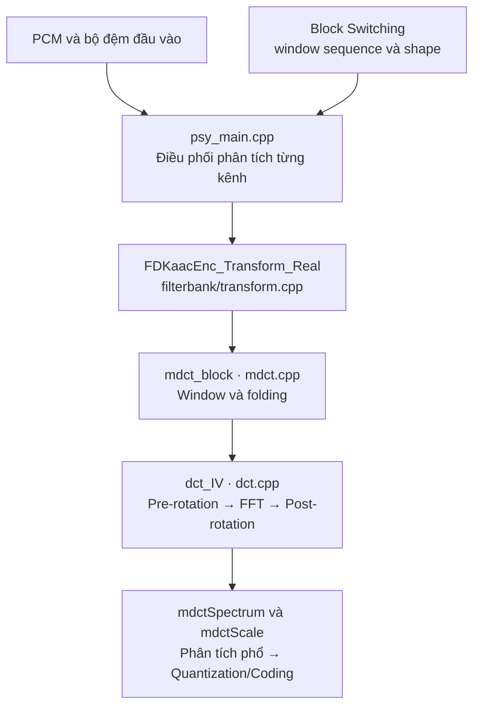
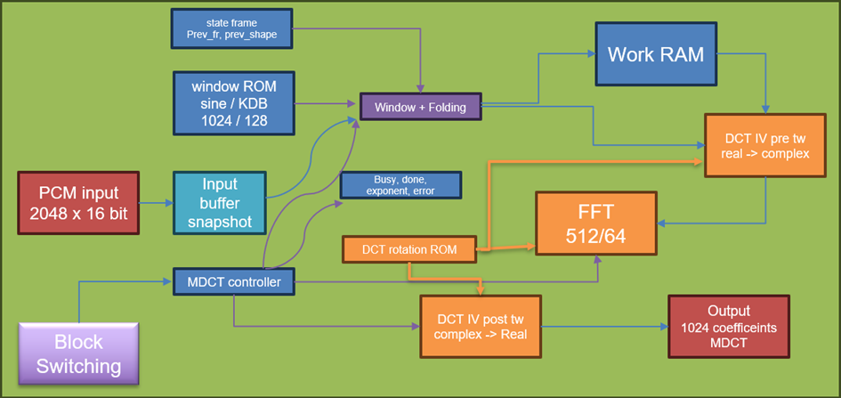
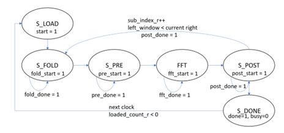
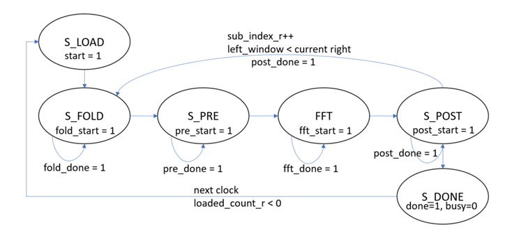
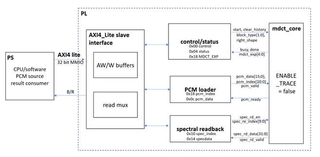
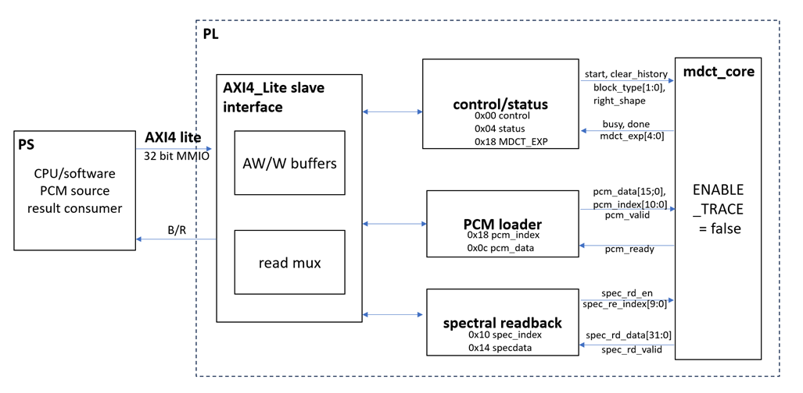

# Window/MDCT trong AAC-LC

Khối **Window/MDCT** thực hiện analysis filterbank cho AAC-LC: nhận snapshot PCM, áp dụng cửa sổ và folding, sau đó biến đổi sang miền tần số bằng DCT-IV dựa trên FFT radix-2. Tài liệu giữ bố cục của bản phác thảo và đối chiếu với mã FDK-AAC, reference model, RTL và driver trong workspace này.

> **Cấu hình hiện có:** AAC-LC, frame 1024 mẫu/kênh, snapshot 2048 mẫu PCM16, datapath Q1.31, hệ số Q1.15, FFT64/512, giao tiếp PS–PL bằng AXI4-Lite MMIO. Stereo, AXI4-Stream/AXI DMA và HAL tích hợp encoder là các hạng mục phát triển tiếp.

**Mục lục**

- [1. Giới thiệu tổng quan](#1-giới-thiệu-tổng-quan)
- [2. Tình trạng hiện tại của module Window/MDCT](#2-tình-trạng-hiện-tại-của-module-windowmdct)
- [3. Mục tiêu và phạm vi](#3-mục-tiêu-và-phạm-vi)
- [4. Thông số cố định và mã hóa](#4-thông-số-cố-định-và-mã-hóa)
- [5. Kiến trúc tổng quan](#5-kiến-trúc-tổng-quan)
- [6. Hướng dẫn sử dụng và cách chạy](#6-hướng-dẫn-sử-dụng-và-cách-chạy)

---

## 1. Giới thiệu tổng quan

Window/MDCT thuộc **analysis filterbank** của encoder AAC-LC. Khối này chuyển tín hiệu PCM trong miền thời gian thành các hệ số phổ để phần psychoacoustic tiếp tục tính năng lượng, masking, TNS/PNS và cung cấp dữ liệu cho lượng tử hóa, mã hóa bitstream.

Trong workspace, đường gọi phần mềm là:



Về nguyên lý, một biến đổi MDCT nhận $2L$ mẫu đã chọn cửa sổ và sinh $L$ hệ số:

$$
X[k]=\sum_{n=0}^{2L-1}x[n]w[n]
\cos\left[\frac{\pi}{L}\left(n+\frac{1}{2}+\frac{L}{2}\right)
\left(k+\frac{1}{2}\right)\right],
\qquad 0\le k<L.
$$

Đây là biểu thức giải thích nguyên lý; khi đối chiếu FDK phải dùng đúng gain, cách folding, bảng hệ số lượng tử hóa và exponent ở [mục 5.2](#52-hợp-đồng-số-học). Không dùng trực tiếp công thức floating-point này làm chuẩn so sánh hexadecimal.

- **LONG/START/STOP:** một biến đổi $L=1024$, FFT phức $M=L/2=512$ điểm.
- **SHORT:** tám biến đổi $L=128$, mỗi biến đổi dùng FFT phức $M=64$ điểm; ghép lại vẫn có $8\times128=1024$ hệ số/frame.
- Hai snapshot của các frame liên tiếp cách nhau **1024 mẫu**, chồng lấn 50% trên snapshot 2048 mẫu. Bộ đệm phía trước chịu trách nhiệm tạo overlap và padding.

Khối được hiện thực bằng **VHDL** để triển khai trên phần **PL của PYNQ-Z2**. PS cung cấp PCM và thông tin cửa sổ, khởi động phép biến đổi, sau đó đọc phổ cùng exponent. Phần cứng chỉ đảm nhiệm phép biến đổi; quyết định block switching và các bước psychoacoustic còn lại nằm ngoài `mdct_core`.

Nguồn đối chiếu chính: [psy_main.cpp](../../libAACenc/src/psy_model/psy_main.cpp), [transform.cpp](../../libAACenc/src/filterbank/transform.cpp), [mdct.cpp](../../libFDK/src/mdct.cpp), [dct.cpp](../../libFDK/src/dct.cpp). Cách ghép window/fold rồi gọi DCT-IV cũng được mô tả trong [mã MDCT FDK-AAC upstream](https://github.com/mstorsjo/fdk-aac/blob/master/libFDK/src/mdct.cpp); thông số triển khai trong README này lấy theo snapshot cục bộ.

## 2. Tình trạng hiện tại của module Window/MDCT

| Hạng mục | Hiện trạng trong workspace | Bằng chứng và giới hạn |
| :--- | :--- | :--- |
| Kiến trúc phần mềm | Có reference C++ và Python mô tả window/fold, DCT-IV pre/post và FFT radix-2 | [Reference C++](ref/fixed_mdct_radix2.cpp), [reference Python](ref/mdct_radix2_model.py); giữ quy tắc fixed-point và ROM của FDK |
| Đối chiếu FDK | Có harness so sánh reference với `mdct_block()` và `dct_IV()` gốc, dùng kernel `dit_fft` của FDK cho FFT64/512 | [verify_mdct_fdk.cpp](tb/verify_mdct_fdk.cpp); lịch sử bàn giao ghi nhận 6144 hệ số khớp, xem [CHANGES_RESEARCH.md, phần 5](../../CHANGES_RESEARCH.md) |
| Top-level biến đổi | Đã có `mdct_core.vhd` xử lý một luồng mono, đầy đủ LONG/START/SHORT/STOP và SINE/KBD | Có testbench kiểm tra từng biên fold/pre/FFT/post/final; biên bản bàn giao ghi **chưa chạy mô phỏng VHDL** do thiếu GHDL |
| Ngoại vi PS–PL | Đã có `mdct_axi_lite.vhd`, truy cập thanh ghi và truyền dữ liệu bằng MMIO 32 bit | Có driver PYNQ và testbench AXI; đây là đường giao tiếp hiện tại |
| Triển khai PYNQ-Z2 | Có Tcl dựng hệ PS–PL, tổng hợp, place/route, kiểm tra timing và xuất cặp `.bit`/`.hwh` | Snapshot hiện tại không kèm report triển khai, overlay hoặc kết quả chạy FPGA |
| Stereo | Định hướng mở rộng | Core hiện có một bộ trạng thái cửa sổ; cần giữ lịch sử riêng cho từng kênh |
| AXI4-Stream và DMA | Định hướng thay đường truyền PCM/phổ bằng AXI DMA MM2S/S2MM | Chưa có adapter streaming/DMA trong module hiện tại |
| Tích hợp vào encoder FDK | Định hướng dùng HAL/driver để thay lời gọi biến đổi phần mềm bằng accelerator PL | `psy_main.cpp` hiện vẫn gọi đường transform phần mềm; chưa có HAL chuyển tiếp sang PL trong đường gọi này |

**Kết quả phần mềm đã được ghi nhận trước đó:** [CHANGES_RESEARCH.md, phần 4–5](../../CHANGES_RESEARCH.md) ghi build/kiểm thử host, C++/Python khớp 0 LSB trên 18 frame và 39 subtransform, cùng đối chiếu native FDK. Đây là kết quả lịch sử được ghi trong repo, không phải log chạy mới của lần biên tập tài liệu này.

**Điểm cần giữ khi diễn giải kết quả:** [kiểm chứng Block Switching](../block_switch/docs/verification.md) đang ghi DUT–REF **FAIL** do bảng `blockType2windowShape` thiếu hàng LD trước hàng LC. Việc reference Window/MDCT khớp số học không chứng minh policy chọn cửa sổ của toàn encoder đã đúng upstream. Nên kiểm tra riêng block type/shape truyền vào accelerator.

## 3. Mục tiêu và phạm vi

**Mục tiêu**

- Chuyển phép tính Window/MDCT từ CPU sang PL nhưng giữ giao ước phổ và exponent mà encoder FDK sử dụng.
- Tái sử dụng một FFT radix-2 cho hai kích thước 64/512, chọn theo từng frame ở runtime.
- Giữ kết quả **bit-exact** với profile Q31/Q15 đã khóa: cùng thứ tự phép toán, vị trí truncate, dịch số học và overflow wrap.
- Có thể kiểm tra từng ranh giới datapath bằng golden vector trước khi tích hợp vào pipeline AAC-LC.

**Phạm vi hiện tại**

| Có trong module | Ngoài phạm vi hiện tại |
| :--- | :--- |
| AAC-LC frame 1024, PCM signed 16 bit, một kênh/luồng | Frame 960, PCM24/32, AAC-LD/ELD, HE-AAC/SBR |
| Bốn window sequence và hai window shape SINE/KBD | Tự phát hiện transient hoặc tự chọn block type/shape |
| Snapshot 2048 mẫu → 1024 hệ số Q31 và một exponent/frame | Tự tạo overlap, đọc WAV hoặc quản lý audio I/O |
| AXI4-Lite MMIO, polling trạng thái, trace tùy chọn | AXI4-Stream, DMA, interrupt và xử lý stereo đồng thời |
| Window/fold → DCT-IV → phổ theo thứ tự FDK | IMDCT/decoder, SFB, masking, TNS/PNS, lượng tử hóa và ghi bitstream |

Điều kiện nghiệm thu số học là **0 LSB mismatch và đúng exponent** trên bộ vector, gồm cả các chuyển tiếp LONG → START → SHORT → STOP → LONG và thay đổi SINE/KBD. Điều kiện nghiệm thu hệ thống cần thêm mô phỏng giao tiếp, timing sau route và kiểm thử trên board; từng lớp phải có kết quả riêng.

## 4. Thông số cố định và mã hóa

Thông số được khai báo tại [mdct_pkg.vhd](rtl/mdct_pkg.vhd) và [fft_radix2_pkg.vhd](fft_radix2_core/rtl/fft_radix2_pkg.vhd).

| Thông số | Giá trị | Ý nghĩa |
| :--- | :---: | :--- |
| Profile MDCT | `FDK_AACLC_1024_MDCT_Q31Q15_RAD2_V1` | Hợp đồng số học của reference C++ |
| Profile FFT | `FDK_AACLC_1024_Q31Q15_RAD2_V1` | FFT forward, pure radix-2 DIT |
| `MDCT_FRAME_LEN` | 1024 | Số mẫu mới và số hệ số phổ/frame/kênh |
| `MDCT_SNAPSHOT_N` | 2048 | Số mẫu PCM phải nạp cho mỗi lệnh |
| `MDCT_SHORT_LEN` / `MDCT_SHORT_COUNT` | 128 / 8 | Kích thước và số short transform |
| PCM | signed 16 bit, Q1.15 | Khoảng integer $[-32768,32767]$ |
| Datapath/phổ | signed 32 bit, Q1.31 | Mantissa; luôn đi kèm exponent |
| Hệ số | signed 16 bit, Q1.15 | Window, pre/post rotation và FFT twiddle |
| Chỉ số PCM / phổ / FFT | 11 / 10 / 9 bit | Tương ứng 0–2047 / 0–1023 / 0–511 |
| `size_mode` | `0`: FFT64; `1`: FFT512 | Cùng quy ước trong MDCT và FFT |
| `right_shape` | `0`: SINE; `1`: KBD | Chọn cửa sổ phải của frame hiện tại |
| Số học | Truncate, arithmetic shift, wrap 32 bit | Không saturation, không round-to-nearest |

**Mã hóa block type và hình học biến đổi**

| `block_type` | Tên FDK / RTL | Số biến đổi | $L$ | $M=L/2$ | Sườn phải $f_r$ | Exponent cuối |
| :---: | :--- | ---: | ---: | ---: | ---: | ---: |
| `00` | `LONG_WINDOW` / `MDCT_LONG` | 1 | 1024 | 512 | 1024 | 12 |
| `01` | `START_WINDOW` / `MDCT_START` | 1 | 1024 | 512 | 128 | 12 |
| `10` | `SHORT_WINDOW` / `MDCT_SHORT` | 8 | 128 | 64 | 128 | 9 |
| `11` | `STOP_WINDOW` / `MDCT_STOP` | 1 | 1024 | 512 | 1024 | 12 |

Sườn trái $f_l$ và shape trái lấy từ **sườn phải của biến đổi trước**, không chỉ suy ra từ `block_type` hiện tại. Với chuỗi chuyển tiếp hợp lệ thông thường:

| Sequence | $f_l$ | $f_r$ | $n_l=(L-f_l)/2$ | $n_r=(L-f_r)/2$ |
| :--- | ---: | ---: | ---: | ---: |
| LONG sau LONG/STOP | 1024 | 1024 | 0 | 0 |
| START sau LONG | 1024 | 128 | 0 | 448 |
| SHORT sau START/SHORT | 128 | 128 | 0 | 0 |
| STOP sau SHORT | 128 | 1024 | 448 | 0 |

Ở cold start hoặc khi `clear_history=1`, core dùng shape và sườn phải hiện tại để khởi tạo sườn trái. Vì thế bảng trên mô tả chuỗi đã có lịch sử hợp lệ; không áp dụng máy móc cho frame đầu tiên. Core không có FSM kiểm tra toàn bộ tính hợp lệ của chuỗi AAC; phía điều khiển phải cung cấp sequence phù hợp.

Với short transform thứ $q$:

$$
b_{\mathrm{in}}(q)=448+128q,\qquad
b_{\mathrm{out}}(q)=128q,\qquad 0\le q<8.
$$

Mỗi short transform đọc 256 mẫu từ snapshot và ghi 128 hệ số liên tiếp. Ví dụ $q=0$ đọc PCM 448–703, ghi phổ 0–127; $q=7$ đọc PCM 1344–1599, ghi phổ 896–1023. Các short transform chồng lấn nhau 128 mẫu.

## 5. Kiến trúc tổng quan

Core tách **control plane** khỏi **datapath**, dùng bộ nhớ trung gian để tái sử dụng các engine theo từng subtransform. Pipeline dưới đây mô tả đường dữ liệu; các pha được FSM điều phối tuần tự.


FFT có twiddle ROM và hai bank RAM ping-pong riêng. `Work RAM` nằm trong pre-engine, còn `FFT cache` nằm trong post-engine; không phải hai giao diện ngoài `mdct_core`.

<details>
<summary>Ảnh phác thảo kiến trúc ban đầu</summary>



Ảnh được giữ làm tham chiếu. Tên cửa sổ đúng là **KBD**; sơ đồ khối và tên module ở trên theo RTL hiện tại.

</details>

### 5.1. Giao diện `mdct_core`

Khai báo đầy đủ: [mdct_core.vhd](rtl/mdct_core.vhd). Core chạy trên một clock, reset active-low; generic `ENABLE_TRACE` mặc định `false`.

| Nhóm | Tín hiệu | Hướng so với core | Rộng | Quy ước |
| :--- | :--- | :---: | :---: | :--- |
| Clock/reset | `clk`, `rst_n` | In | 1 mỗi tín hiệu | Giao dịch tại cạnh lên; `rst_n=0` reset điều khiển |
| Nạp PCM | `pcm_valid` / `pcm_ready` | In / Out | 1 / 1 | Chấp nhận mẫu khi cả hai cùng bằng 1 |
| Nạp PCM | `pcm_index` | In | 11 | Bắt buộc liên tục từ 0 đến 2047 |
| Nạp PCM | `pcm_data` | In | 16 signed | Mẫu PCM Q1.15 |
| Lệnh frame | `start` | In | 1 | Xung một chu kỳ, sau khi nạp đủ snapshot |
| Lệnh frame | `block_type` | In | 2 | LONG/START/SHORT/STOP |
| Lệnh frame | `right_shape` | In | 1 | SINE/KBD; chốt khi nhận lệnh |
| Lệnh frame | `clear_history` | In | 1 | Xóa hiệu lực lịch sử cửa sổ ở pha LOAD; có thể đi cùng `start` |
| Trạng thái | `busy` | Out | 1 | Bằng 1 trong các pha tính toán |
| Trạng thái | `done` | Out | 1 | Xung một chu kỳ ở `S_DONE` |
| Trạng thái | `mdct_exp` | Out | 5 | 12 cho long transform; 9 cho short transform |
| Đọc phổ | `spec_rd_en`, `spec_rd_index` | In | 1 / 10 | Yêu cầu đọc đồng bộ theo địa chỉ 0–1023 |
| Đọc phổ | `spec_rd_valid`, `spec_rd_data` | Out | 1 / 32 signed | Kết quả đọc sau cạnh clock, chỉ lấy khi valid |
| Trace | `trace_sub_index` | Out | 3 | Short subtransform hiện tại, 0–7 |
| Trace | `trace_fold_*`, `trace_pre_*`, `trace_fft_*`, `trace_post_*` | Out | Theo từng biên | Valid, index và dữ liệu đã được chấp nhận |
| Trace FFT | `trace_fft_stage_*`, `trace_fft_addr_*`, `trace_fft_a_*`, `trace_fft_b_*` | Out | Theo khai báo entity | Quan sát stage và hai kết quả butterfly |

**Hợp đồng sử dụng**

- Nạp đủ 2048 mẫu trước `start`; không đồng thời nạp PCM và phát lệnh bắt đầu. `pcm_ready` còn phụ thuộc địa chỉ mong đợi, không chỉ trạng thái rảnh.
- Khi `busy=1`, không nạp snapshot mới. Thiết kế hiện tại chưa double-buffer input để chồng lấp frame.
- Đọc phổ sau `done`; core cung cấp RAM read port, không tự phát luồng AXI4-Stream. RAM có thể đọc được về mặt điện trong lúc tính, nhưng dữ liệu lúc đó có thể chưa hoàn chỉnh.
- `done` của core là xung; wrapper AXI giữ lại bằng cờ `DONE` sticky để PS polling không bỏ lỡ.
- `clear_history` chỉ tác động lịch sử cửa sổ, không khởi tạo lại bộ đếm của một snapshot đã nạp dở. Reset core/overlay khi cần phục hồi giao dịch lỗi.
- Một instance hiện giữ lịch sử cho một luồng liên tục. Không xen kẽ hai kênh stereo vào cùng instance nếu chưa có cơ chế lưu/phục hồi lịch sử từng kênh.

### 5.2. Hợp đồng số học

**Biểu diễn mantissa–exponent**

Với integer 32 bit $m$ và exponent $e$, giá trị khôi phục theo quy ước FDK là:

$$
v_{\mathrm{FDK}}=\frac{m}{2^{31}}\,2^e.
$$

PCM chuẩn hóa có thể được viết $x_{\mathrm{norm}}=p/2^{15}$, với $p$ là PCM integer. Gain của Window/MDCT phải theo cặp mantissa–exponent của FDK; không tự chuẩn hóa từng frame hoặc từng stage theo peak khi so sánh.

| Biên datapath | Kiểu dữ liệu | LONG/START/STOP | SHORT |
| :--- | :--- | ---: | ---: |
| Sau window/fold | $L$ số thực Q31 | $e=2$ | $e=2$ |
| Sau pre-rotation | $M$ số phức Q31 | $e=4$ | $e=4$ |
| FFT tăng exponent | Scale cố định theo stage | $+8$ | $+5$ |
| Sau FFT | $M$ số phức Q31 | $e=12$ | $e=9$ |
| Sau post-rotation | $L$ số thực Q31 | $e=12$ | $e=9$ |

$$
e_{\mathrm{out}}=2_{\mathrm{fold}}+2_{\mathrm{pre}}
+\left(\log_2 M-1\right)_{\mathrm{FFT}}
=\begin{cases}12,&M=512,\\9,&M=64.\end{cases}
$$

**Phép toán fixed-point**

Đặt $\operatorname{wrap}_{32}$ là phép giữ 32 bit thấp và diễn giải lại dưới dạng signed two's complement:

$$
\operatorname{wrap}_{32}(z)=\left((z+2^{31})\bmod 2^{32}\right)-2^{31}.
$$

Phép dịch phải là dịch số học, tương đương làm tròn về $-\infty$:

$$
\operatorname{ASR}(z,s)=\left\lfloor\frac{z}{2^s}\right\rfloor.
$$

Với $a$ là integer Q31, $c$ là integer Q15:

$$
\begin{aligned}
\operatorname{fMultDiv2}(a,c)
&=\operatorname{wrap}_{32}\!\left(\operatorname{ASR}(ac,16)\right),\\
\operatorname{fMult}(a,c)
&=\operatorname{wrap}_{32}\!\left(2\operatorname{fMultDiv2}(a,c)\right).
\end{aligned}
$$

`fMult` phải truncate **trước** khi nhân đôi; nói chung không thay bằng một phép `ASR(a*c, 15)`. Cộng, trừ và đổi dấu đều wrap; các tích trong phép nhân phức được truncate riêng trước khi cộng/trừ. Thay đổi thứ tự này có thể tạo sai khác LSB.

**Window và folding**

SINE có biểu thức lý tưởng trên cửa sổ dài $2L$:

$$
w_{\mathrm{sine}}[n]=\sin\!\left[\frac{\pi}{2L}\left(n+\frac12\right)\right],
\qquad 0\le n<2L.
$$

Với cửa sổ đối xứng cùng độ dài, điều kiện Princen–Bradley là:

$$
w^2[n]+w^2[n+L]=1,\qquad 0\le n<L.
$$

Trong thực thi, lấy đúng các bảng `SineWindow1024`, `KBDWindow1024`, `SineWindow128`, `KBDWindow128` từ [FDK_tools_rom.cpp](../../libFDK/src/FDK_tools_rom.cpp). Biểu thức lý tưởng không thay thế bảng Q15. Các frame START/STOP ghép sườn dài/ngắn và phần phẳng/zero theo hình học ở mục 4.

Gọi $p[n]$ là PCM integer của subtransform, $W_l[i]=(c_l[i],s_l[i])$, $W_r[i]=(c_r[i],s_r[i])$ là cặp `re/im` integer Q15. Bốn vòng fold của FDK tương ứng:

$$
\begin{aligned}
u[L/2+i]
&=\operatorname{wrap}_{32}\!\left(-p[L-i-1]2^{15}\right),
&&0\le i<n_l,\\
u[L/2+n_l+i]
&=\operatorname{wrap}_{32}\!\left(p[n_l+i]s_l[i]-p[L-n_l-i-1]c_l[i]\right),
&&0\le i<f_l/2,\\
u[L/2-1-i]
&=\operatorname{wrap}_{32}\!\left(-p[L+i]2^{15}\right),
&&0\le i<n_r,\\
u[L/2-n_r-i-1]
&=\operatorname{wrap}_{32}\!\left(-p[L+n_r+i]c_r[i]-p[2L-n_r-i-1]s_r[i]\right),
&&0\le i<f_r/2.
\end{aligned}
$$

Tích PCM16 × Q15 được giữ đủ 32 bit ở biên này. Fold rút $2L$ mẫu xuống $L$ mẫu thực; về hình học tương ứng ghép $(-D-C^r,\ A-B^r)$ sau khi áp cửa sổ. RTL phát các mẫu fold theo chỉ số tự nhiên dù FDK ghi kết quả theo bốn vòng địa chỉ.

**Pre-rotation, FFT và post-rotation**

DCT-IV lý tưởng của vector đã fold là:

$$
Y[k]=\sum_{n=0}^{L-1}u_{\mathrm{FDK}}[n]
\cos\!\left[\frac{\pi}{L}\left(n+\frac12\right)\left(k+\frac12\right)\right].
$$

Pre-rotation đóng gói $L$ giá trị thực thành $M=L/2$ giá trị phức. Theo [mdct_dct4_pre.vhd](rtl/mdct_dct4_pre.vhd), với chỉ số FFT $m$:

$$
t(m)=\begin{cases}
2m,&0\le m<M/2,\\
2(M-1-m)+1,&M/2\le m<M.
\end{cases}
$$

Đặt $a=u[L-1-t]+j\,u[t]$ và $c=a(c_t+j s_t)$; các thành phần của phép nhân $c$ dùng `fMultDiv2`. Kết quả đóng gói là:

$$
\begin{aligned}
z[m]_{\mathrm{re}}&=\operatorname{ASR}(c_{\mathrm{im}},1),\\
z[m]_{\mathrm{im}}&=\begin{cases}
\operatorname{ASR}(c_{\mathrm{re}},1),&m<M/2,\\
\operatorname{wrap}_{32}\!\left(-\operatorname{ASR}(c_{\mathrm{re}},1)\right),&m\ge M/2.
\end{cases}
\end{aligned}
$$

FFT dùng chiều forward với dấu mũ âm:

$$
Z[k]=\sum_{m=0}^{M-1}z[m]e^{-j2\pi km/M}.
$$

Đây là FFT có scaling nội bộ: mask theo thứ tự stage 1 → cuối là `101111` cho FFT64 và `101111111` cho FFT512. Stage 1 có scale, stage 2 không scale, các stage từ 3 có scale. I/O theo thứ tự tự nhiên; bit reversal được xử lý bên trong. Các twiddle đặc biệt $1$ và $-j$ có bypass chính xác, tránh thay $1$ bằng Q15 `0x7FFF`.

Post-rotation nhân twiddle bằng `fMult` và sắp xếp lại thành $L$ hệ số thực. Các biên đầu/cuối và hai hệ số giữa được xử lý riêng, trong đó $\sqrt{1/2}$ dùng Q15 `0x5A82`; xem [mdct_dct4_post.vhd](rtl/mdct_dct4_post.vhd). Post không tăng exponent. Với SHORT, ghi theo cửa sổ trước, bin sau:

$$
\mathrm{spec}[128q+k]=Y_q[k],\qquad 0\le q<8,\quad 0\le k<128.
$$

### 5.3. FSM và giao tiếp nội bộ

FSM tại [mdct_control.vhd](rtl/mdct_control.vhd) chỉ quản lý lệnh, hình học và trạng thái; datapath và bộ nhớ được nối trong top-level.



| Ranh giới | Cách truyền dữ liệu | Điều kiện cần giữ |
| :--- | :--- | :--- |
| Loader → PCM RAM | `pcm_valid && pcm_ready` | Địa chỉ liên tục, không nạp trong pha tính |
| PCM RAM/Window ROM → Fold | Read đồng bộ và tag trễ cùng request | Ghép đúng dữ liệu với region/index |
| Fold → Pre-loader | `fold_valid` và địa chỉ mẫu | Fold không hỗ trợ stall; pre-loader phải luôn sẵn sàng trong pha này |
| Pre → FFT loader | `fft_valid && fft_ready` | Pre giữ dữ liệu khi downstream chưa ready |
| FFT RAM → Post-loader | `rd_en`, `rd_valid`, tag chỉ số | Đếm riêng request và response; chỉ kết thúc khi post đã nhận đủ $M$ bin |
| Post → Spectrum RAM | `sample_valid && sample_ready` | Top-level giữ `sample_ready=1`; địa chỉ ghi cộng output base |

Sau mỗi subtransform, `prev_shape` và `prev_slope_len` được cập nhật bằng cửa sổ phải vừa dùng. Trong frame SHORT, subtransform thứ hai trở đi dùng lịch sử của short transform liền trước. Lịch sử này được giữ qua các frame, còn bộ đếm nạp PCM được đưa về 0 sau `S_DONE`.

<details>
<summary>Ảnh phác thảo FSM ban đầu</summary>



Ảnh gộp các pha START/WAIT. Sơ đồ khối ở trên thể hiện thêm `S_POST_LOAD` và các trạng thái đúng theo RTL.

</details>

### 5.4. Tổ chức bộ nhớ

| Bộ nhớ | Module/khối sở hữu | Kích thước logic tối đa | Chức năng |
| :--- | :--- | :---: | :--- |
| PCM snapshot | [mdct_pcm_memory.vhd](rtl/mdct_pcm_memory.vhd) | $2048\times16$ bit = 4 KiB | Một cổng dùng luân phiên cho loader/read A; cổng còn lại read B khi fold |
| Work RAM | [mdct_work_memory.vhd](rtl/mdct_work_memory.vhd), trong pre-engine | $1024\times32$ bit = 4 KiB | Lưu vector fold, cung cấp hai toán hạng cho pre-rotation |
| FFT bank 0 và bank 1 | [fft_radix2_memory.vhd](fft_radix2_core/rtl/fft_radix2_memory.vhd) | $2\times512\times64$ bit = 8 KiB | Ping-pong giữa các FFT stage; mỗi word gồm Re/Im 32 bit |
| FFT cache | [mdct_fft_cache_memory.vhd](rtl/mdct_fft_cache_memory.vhd), trong post-engine | $512\times64$ bit = 4 KiB | Giữ kết quả FFT theo thứ tự tự nhiên cho post-rotation |
| Spectrum RAM | [mdct_spectrum_memory.vhd](rtl/mdct_spectrum_memory.vhd) | $1024\times32$ bit = 4 KiB | Lưu phổ cuối để host đọc theo địa chỉ |
| Window ROM | [mdct_window_rom.vhd](rtl/mdct_window_rom.vhd) | 1152 cặp Q15 | Hai bảng dài 512 cặp và hai bảng ngắn 64 cặp, SINE/KBD |
| DCT rotation ROM | [mdct_rotation_rom.vhd](rtl/mdct_rotation_rom.vhd) | Pre: 512/64 cặp; post: 256 cặp | Hệ số quay; các instance có thể được tổng hợp riêng |
| FFT twiddle ROM | [fft_radix2_twiddle_rom.vhd](fft_radix2_core/rtl/fft_radix2_twiddle_rom.vhd) | Bảng nén theo đối xứng | Giải mã phase và dấu theo profile FFT |

Tổng dung lượng RAM dữ liệu khai báo là **24 KiB**, chưa tính ROM và register. Đây là dung lượng logic, không phải số BRAM36/BRAM18 sau mapping; mức sử dụng thực tế phải lấy từ `report_utilization`.

Các RAM đọc đồng bộ, dùng `ram_style="block"`. Reset điều khiển/valid không có nghĩa là xóa toàn bộ nội dung RAM; phải nạp đủ snapshot và chờ hoàn tất frame trước khi dùng dữ liệu. Mode SHORT dùng phần địa chỉ đầu của work/FFT/cache và tái sử dụng các bộ nhớ qua tám subtransform.

### 5.5. Giao diện AXI4 giao tiếp bên trong Z2

Đường giao tiếp hiện tại là **AXI4-Lite slave 32 bit**. PS dùng `M_AXI_GP0`, qua AXI interconnect, truy cập `mdct_axi_lite`; wrapper chuyển thanh ghi sang giao diện native của core.



**Ánh xạ địa chỉ**

Tcl cấp một segment PS rộng **64 KiB** ở `0x43C00000`. Wrapper mặc định có 6 bit địa chỉ, tương ứng cửa sổ thanh ghi nội bộ **64 byte**; các offset đã định nghĩa nằm trong bảng sau. Chỉ truy cập các offset công bố, vì RTL giải mã địa chỉ word bằng các bit `[5:2]`.

| Offset | Thanh ghi | Truy cập | Nội dung / tác động |
| :---: | :--- | :---: | :--- |
| `0x00` | `CONTROL` | R/W | Lệnh ở bit 0–3; cấu hình ở bit 8–10 |
| `0x04` | `STATUS` | R | Ready, active, done, spectrum-valid và lỗi |
| `0x08` | `PCM_INDEX` | R | Chỉ số PCM kế tiếp, tự tăng; ghi vào gây protocol error |
| `0x0C` | `PCM_DATA` | W/R | Ghi bit `[15:0]` để enqueue một PCM; đọc trả mẫu issue gần nhất |
| `0x10` | `SPEC_INDEX` | R/W | Chỉ số phổ kế tiếp; đặt 0 trước khi đọc toàn frame |
| `0x14` | `SPEC_DATA` | R | Kết quả đọc phổ gần nhất, signed 32 bit |
| `0x18` | `MDCT_EXP` | R | Exponent ở bit `[4:0]` |
| `0x1C` | `ID` | R | `0x4D444354`, ASCII `MDCT` |
| `0x20` | `PCM_COUNT` | R | Số mẫu đã được core nhận, bit `[11:0]`; reset về 0 khi wrapper chấp nhận START |

**Các bit điều khiển và trạng thái**

| Thanh ghi | Bit | Tên | Ý nghĩa |
| :--- | :---: | :--- | :--- |
| `CONTROL` | 0 | `START` | Bắt đầu frame khi đã nạp đủ 2048 mẫu và không có giao dịch đang pending |
| `CONTROL` | 1 | `CLEAR_HISTORY` | Xóa lịch sử cửa sổ khi đi cùng START được chấp nhận |
| `CONTROL` | 2 | `SPEC_READ` | Phát một request đọc phổ; `SPEC_INDEX` tự tăng sau request |
| `CONTROL` | 3 | `CLEAR_FLAGS` | Xóa DONE sticky, spectrum-valid và protocol-error |
| `CONTROL` | 9:8 | `BLOCK_TYPE` | Mã LONG/START/SHORT/STOP |
| `CONTROL` | 10 | `RIGHT_SHAPE` | `0`: SINE; `1`: KBD |
| `STATUS` | 0 | `PCM_READY` | Wrapper có thể nhận thêm một PCM |
| `STATUS` | 1 | `ACTIVE` | Frame đang active hoặc core đang busy |
| `STATUS` | 2 | `DONE` | Frame hoàn tất; sticky đến khi clear hoặc start frame mới |
| `STATUS` | 3 | `SPEC_VALID` | `SPEC_DATA` chứa response hợp lệ của request gần nhất |
| `STATUS` | 4 | `ERROR` | Vi phạm giao thức, được giữ đến khi clear/reset |
| `STATUS` | 5 | `PCM_PENDING` | Wrapper đang chờ core nhận mẫu PCM |
| `STATUS` | 6 | `SPEC_PENDING` | Wrapper đang chờ response đọc phổ |

Các bit lệnh tự phát thành xung trong wrapper; đọc `CONTROL` chỉ trả cấu hình. Khi ghi lệnh, driver ghép lại `BLOCK_TYPE` và `RIGHT_SHAPE` để giữ cấu hình mong muốn.

**Quy tắc giao dịch**

- Kênh AW và W được buffer độc lập; địa chỉ và dữ liệu không bắt buộc đến cùng chu kỳ. Response B/R được giữ khi master backpressure.
- `WSTRB=0000` là ghi hủy, không có tác động. Khi ghi `PCM_DATA`, cả hai byte thấp phải được enable, tức `WSTRB[1:0]=11`.
- Đợi `PCM_READY` trước từng mẫu, rồi đợi `PCM_COUNT=2048` trước START. Không ghi `PCM_INDEX` để tự điều chỉnh loader.
- Không phát START và SPEC_READ trong cùng lệnh. Chỉ đọc phổ sau DONE; mỗi lần đợi `SPEC_VALID` rồi mới lấy `SPEC_DATA`.
- `BRESP/RRESP` của wrapper luôn trả `OKAY`; lỗi mức module nằm trong `STATUS.ERROR`. Response AXI thành công không thay cho việc kiểm tra cờ lỗi.
- LED LD0–LD3 lần lượt biểu thị loader-ready, active, done và protocol-error.

**Định hướng DMA:** PS/DDR → AXI DMA **MM2S** → adapter AXI4-Stream PCM → core; phổ từ core → adapter AXI4-Stream → AXI DMA **S2MM** → PS/DDR. AXI4-Lite có thể tiếp tục dùng cho control/status. Cần bổ sung packing PCM16/Q31, `TVALID/TREADY/TLAST`, quản lý buffer/cache, timeout và trạng thái từng kênh trước khi coi đường này là khả dụng.

<details>
<summary>Ảnh phác thảo giao tiếp PS–PL ban đầu</summary>



Offset đúng của `PCM_INDEX` là **`0x08`** theo RTL và bảng thanh ghi ở trên; nhãn `0x18` ở khối PCM loader trong ảnh là lỗi ghi chú. `0x18` dành cho `MDCT_EXP`.

</details>

### 5.6. Trình tự vận hành hệ thống

1. **Khởi tạo:** nạp cặp `.bit`/`.hwh` cùng build, kiểm tra `ID`, bảo đảm wrapper idle, không pending và `PCM_COUNT=0`.
2. **Chuẩn bị frame:** bộ đệm phía PS tạo snapshot 2048 PCM16 đúng overlap; Block Switching cung cấp `block_type` và `right_shape`.
3. **Xóa cờ và nạp PCM:** ghi CLEAR_FLAGS cùng cấu hình; lần lượt đợi PCM_READY rồi ghi 2048 mẫu vào PCM_DATA. Chờ PCM_COUNT đạt 2048.
4. **Bắt đầu:** ghi START cùng cấu hình; thêm CLEAR_HISTORY cho đầu luồng độc lập. Giữ lịch sử ở các frame tiếp theo của cùng luồng.
5. **Tính toán:** FSM chạy fold → pre → FFT → post-load → post. Với SHORT, lặp tám lần, cập nhật lịch sử giữa các subtransform.
6. **Chờ hoàn tất:** PS polling DONE, đồng thời kiểm tra ERROR và deadline. Không coi `ACTIVE=0` đơn lẻ là bằng chứng đã có kết quả mới.
7. **Đọc phổ:** đặt SPEC_INDEX=0, lặp 1024 lần SPEC_READ → đợi SPEC_VALID → đọc SPEC_DATA. Đọc MDCT_EXP và diễn giải dữ liệu signed.
8. **Kiểm chứng hoặc trả về encoder:** so sánh integer/exponent với golden, hoặc chuyển cặp phổ–exponent cho HAL/psychoacoustic khi đường tích hợp đã được hiện thực. Sau lỗi/timeout hoặc truyền dở, reload overlay trước giao dịch tiếp theo theo hợp đồng driver.

### 5.7. Kết quả triển khai

#### 5.7.1. Kết quả

| Lớp kiểm chứng | Bằng chứng có trong repo | Cách diễn giải |
| :--- | :--- | :--- |
| Reference C++ ↔ Python | Lịch sử bàn giao ghi 18 frame, 39 subtransform khớp 0 LSB | Kết quả host đã ghi nhận, cần chạy lại để có log trên máy hiện tại |
| Reference ↔ FDK | Lịch sử ghi 6144 hệ số khớp; có harness native | Kiểm tra số học trong profile FFT64/512, không thay thế kiểm tra policy Block Switching |
| `mdct_core` RTL | Có testbench fold/pre/mọi FFT stage/post/final | Baseline được thiết kế cho 18 frame, 18432 bin; chưa có log mô phỏng trong snapshot |
| AXI4-Lite RTL | Có testbench AW/W lệch pha, stall B/R, WSTRB và lệnh sai | Không suy ra PASS từ chuỗi `report "PASS"` trong source testbench |
| Driver/package host | Lịch sử ghi 14/14 ca đạt | Một số bài test phụ thuộc golden và helper đóng gói chưa có trong snapshot hiện tại |
| Synthesis/place/route | Có Tcl và XDC | Chưa có report LUT/FF/DSP/BRAM, WNS/TNS hoặc công suất để công bố |
| FPGA PYNQ-Z2 | Có driver, runner và xuất report JSON/CSV | Chưa có kết quả chạy board đi kèm; cần kiểm chứng bằng overlay thực |

Khi bổ sung kết quả, lưu kèm phiên bản công cụ, part, clock, profile, hash ROM/golden và hash cặp overlay. Các file `summary.json`, `frames.csv`, `output_compare.csv` của runner giúp phân biệt sai khác dữ liệu với sai exponent và thời gian giao dịch.

#### 5.7.2. Latency, clock và timing

| Đại lượng | Giá trị/cách xác định | Nguồn |
| :--- | :--- | :--- |
| FPGA mục tiêu | `xc7z020clg400-1` | Tcl PYNQ-Z2 |
| Clock overlay mặc định | **50 MHz**, chu kỳ 20 ns | `MDCT_FCLK_MHZ` trong Tcl; có thể override |
| Clock characterization standalone | **100 MHz**, chu kỳ 10 ns | `synth/mdct_core.xdc`; là ràng buộc mục tiêu, chưa chứng minh timing đạt |
| Ghi chú timing cũ trong Tcl | Khoảng 66,1 MHz / 15,139 ns | Chỉ có comment, thiếu report tương ứng; không dùng làm Fmax đã xác nhận |
| Latency core thực tế | Đếm clock từ START được nhận đến DONE, tách long và eight-short | Chưa có số đo trong snapshot |
| Latency PS–PL thực tế | `load_ms`, `compute_poll_ms`, `read_ms`, `total_ms` | Driver đo wall time, bao gồm Python/MMIO/polling |

Thời gian tính từ số chu kỳ core:

$$
T_{\mathrm{core}}=\frac{C_{\mathrm{start\rightarrow done}}}{f_{\mathrm{clk}}},
\qquad
T_{\mathrm{frame,host}}=T_{\mathrm{load}}+T_{\mathrm{compute/poll}}+T_{\mathrm{read}}.
$$

Mỗi FFT radix-2 cần số butterfly lý thuyết:

$$
B(M)=\frac{M}{2}\log_2 M,
\qquad B(512)=2304,\qquad 8B(64)=1536.
$$

Số butterfly không bằng latency toàn core: còn window/fold, pre/post, nạp/đọc RAM và các pha điều khiển. MMIO hiện truyền ít nhất 2048 word PCM và 1024 word phổ/frame, tương ứng **12 KiB payload truy cập 32 bit**, chưa tính control/status và polling.

Nếu tốc độ lấy mẫu là $f_s$, deadline một frame là:

$$
T_{\mathrm{deadline}}=\frac{1024}{f_s}.
$$

Ví dụ $f_s=48\,000$ Hz cho deadline khoảng **21,33 ms/frame/kênh**. Muốn kết luận real-time cần đo tổng thời gian hệ thống trong điều kiện chạy thực, kể cả tải CPU, truyền dữ liệu và số kênh.

Tcl overlay chỉ export sau khi kiểm tra setup/hold slack không âm và không còn endpoint nội bộ thiếu constraint/clock. Các báo cáo cần xem là `pynq_z2_timing_post_route.rpt`, `pynq_z2_utilization_post_route.rpt`, `pynq_z2_check_timing_post_route.rpt` và `build_info.txt` của đúng build. Kết quả standalone không tự thay thế timing của cả hệ PS–PL.

## 6. Hướng dẫn sử dụng và cách chạy

Các lệnh bên dưới chạy **từ thư mục gốc repo**, trừ khi có ghi khác. Dùng Python thực đã cài trên PATH, NumPy/Matplotlib cho model và plot; compiler C++17 cho reference; GHDL hỗ trợ VHDL-2008 cho mô phỏng; Vivado cùng board files PYNQ-Z2 cho overlay. Máy board cần môi trường PYNQ và NumPy.

**Cấu trúc thư mục**

```text
my_workspace/window_mdct/
├── README.md                  # Tài liệu module
├── rtl/                       # MDCT package, controller, datapath, RAM/ROM
├── fft_radix2_core/            # FFT IP và reference/tool riêng
├── ref/                       # Reference C++ và Python fixed-point
├── tb/                        # Native FDK harness, golden C++, testbench VHDL
├── tools/                     # Sinh vector/ROM, trace native, vẽ các stage
├── board/pynq_z2/             # AXI4-Lite wrapper và ràng buộc LED
├── synth/                     # Tcl/XDC cho standalone và overlay
├── sw/                        # Driver MMIO, runner board, comparator
├── tests/                     # Kiểm thử host, trace, window và FFT
└── experiments/               # Khảo sát window/FFT với encoder native
```

`golden/`, `build/`, `output/`, `plots/`, các report Vivado và cặp overlay là artifact sinh khi chạy, không có sẵn trong bản source hiện tại. Thư mục `docs/` hiện chưa có các tài liệu verification mà một số README/tool cũ nhắc tới; dùng README này và [CHANGES_RESEARCH.md](../../CHANGES_RESEARCH.md) để tra trạng thái bàn giao.

**A. Kiểm tra model và sinh golden vector**

```powershell
python -m pip install -r requirements.txt
python my_workspace/window_mdct/tools/gen_mdct_vectors.py --self-test-only
python my_workspace/window_mdct/tools/gen_mdct_vectors.py
```

Lệnh mặc định tạo baseline tại `my_workspace/window_mdct/golden/radix2_q31_v1`: **3 case × 6 frame = 18 frame**, 39 subtransform, 18432 hệ số cuối. Các case bao gồm zero, impulse tại biên, extrema, ramp và PRNG; sequence LONG/LONG/START/SHORT/STOP/LONG kết hợp SINE/KBD.

| File sinh ra | Công dụng |
| :--- | :--- |
| `contract.meta`, `manifest.csv`, `cases.csv` | Profile, hình học từng subtransform, seed và metadata |
| `pcm_in_s16.txt` | Input PCM16 theo case/frame/index |
| `fold_q31.txt`, `pre_q31.txt`, `fft_stage_q31.txt`, `post_q31.txt` | Golden tại từng biên và mỗi FFT stage |
| `mdct_out_q31.txt` | 1024 hệ số cuối/frame cùng exponent |
| `rom_window_q15.txt`, `rom_fft_q15.txt`, `rom_dct_q15.txt` | Bản dump các bảng ROM dùng đối chiếu |
| `numpy_metrics.csv` | Sai số với oracle float64, tách khỏi chuẩn hexadecimal |
| `checksums.sha256` | Hash các file trong bộ vector |

Sinh thêm bộ stress 100 frame có snapshot overlap liên tục:

```powershell
python my_workspace/window_mdct/tools/gen_mdct_vectors.py --suite extended
```

Bộ này mặc định nằm tại `my_workspace/window_mdct/build/golden/radix2_q31_extended_v1`. Hai testbench VHDL hiện cố định cấu trúc baseline 3 × 6 frame, nên **không đổi GOLDEN_DIR sang extended rồi chạy nguyên testbench**. Runner board đọc manifest có thể dùng bộ extended. Generator từ chối ghi đè bộ cũ; chỉ thêm `--force` khi chủ động tái sinh.

**B. Đối chiếu C++ với vector Python**

Ví dụ PowerShell với GCC/MinGW `g++` trên PATH:

```powershell
New-Item -ItemType Directory -Force build/window_mdct | Out-Null
g++ -std=c++17 -O2 -IlibFDK/include -IlibSYS/include my_workspace/window_mdct/ref/fixed_mdct_radix2.cpp my_workspace/window_mdct/tb/gen_mdct_golden.cpp libFDK/src/FDK_tools_rom.cpp -o build/window_mdct/gen_mdct_golden.exe
./build/window_mdct/gen_mdct_golden.exe --verify-python my_workspace/window_mdct/golden/radix2_q31_v1
```

Đây là đối chiếu C++ ↔ Python/ROM. Harness [verify_mdct_fdk.cpp](tb/verify_mdct_fdk.cpp) là lớp kiểm tra riêng với native `mdct_block()`/`dct_IV()`, không đồng nhất hai phép kiểm tra này.

**C. Mô phỏng core và wrapper AXI4-Lite bằng GHDL**

Sau khi đã sinh **baseline golden**, chạy PowerShell từ gốc repo. Dùng work directory riêng để không trộn thư viện mô phỏng:

```powershell
New-Item -ItemType Directory -Force build/window_mdct/ghdl | Out-Null
$mdctRtl = "my_workspace/window_mdct/rtl"
$fftRtl = "my_workspace/window_mdct/fft_radix2_core/rtl"
$vhdlSources = @(
    "$fftRtl/fft_radix2_pkg.vhd"
    "$mdctRtl/mdct_pkg.vhd"
    "$fftRtl/fft_radix2_twiddle_rom.vhd"
    "$fftRtl/fft_radix2_addr_gen.vhd"
    "$fftRtl/fft_radix2_memory.vhd"
    "$fftRtl/fft_radix2_butterfly.vhd"
    "$fftRtl/fft_radix2_control.vhd"
    "$fftRtl/fft_radix2_core.vhd"
    "$mdctRtl/mdct_window_rom.vhd"
    "$mdctRtl/mdct_rotation_rom.vhd"
    "$mdctRtl/mdct_pcm_memory.vhd"
    "$mdctRtl/mdct_work_memory.vhd"
    "$mdctRtl/mdct_fft_cache_memory.vhd"
    "$mdctRtl/mdct_spectrum_memory.vhd"
    "$mdctRtl/mdct_window_fold.vhd"
    "$mdctRtl/mdct_dct4_pre.vhd"
    "$mdctRtl/mdct_dct4_post.vhd"
    "$mdctRtl/mdct_control.vhd"
    "$mdctRtl/mdct_core.vhd"
    "my_workspace/window_mdct/board/pynq_z2/mdct_axi_lite.vhd"
    "my_workspace/window_mdct/tb/tb_mdct_core.vhd"
    "my_workspace/window_mdct/tb/tb_mdct_axi_lite.vhd"
)
ghdl -a --std=08 -frelaxed-rules --workdir=build/window_mdct/ghdl @vhdlSources
ghdl -r --std=08 -frelaxed-rules --workdir=build/window_mdct/ghdl tb_mdct_core --assert-level=error -gRTL_OUT_FILE=build/window_mdct/rtl_mdct_out_q31.txt
ghdl -r --std=08 -frelaxed-rules --workdir=build/window_mdct/ghdl tb_mdct_axi_lite --assert-level=error
```

Chỉ kết luận PASS khi process kết thúc thành công, không có assertion lỗi và đạt kiểm tra dữ liệu/exponent. Testbench core kiểm cả trace từng FFT stage; testbench AXI kiểm thêm các channel lệch pha, backpressure và protocol error.

**D. Tổng hợp và tạo overlay PYNQ-Z2**

```powershell
# Characterization riêng mdct_core, không tạo hệ PS–PL.
vivado -mode batch -source my_workspace/window_mdct/synth/vivado_mdct_runtime.tcl

# Tạo hệ PS–PL và overlay AXI4-Lite, clock mặc định 50 MHz.
vivado -mode batch -source my_workspace/window_mdct/synth/vivado_pynq_z2_bitstream.tcl
```

Có thể đặt `$env:MDCT_FCLK_MHZ = "50"`, `$env:VIVADO_JOBS = "4"` hoặc `$env:BOARD_PART` trước lệnh overlay khi cần cấu hình rõ ràng. Các script dùng project tạm `.vivado_mdct_runtime`/`.vivado_pynq_z2` với `-force`; khi chạy lại cần lưu riêng các report/build muốn giữ.

Overlay thành công được xuất vào `my_workspace/window_mdct/build/pynq_z2/<build_id>/`, gồm `mdct_pynq_z2.bit`, `mdct_pynq_z2.hwh`, `build_info.txt` và thư mục `reports/`. Luôn chuyển đúng cặp `.bit`/`.hwh` cùng build sang board. Dòng gợi ý `pack_pynq_z2.py` cuối Tcl phụ thuộc helper chưa có trong snapshot; có thể chuyển trực tiếp các artifact và source Python cần thiết.

**E. Chạy trên PYNQ-Z2 và đối chiếu kết quả**

Đặt cặp overlay cạnh các script trong `sw/`, đồng thời chuyển bộ golden baseline vào đúng đường dẫn `golden/radix2_q31_v1/`. Trên board, từ gốc repo:

```bash
# Chỉ kiểm tra cấu trúc/hash golden; chưa truy cập FPGA.
python3 my_workspace/window_mdct/sw/run_mdct_board.py --validate-only

# Chạy PL, so sánh từng bin/exponent, đo thời gian và so thêm float64.
python3 my_workspace/window_mdct/sw/run_mdct_board.py --bitfile my_workspace/window_mdct/sw/mdct_pynq_z2.bit --repeat 1 --compare-float
```

Runner tạo thư mục kết quả mới trong `sw/results/<timestamp>/`, gồm `summary.json`, `frames.jsonl`, `frames.csv`, `input_pcm.txt`, `actual_q31.txt`, `output_compare.csv`; chế độ `--compare-float` bổ sung báo cáo so sánh float. Dùng `--output <thư-mục-mới>` để chọn nơi lưu và `--timeout` để điều chỉnh deadline giao dịch. `--validate-only` thành công chỉ xác nhận golden hợp lệ, không chứng minh FPGA đã chạy đúng.

Ví dụ dùng driver trực tiếp trong Python trên board, với thư mục `sw/` nằm trên `PYTHONPATH`:

```python
import numpy as np
from mdct_pynq import MdctPynq

device = MdctPynq("my_workspace/window_mdct/sw/mdct_pynq_z2.bit")
pcm_snapshot = np.zeros(2048, dtype=np.int16)
spectrum_q31, exponent = device.transform(
    pcm_snapshot,
    block_type="long",
    right_shape="sine",
    clear_history=True,
    timeout_s=5.0,
)
spectrum_fdk = spectrum_q31.astype(np.float64) * (2.0 ** exponent / 2.0 ** 31)
print(exponent, device.last_timings)
```

Giữ `clear_history=False` cho các frame tiếp theo của cùng luồng. Ví dụ zero-input chỉ minh họa giao diện; bộ vector đầy đủ mới kiểm được các chuyển tiếp và chi tiết số học.

**F. Trace encoder native và các khảo sát window/FFT**

Các target `fdk_mdct_trace`, `fdk_window_experiment`, `fdk_fft_experiment` trong CMake hiện tham chiếu helper `my_workspace/fdk_model_testing/tools/wav_pcm.cpp/.h`. **Thư mục helper này chưa có trong snapshot hiện tại**; cần khôi phục đúng helper trước khi build các target nghiên cứu, nếu không CMake sẽ báo thiếu source. Luồng reference, sinh vector, RTL và Tcl ở trên không cần helper WAV này.

Khi helper đã được khôi phục, ví dụ PowerShell với Ninja/C++17:

```powershell
cmake -S . -B build/mdct_debug -G Ninja -DCMAKE_BUILD_TYPE=Release -DBUILD_SHARED_LIBS=OFF -DMDCT_DEBUG=ON -DBUILD_TESTING=ON
cmake --build build/mdct_debug --target fdk_mdct_trace --parallel 4
./build/mdct_debug/fdk_mdct_trace.exe --input my_workspace/INPUT/data/abc_votay.wav --output-dir my_workspace/window_mdct/output --frame auto --channel 0
python my_workspace/window_mdct/tools/plot_mdct_stages.py --data-dir my_workspace/window_mdct/output --plot-dir my_workspace/window_mdct/plots
ctest --test-dir build/mdct_debug --output-on-failure
```

`--frame auto` chọn frame native có RMS lớn nhất sớm nhất, không bảo đảm đó là SHORT. Muốn kiểm short transform, chọn frame theo metadata/trace thực tế. Với Visual Studio, dùng `--config Release` và đường dẫn binary tương ứng; trên Linux bỏ hậu tố `.exe`.

Tham khảo thêm [FFT radix-2](fft_radix2_core/README.md) và [khảo sát FFT native/radix-2](experiments/fft/README.md). Chỉ chạy các tool sinh lại ROM khi chủ động cập nhật bảng, vì chúng có thể ghi trực tiếp vào source RTL/reference.
